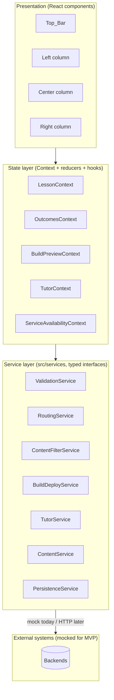
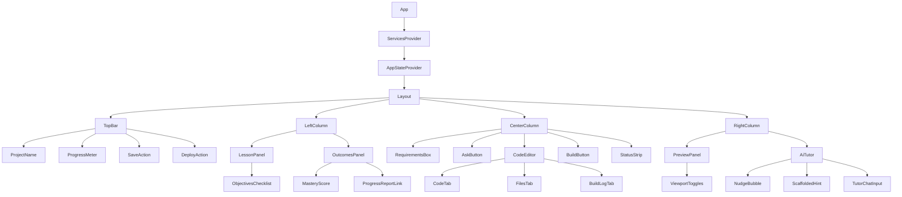
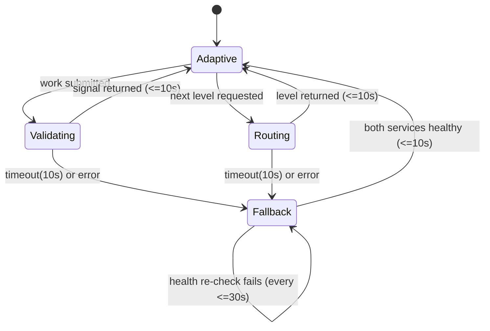

# Design Document

## Overview

This document describes the technical design for the **CodeAI frontend** — a single-screen, three-column learning interface for K-12 students. The frontend is a React SPA that renders the full learning loop (describe a requirement → generate code → run/build → preview → get help) on one screen, reflects state produced by external backend services, and degrades gracefully when those services fail.

This design is **frontend-only**. Every backend capability (Validation_Service, Routing_Service, Content_Filter, build/deploy execution, AI_Tutor inference, lesson/level content delivery, save/deploy persistence) is treated as an external system reached through a typed service-layer interface. For the hackathon MVP, each interface has a **mock implementation** that returns typed data, simulates latency, and can be toggled to simulate failure/timeout so every error and fallback path is demonstrable. A real HTTP implementation can later be dropped in behind the same interfaces with no change to the UI.

### Locked technical decisions

| Concern | Decision |
| --- | --- |
| Framework | React + Vite + TypeScript, single-page application |
| Styling | Plain CSS Modules with design tokens (CSS custom properties). No heavy component library. |
| State | React hooks + Context, with `useReducer` for cross-cutting app state. No Redux. |
| Service layer | Typed interfaces in `src/services` with mock implementations (latency + failure/timeout toggles); real HTTP impl swappable behind the same interface. |
| Testing | Vitest + React Testing Library; fake timers for timing/timeout criteria; jest-axe + role/label queries for accessibility. |

### Design goals derived from requirements

- **One screen, always visible loop** (Req 1): three columns + top bar, responsive stacking under 768px, independent per-column scrolling.
- **Outcomes are first-class** (Req 2, 4): progress and mastery visible and live-updating.
- **Resilience** (Req 13, 14): adaptive validating/routing state is visible; a Fallback_Path keeps the lesson usable during outages and auto-resumes.
- **Scaffolded help, not answers** (Req 11, 12): step-revealed hints and proactive nudges with cooldown.
- **Accessible to young learners** (Req 15): keyboard operability, live regions, visible focus, sufficient contrast.

## Architecture

### High-level architecture

The application has four layers:

1. **Presentation layer** — React components that render the three columns and top bar. Components are mostly presentational and read state from context.
2. **State layer** — React Contexts backed by reducers. Holds lesson/level, objectives + completion, outcomes, build/preview/tutor state, and service-availability/fallback flags. Orchestrates timing (timeouts, cooldowns, polling) via hooks.
3. **Service layer** — typed interfaces in `src/services`. The single boundary to all backends. Mock implementations today; HTTP implementations later.
4. **External systems** — Validation_Service, Routing_Service, Content_Filter, Build/Deploy, AI_Tutor, Content (lesson/level), Persistence. Out of scope except as contracts.



### Service-layer boundary and swappable implementations

Every service is defined as a TypeScript interface. A factory (`src/services/index.ts`) selects the implementation based on an environment flag:

```typescript
// src/services/index.ts
export interface Services {
  validation: ValidationService;
  routing: RoutingService;
  contentFilter: ContentFilterService;
  buildDeploy: BuildDeployService;
  tutor: TutorService;
  content: ContentService;
  persistence: PersistenceService;
}

// USE_MOCKS=true selects mock impls; a future HTTP factory returns the same shape.
export function createServices(config: ServicesConfig): Services { /* ... */ }
```

The app accesses services through a `ServicesContext` so components and hooks never import a concrete implementation directly. Swapping mocks for HTTP is a one-line factory change.

### Timing and orchestration strategy

All time-bound behavior (the 500ms / 1s / 2s / 10s / 30s / 120s bounds) is implemented in the state layer, not in components. A small set of hooks encapsulates it:

- `useTimeout(fn, ms)` — fires a callback after a deadline; used for request timeouts (Req 3.6, 5.6, 6.5, 8.6, 9.5, 14.1, 14.2).
- `useInterval(fn, ms)` — periodic polling; used for fallback health re-check (Req 14.5) and time-on-task tick (Req 4.1).
- `useCooldown(ms)` — gates re-triggering; used for the nudge cooldown (Req 12.5).
- Service calls are wrapped in a `withDeadline(promise, ms)` utility that rejects with a `TimeoutError` so the UI can distinguish timeout from error.

Using fake timers (Vitest), these bounds are deterministically testable.

### Three-column layout composition

The layout is a CSS Grid shell. The top bar spans full width; the three columns share the remaining height. Each column is an independently scrollable region (`overflow-y: auto`), so content overflow scrolls within the column while the others stay fixed (Req 1.6).

```
┌─────────────────────────────────────────────────────────────┐
│ Top_Bar: project name · Progress_Meter · Save · Deploy        │
├───────────────┬───────────────────────┬───────────────────────┤
│ LEFT          │ CENTER                │ RIGHT                 │
│ Lesson_Panel  │ Requirements_Box      │ Preview_Panel         │
│ Objectives    │ Ask_Button            │  (web/phone toggles)  │
│ Outcomes_Panel│ Code_Editor (tabs)    │ ─────────────────     │
│ Mastery_Score │ Build_Button          │ AI_Tutor              │
│ Progress link │ Status_Strip          │  Nudge_Bubble / hints │
└───────────────┴───────────────────────┴───────────────────────┘
```

- `>= 768px`: three-column grid, no horizontal page scroll (Req 1.1–1.4).
- `< 768px`: a single media query collapses the grid to one column, stacking lesson → code → preview-and-tutor (Req 1.5).
- Column scroll containment via `min-height: 0` on grid children plus `overflow-y: auto` (Req 1.6).

```css
/* layout.module.css (design tokens omitted) */
.app { display: grid; grid-template-rows: auto 1fr; height: 100vh; }
.columns { display: grid; grid-template-columns: 1fr 1.4fr 1fr; min-height: 0; }
.column { overflow-y: auto; min-height: 0; }
@media (max-width: 767.98px) {
  .columns { grid-template-columns: 1fr; grid-auto-rows: auto; }
}
```

## Components and Interfaces

### Component hierarchy



### Component responsibilities

Each glossary term maps to a component. The table lists each component, the requirements it serves, and its key behavior.

| Component | Glossary term | Requirements | Key behavior |
| --- | --- | --- | --- |
| `Layout` | Learning_UI | 1.1–1.6 | Grid shell; responsive stacking; per-column scroll. |
| `TopBar` | Top_Bar | 1.1, 9 | Hosts project name, progress meter, Save, Deploy. |
| `ProgressMeter` | Progress_Meter | 2.1–2.5 | Shows completed/total; empty + error states; retains last count on error. |
| `SaveAction` | Save | 9.1–9.2 | Persist with 5s deadline; confirmation ≥3s; failure keeps unsaved state. |
| `DeployAction` | Deploy | 9.3–9.5 | Deploy with 120s deadline; progress indicator; retains last URL on failure. |
| `LessonPanel` | Lesson_Panel | 3.1, 3.4–3.6 | Renders current Level content; loading (≤10s), error + retry. |
| `ObjectivesChecklist` | Objectives_Checklist | 3.2, 3.3, 13.2, 13.4 | Completed indicators; active objective distinct; validating/not-passed state. |
| `OutcomesPanel` | Outcomes_Panel | 4.1, 4.3–4.7 | Concepts mastered, hints used, time on task, mastery; report link. |
| `MasteryScore` | Mastery_Score | 4.1, 4.2, 4.5, 4.6 | 0–100 value; unavailable-state; retain last on error. |
| `ProgressReportLink` | Progress_Report | 4.4, 4.7 | Opens report view; error indication on failure. |
| `RequirementsBox` | Requirements_Box | 5.1–5.8 | ≤5000 chars; empty guard; content-filter; 30s deadline; code result. |
| `AskButton` | Ask_Button | 6.1–6.5 | 1–2000 char question; content-filter; route to tutor; 10s deadline. |
| `CodeEditor` | Code_Editor | 7.1–7.9 | Exactly 3 tabs; ≤500ms switch; edit marks preview out-of-date; unavailable msg. |
| `BuildButton` | Build_Button | 8.1, 8.5, 8.6 | Starts build; disabled while running; re-enabled on any result. |
| `StatusStrip` | Status_Strip | 8.2, 8.3, 9.4 | Build/deploy result + sandbox URL; failure state. |
| `PreviewPanel` | Preview_Panel | 10.1–10.9 | Renders output; web/phone toggles; out-of-date + empty + error states. |
| `ViewportToggles` | — | 10.2–10.5 | Web default 1280×800; phone 375×667. |
| `AiTutor` | AI_Tutor | 6.3, 11.1–11.7 | Chat input (1–2000); scaffolded hints; content-filter on output. |
| `ScaffoldedHint` | Scaffolded_Hint | 11.1–11.4 | Step N of M; reveal-next; no-more-steps indication. |
| `NudgeBubble` | Nudge_Bubble | 12.1–12.5 | Offered on stuck-state; accept → scaffolded hint; dismiss; 60s cooldown. |

### Component contracts (illustrative)

Components are driven by context state and dispatch actions; they take few props. Example contracts:

```typescript
// ProgressMeter reads completed/total from LessonContext; no props.
type ProgressMeterState =
  | { kind: "ready"; completed: number; total: number }
  | { kind: "empty" }
  | { kind: "error"; lastCompleted?: number; lastTotal?: number };

// ScaffoldedHint stepper
interface ScaffoldedHintProps {
  hint: ScaffoldedHint;         // see Data Models
  currentStep: number;          // 1-based
  onRevealNext: () => void;
}

// ViewportToggles
type Viewport = "web" | "phone";
interface ViewportTogglesProps {
  selected: Viewport;
  onSelect: (v: Viewport) => void;
}
```

### State-layer hooks that implement behavior

| Hook | Serves | Behavior |
| --- | --- | --- |
| `useRequirementsSubmission` | Req 5 | Validate non-empty → content-filter → generate; 30s deadline; disables control; surfaces no-code result. |
| `useAskQuestion` | Req 6 | 1–2000 guard; content-filter (10s); route to tutor; preserve input on timeout. |
| `useBuild` | Req 8 | Start build; 120s deadline; disable/re-enable button; mark preview out-of-date→fresh. |
| `useSaveDeploy` | Req 9 | Save (5s) + confirmation; deploy (120s); retain last URL / unsaved state on failure. |
| `useScaffoldedHint` | Req 11 | Step state machine; content-filter gate on output. |
| `useStuckDetection` | Req 12 | Detect stuck-state; emit nudge; enforce 60s cooldown. |
| `useAdaptiveFlow` | Req 13, 14 | Validating/routing indicators; Fallback_Path switch; 30s health re-check; resume. |

## Data Models

The UI data models mirror the backend entities in `database/data-model.mmd` (UNIT, LESSON, LEVEL, OBJECTIVE, LESSON_OBJECTIVE, SKILL, SKILL_LEVEL, SKILL_EDGE) but keep only the fields the frontend renders, plus UI-local state (completion, timers, service-availability). Backend IDs are kept as opaque identifiers so a real API maps cleanly.

### Domain entities (mirrors of backend, UI projection)

```typescript
type Id = string; // opaque; maps to backend bigint PKs

interface Unit {
  unitId: Id;
  title: string;
  sequence: number;
  status: "draft" | "published" | string;
}

interface Lesson {
  lessonId: Id;
  unitId: Id;
  title: string;
  sequence: number;
  estimatedMinutes: number;
  status: string;
  objectives: LearningObjective[]; // from LESSON_OBJECTIVE join
  levels: Level[];                  // ordered by sequence
}

// OBJECTIVE + LESSON_OBJECTIVE weight, projected with UI completion state
interface LearningObjective {
  objectiveId: Id;
  code: string;        // OBJECTIVE.code (UK)
  title: string;
  description?: string;
  weight?: number;     // LESSON_OBJECTIVE.weight
  completed: boolean;  // UI-tracked completion (Req 2, 3, 13)
}

// LEVEL: a single adaptive step within a lesson
interface Level {
  levelId: Id;
  lessonId: Id;
  objectiveId: Id;         // the objective this level targets
  sequence: number;
  contentType: string;     // LEVEL.content_type
  instructions: string;    // rendered by Lesson_Panel
  difficulty: number;
  isFallback: boolean;     // part of the fixed Fallback_Path (Req 14)
  status: string;
}

// SKILL / SKILL_EDGE surface only where the UI shows the adaptive graph context.
interface Skill {
  skillId: Id;
  objectiveId: Id;
  name: string;
  difficulty: number;
}
```

### Outcomes and mastery

```typescript
interface Outcomes {
  conceptsMastered: number;      // non-negative integer (Req 4.1)
  hintsUsed: number;             // non-negative integer (Req 4.1, 4.3)
  timeOnTaskSeconds: number;     // rendered as HH:MM:SS (Req 4.1)
  masteryScore: number | null;   // 0–100, or null = unavailable (Req 4.1, 4.5)
  masteryUpdateFailed: boolean;  // Req 4.6
}

// Validation_Service signal
interface MasterySignal {
  objectiveId: Id;
  score: number;        // 0–100
  passing: boolean;     // drives objective completion (Req 13.2, 13.4)
}
```

### Build / deploy / preview

```typescript
type BuildOutcome = "success" | "failure" | "timeout";

interface BuildResult {
  outcome: BuildOutcome;
  sandboxUrl?: string;   // present on success (Req 8.2)
  log: string;           // Build log tab content (Req 8.3)
  errors?: string[];
}

type PreviewState =
  | { kind: "empty" }                                  // Req 10.9
  | { kind: "rendering"; viewport: Viewport }          // Req 10.7
  | { kind: "ready"; viewport: Viewport; outOfDate: boolean } // Req 7.7, 10.6
  | { kind: "error"; lastReady?: { viewport: Viewport } };    // Req 10.8

interface ViewportDimensions { width: number; height: number; }
const VIEWPORTS: Record<Viewport, ViewportDimensions> = {
  web: { width: 1280, height: 800 },   // Req 10.4 (default, Req 10.3)
  phone: { width: 375, height: 667 },  // Req 10.5
};

interface DeployResult {
  outcome: "success" | "failure" | "timeout";
  sandboxUrl?: string;
}
```

### Code editor model

```typescript
type EditorTab = "code" | "files" | "buildLog"; // exactly three (Req 7.1)

interface EditorState {
  activeTab: EditorTab;
  code: string;                 // editable (Req 7.4)
  files: FileEntry[] | null;    // read-only (Req 7.5); null = unavailable (Req 7.9)
  buildLog: string | null;      // read-only (Req 7.6)
}
interface FileEntry { path: string; size: number; }
```

### Tutor: hints and nudges

```typescript
interface HintStep { stepNumber: number; text: string; } // 1-based

interface ScaffoldedHint {
  hintId: Id;
  steps: HintStep[];       // total = steps.length (Req 11.1)
  revealedCount: number;   // starts at 1; capped at steps.length (Req 11.3, 11.4)
}

interface Nudge {
  nudgeId: Id;
  objectiveId: Id;         // the active objective (Req 12.1, 12.5)
  offeredHint: ScaffoldedHint;
}

interface TutorMessage {
  id: Id;
  role: "student" | "tutor";
  text: string;            // tutor text passes Content_Filter (Req 11.5, 11.6)
}
```

### Service-availability / fallback

```typescript
interface ServiceAvailability {
  validationUp: boolean;
  routingUp: boolean;
  onFallbackPath: boolean;   // Req 14
  lastHealthCheckAt: number; // epoch ms; re-check interval ≤30s (Req 14.5)
}
```

### Application state shape

```typescript
interface AppState {
  lesson: {
    lesson: Lesson | null;
    activeLevel: Level | null;
    activeObjectiveId: Id | null;
    contentStatus: "loading" | "ready" | "error";
  };
  outcomes: Outcomes;
  progress: ProgressMeterState;
  editor: EditorState;
  build: {
    status: "idle" | "running" | "done";
    result: BuildResult | null;
  };
  preview: PreviewState;
  requirements: { text: string; submitting: boolean; message?: string };
  ask: { text: string; sending: boolean; message?: string };
  tutor: {
    messages: TutorMessage[];
    activeHint: ScaffoldedHint | null;
    nudge: Nudge | null;
    nudgeCooldownUntilByObjective: Record<Id, number>;
  };
  adaptive: {
    validating: boolean;        // Req 13.1
    routing: boolean;           // Req 13.6
    availability: ServiceAvailability;
  };
  save: { status: "idle" | "saving" | "saved" | "error"; dirty: boolean };
  deploy: { status: "idle" | "deploying" | "done" | "error"; lastUrl?: string };
}
```

### Service interfaces

All interfaces live in `src/services`. Each method returns a `Promise`; timeouts are enforced by the caller via `withDeadline`, and each mock exposes failure/latency toggles.

```typescript
// Shared error contract
class ServiceError extends Error { constructor(public code: string, message: string) { super(message); } }
class TimeoutError extends ServiceError {}

interface ContentService {
  // Req 3: lesson/level content
  getLesson(lessonId: Id): Promise<Lesson>;
  getLevel(levelId: Id): Promise<Level>;
}

interface ContentFilterService {
  // Req 5.3/5.4, 6.1–6.4, 11.5/11.6
  check(text: string): Promise<{ accepted: boolean; reason?: string }>;
}

interface ValidationService {
  // Req 13.1–13.4, 14.1
  validate(req: { objectiveId: Id; code: string }): Promise<MasterySignal>;
  health(): Promise<void>; // Req 14.4/14.5
}

interface RoutingService {
  // Req 13.5–13.8, 14.2
  nextLevel(req: { currentLevelId: Id; signal: MasterySignal }): Promise<Level>;
  health(): Promise<void>;
}

interface GenerationService {
  // Req 5.7/5.8 — returns generated code (or none)
  generate(req: { requirements: string }): Promise<{ code: string | null }>;
}

interface BuildDeployService {
  // Req 8, 9
  build(req: { code: string }): Promise<BuildResult>;
  deploy(req: { projectId: Id }): Promise<DeployResult>;
}

interface TutorService {
  // Req 6.3, 11, 12
  ask(req: { question: string }): Promise<{ reply: string }>;
  getHint(req: { objectiveId: Id }): Promise<ScaffoldedHint>;
}

interface PersistenceService {
  // Req 9.1/9.2
  save(req: { projectId: Id; state: unknown }): Promise<{ savedAt: number }>;
}
```

### Mock implementation behavior

Each mock accepts a per-method config so demos and tests can force outcomes:

```typescript
interface MockBehavior {
  latencyMs: number;            // simulated delay
  mode: "ok" | "error" | "hang"; // hang = never resolves (drives caller timeout)
  // optional canned payloads per method
}
```

- **Latency**: mocks `await delay(latencyMs)` before resolving; defaults are small (e.g. 300–800ms) so the happy path feels live.
- **Failure toggle**: `mode: "error"` rejects with a `ServiceError`; used to exercise Req 4.6, 5.4, 6.4, 8.3, 9.2/9.5, 13.4/13.8.
- **Timeout toggle**: `mode: "hang"` returns a never-resolving promise so the caller's `withDeadline` fires a `TimeoutError`; used for Req 3.6, 5.6, 6.5, 8.6, 9.5, 14.1/14.2.
- **Health toggle**: `ValidationService.health` / `RoutingService.health` flip between resolving and rejecting to drive fallback entry and resume (Req 14.4/14.5).
- Mocks are wired through a small dev panel / query-string flags so a presenter can flip any service to error/hang live during the demo.

## Correctness Properties

*A property is a characteristic or behavior that should hold true across all valid executions of a system — essentially, a formal statement about what the system should do. Properties serve as the bridge between human-readable specifications and machine-verifiable correctness guarantees.*

This frontend is largely UI rendering, layout, and time-bound orchestration, where example-based and integration-style tests are the right tool. However, a meaningful subset of the behavior is **pure logic** with input-varying outcomes — progress counting, input validation, the hint stepper state machine, viewport→dimension mapping, the nudge cooldown, the fallback health-check schedule, time formatting, and theme contrast. Those are expressed below as universally quantified properties and verified with property-based tests. The remaining criteria (fixed layout composition, timing bounds, loading/empty/error transitions) are covered by the example/edge/integration tests enumerated in the Testing Strategy.

Each property is implemented by a single property-based test using **fast-check** with **minimum 100 iterations**, tagged `Feature: codeai-frontend, Property {n}: {text}`.

### Property 1: Progress count invariant

*For any* lesson objective list, the Progress_Meter's displayed completed count equals the number of objectives whose `completed` flag is true, the displayed total equals the objective count, both are non-negative integers, and `0 <= completed <= total`.

**Validates: Requirements 2.1**

### Property 2: Lesson panel renders current level content

*For any* Level, when the Lesson_Panel renders that Level, the rendered output contains the Level's instructions/content text.

**Validates: Requirements 3.1**

### Property 3: Objective indicator matches completion

*For any* objectives list, each rendered checklist item shows a completed indicator if and only if that objective's `completed` flag is true.

**Validates: Requirements 3.2**

### Property 4: Exactly one active objective

*For any* objectives list and any chosen active objective id, exactly one rendered checklist item carries the active visual state, and it is the item whose id equals the active id.

**Validates: Requirements 3.3**

### Property 5: Time-on-task format round-trip

*For any* non-negative integer number of seconds, formatting it to the Outcomes_Panel's HH:MM:SS string and parsing that string back yields the original number of seconds, and the string always has two-digit minutes and seconds fields.

**Validates: Requirements 4.1**

### Property 6: Outcomes value invariants

*For any* Outcomes value, the displayed concepts-mastered and hints-used counts are non-negative integers, and when a mastery score is present the displayed Mastery_Score lies within the inclusive range 0 to 100.

**Validates: Requirements 4.1**

### Property 7: Revealing a hint increments hints-used by exactly one

*For any* starting non-negative hints-used count, revealing one Scaffolded_Hint step increases the displayed hints-used count by exactly 1.

**Validates: Requirements 4.3**

### Property 8: Whitespace-only requirements are rejected

*For any* string composed entirely of whitespace, submitting it from the Requirements_Box produces the input-required message and does not invoke any downstream service (no Content_Filter call, no generation).

**Validates: Requirements 5.2**

### Property 9: Non-empty requirements are filtered before processing

*For any* non-whitespace requirements text, submitting it invokes `ContentFilterService.check` before any generation call is made.

**Validates: Requirements 5.3**

### Property 10: Question length gate

*For any* string, activating the Ask_Button sends the text to the Content_Filter if and only if its length is between 1 and 2000 inclusive; otherwise the invalid-question message is shown and no Content_Filter call is made.

**Validates: Requirements 6.2, 11.7**

### Property 11: Tab content mutual exclusion

*For any* selected Code_Editor tab among {code, files, build log}, exactly the selected tab's content is visible and the content of the other two tabs is hidden.

**Validates: Requirements 7.3**

### Property 12: Edit then successful build clears out-of-date

*For any* ready Preview_Panel state, editing code marks the preview out of date, and a subsequently successful build clears the out-of-date indicator.

**Validates: Requirements 7.7, 7.8**

### Property 13: Build button disabled exactly while building

*For any* build lifecycle, the Build_Button is disabled if and only if a build is in progress; any terminal result (success, failure, or timeout) re-enables it.

**Validates: Requirements 8.5**

### Property 14: Failed deploy retains last successful URL

*For any* prior deploy state, a failed or timed-out deployment leaves the Status_Strip displaying the last successfully deployed sandbox URL if one exists, and no URL otherwise.

**Validates: Requirements 9.5**

### Property 15: Viewport maps to fixed dimensions

*For any* selected viewport, the Preview_Panel renders the project output at exactly the dimensions mapped to that viewport (web → 1280×800, phone → 375×667), and before any selection the web viewport is used as default.

**Validates: Requirements 10.3, 10.4, 10.5**

### Property 16: Hint stepper starts at step one

*For any* Scaffolded_Hint with at least one step, beginning the hint reveals exactly the first step, with current step number 1 and total step count equal to the number of steps.

**Validates: Requirements 11.1**

### Property 17: Reveal-next advances by exactly one until the last step

*For any* Scaffolded_Hint and any revealed position strictly less than the total, requesting the next step increases the revealed count by exactly 1 and never exceeds the total.

**Validates: Requirements 11.3**

### Property 18: Reveal-next at the last step is idempotent

*For any* Scaffolded_Hint already showing its final step, requesting the next step keeps the revealed count equal to the total (no change) and signals that no further steps are available.

**Validates: Requirements 11.4**

### Property 19: Tutor output is filtered before display

*For any* AI_Tutor output, `ContentFilterService.check` is invoked before the output is displayed to the student.

**Validates: Requirements 11.5**

### Property 20: Nudge cooldown suppression

*For any* sequence of Stuck_State detections with timestamps for a given Learning_Objective, a new Nudge_Bubble is suppressed if and only if the detection occurs within 60 seconds after a dismissal of a nudge for that same objective.

**Validates: Requirements 12.5**

### Property 21: Objective completion tracks the passing signal

*For any* MasterySignal returned for the active Learning_Objective, the Objectives_Checklist marks that objective completed if and only if the signal is passing.

**Validates: Requirements 13.2, 13.4**

### Property 22: Fallback keeps the build/learn surface rendered

*For any* application state in which `onFallbackPath` is true, the Lesson_Panel, Code_Editor, Build_Button, and Preview_Panel all remain rendered.

**Validates: Requirements 14.3**

### Property 23: Fallback health-check interval bound

*For any* duration spent on the Fallback_Path, the elapsed time between any two consecutive availability re-checks never exceeds 30 seconds.

**Validates: Requirements 14.5**

### Property 24: Every interactive control has a bounded accessible name

*For any* rendered Learning_UI, every non-text interactive control exposes a non-empty accessible name whose length is at most 150 characters.

**Validates: Requirements 15.1**

### Property 25: Theme text contrast meets thresholds

*For any* text/background color-token pair defined in the theme, the computed contrast ratio is at least 4.5:1 for body text and at least 3:1 for large-scale text (and the focus-indicator token is at least 3:1 against its adjacent unfocused state).

**Validates: Requirements 15.4, 15.6**

## Error Handling

Error handling is centralized so every failure path produces a visible, recoverable UI state and never loses student work.

### Error classification

The service layer distinguishes three failure kinds, which the state layer maps to UI states:

| Failure kind | Source | UI response |
| --- | --- | --- |
| `TimeoutError` | `withDeadline` fires before the service resolves (`mode: "hang"` in mocks, slow network later) | Stop in-progress indicator, re-enable controls, show "could not complete" message, retain input/state. |
| `ServiceError` | Service rejects (`mode: "error"`) | Show the relevant error/failure state, retain last good value. |
| Empty/absent result | Service resolves but returns no payload (e.g. `code: null`, zero objectives) | Show the corresponding empty-state label. |

### Per-area handling

- **Progress / outcomes / mastery** (Req 2.5, 4.6): retain the last displayed value and show an error or "update failed" indication; never blank out a previously shown number.
- **Lesson content** (Req 3.5, 3.6): loading indicator up to 10s; on timeout/error show an error message plus a **retry** control that restarts `ContentService.getLevel`.
- **Requirements / Ask** (Req 5.4–5.8, 6.4, 6.5): preserve the student's text on rejection, timeout, or no-code result; re-enable the submit/ask control; show the specific message.
- **Build / deploy** (Req 8.3, 8.6, 9.2, 9.5): build failure routes errors to the Build log tab; build timeout at 120s yields a timeout failure; save failure/timeout keeps the project dirty; deploy failure/timeout retains the last successful sandbox URL.
- **Preview** (Req 10.8): on render failure, stop the rendering indicator, retain the last successfully rendered output, and show an error message.
- **Tutor** (Req 11.6): blocked output is withheld and replaced with an "unavailable" indication.

### Fallback_Path strategy (Req 13, 14)

The adaptive flow is owned by `useAdaptiveFlow`, which models availability as a small state machine:



- **Entry** (Req 14.1, 14.2): when Validation or Routing times out (10s) or errors, switch to the Fallback_Path within 2s. Submitted work is retained in state; a non-blocking notice is shown. Routing failures advance along the fixed sequence of `Level`s where `isFallback` is true.
- **Continuity** (Req 14.3): while on the Fallback_Path the lesson content, Code_Editor, Build_Button, and Preview_Panel keep rendering — only adaptive feedback/routing is degraded.
- **Health re-check** (Req 14.5): `useInterval` polls `validation.health()` and `routing.health()` at a fixed interval of 30s or less while on fallback.
- **Resume** (Req 14.4): when both health calls succeed within 10s, resume the adaptive path within 2s and remove the fallback notice.

Because the mocks expose `mode: "hang"` and `mode: "error"` plus a health toggle, every one of these transitions is demonstrable live and deterministic under fake timers in tests.

## Testing Strategy

### Tooling

- **Test runner / assertions:** Vitest (`--run` for single-pass CI; no watch mode).
- **Component rendering & interaction:** React Testing Library with user-event, driven by role/label queries (which doubles as accessibility verification).
- **Property-based testing:** fast-check, minimum 100 iterations per property.
- **Accessibility:** jest-axe for automated checks, plus explicit keyboard-navigation and live-region assertions.
- **Timing:** Vitest fake timers (`vi.useFakeTimers`) to make every ms/s bound deterministic.
- **Service mocks:** the `src/services` mock implementations, configured per test via `MockBehavior` (`latencyMs`, `mode: ok|error|hang`, health toggle).

### Dual testing approach

- **Property-based tests** verify the 25 universal properties above — the pure logic (counting, validation, stepper, mapping, cooldown, schedule, formatting, contrast). These catch general-correctness bugs across the whole input space.
- **Example / edge / integration tests** verify fixed structure, specific transitions, empty/loading/error states, and timing bounds — the criteria classified EXAMPLE / EDGE_CASE in the prework.

Property tests are kept lean (one test per property); example tests focus on concrete flows and edge cases rather than re-covering the input space.

### Property test configuration

- Each property test runs ≥100 iterations via fast-check.
- Each property test references its design property with a tag comment:
  `// Feature: codeai-frontend, Property {n}: {property text}`
- Pure logic under test (progress counting, time formatting, hint-stepper reducer, viewport mapping, cooldown predicate, fallback schedule, length/whitespace validators, contrast calculator) is factored into pure functions in the state/util layer so property tests exercise them directly without rendering overhead. Rendering-dependent properties (e.g. Property 3, 4, 11, 24) render the component with generated props and assert via RTL queries.

### Testing the timing / timeout criteria

Using fake timers, each bound is asserted deterministically:

| Bound | Requirements | Approach |
| --- | --- | --- |
| 500ms | 7.2, 12.4 | Advance timers to just under / at the bound; assert tab content / nudge removal. |
| 1s | 2.2, 2.3, 4.2, 4.3, 6.1, 6.3, 8.1, 12.1, 13.* | Advance 1000ms; assert the update occurred. |
| 2s | 10.6, 14.1, 14.2, 14.4, 15.5 | Advance 2000ms; assert re-render / fallback / resume / announce. |
| 10s | 3.5/3.6, 6.5, 14.1/14.2/14.4 | Set mock `mode: "hang"`, advance 10000ms; assert timeout handling. |
| 30s | 14.5 | Advance repeatedly; assert health re-check gap ≤30000ms. |
| 120s | 8.6, 9.5 | `mode: "hang"`, advance 120000ms; assert timeout failure + re-enable. |
| ≥3s | 9.1 | Assert save confirmation remains for at least 3000ms. |

The `withDeadline` utility is also unit-tested directly: it resolves with the value when the promise settles first, and rejects with `TimeoutError` when the deadline wins.

### Testing the accessibility criteria

- **15.1 accessible names:** Property 24 (every interactive control has a bounded accessible name) plus jest-axe.
- **15.2 keyboard operability:** user-event `tab()`, `keyboard('{Enter}')`, `keyboard(' ')` across Top_Bar actions, Requirements_Box, Ask_Button, Code_Editor tabs, Build_Button, viewport toggles, and tutor chat input; assert activation with no pointer events.
- **15.3 no focus trap:** enter each component, Tab, assert focus leaves.
- **15.4 / 15.6 contrast:** Property 25 computes contrast ratios from the theme tokens against the thresholds.
- **15.5 live regions:** assert the Status_Strip / Progress_Meter / Outcomes_Panel updates flow through an `aria-live` region within 2s and that `document.activeElement` is unchanged.

### Layout tests

- `>=768px` three-column composition and ordering (Req 1.1–1.4): render at width ≥768 and assert the four regions exist in order.
- `<768px` stacking (Req 1.5): render below the breakpoint and assert single-column stacking order.
- Per-column scroll containment (Req 1.6): assert `overflow-y: auto` / `min-height: 0` styling on column containers.

### Requirements traceability

| Requirement | Design elements | Tests |
| --- | --- | --- |
| 1 Three-column layout | `Layout`, CSS grid shell, media query, column scroll | Layout example tests (1.1–1.6) |
| 2 Progress meter | `ProgressMeter`, `ProgressMeterState`, `LessonContext` | Property 1; examples 2.2–2.5 |
| 3 Lesson & objectives | `LessonPanel`, `ObjectivesChecklist`, `ContentService` | Properties 2–4; examples 3.4–3.6 |
| 4 Outcomes & mastery | `OutcomesPanel`, `MasteryScore`, `ProgressReportLink`, `Outcomes` | Properties 5–7; examples 4.2, 4.4–4.7 |
| 5 Requirements input | `RequirementsBox`, `useRequirementsSubmission`, `ContentFilterService`, `GenerationService` | Properties 8–9; examples 5.1, 5.4–5.8 |
| 6 Ask a question | `AskButton`, `useAskQuestion`, `ContentFilterService`, `TutorService` | Property 10; examples 6.1, 6.3–6.5 |
| 7 Code editor tabs | `CodeEditor`, `EditorState`, `PreviewState` | Properties 11–12; examples 7.1, 7.2, 7.4–7.7, 7.9 |
| 8 Build feedback | `BuildButton`, `StatusStrip`, `useBuild`, `BuildDeployService` | Property 13; examples 8.1–8.4, 8.6 |
| 9 Save & deploy | `SaveAction`, `DeployAction`, `useSaveDeploy`, `PersistenceService`, `BuildDeployService` | Property 14; examples 9.1–9.4 |
| 10 Live preview | `PreviewPanel`, `ViewportToggles`, `VIEWPORTS`, `PreviewState` | Property 15; examples 10.1, 10.2, 10.6–10.9 |
| 11 Scaffolded hints | `AiTutor`, `ScaffoldedHint`, `useScaffoldedHint`, `ContentFilterService` | Properties 16–19; examples 11.2, 11.6 |
| 12 Proactive nudge | `NudgeBubble`, `useStuckDetection`, `useCooldown` | Property 20; examples 12.1–12.4 |
| 13 Routing & validation state | `useAdaptiveFlow`, `ObjectivesChecklist`, `MasterySignal`, `ValidationService`, `RoutingService` | Property 21; examples 13.1, 13.3, 13.5–13.8 |
| 14 Graceful fallback | `useAdaptiveFlow`, `ServiceAvailability`, fallback state machine, `useInterval` | Properties 22–23; examples 14.1, 14.2, 14.4 |
| 15 Accessibility | design tokens, roles/labels, `aria-live` regions, focus styles | Properties 24–25; examples 15.2, 15.3, 15.5 |

### Out of scope

Backend behavior (actual validation, routing, content filtering, code generation, build execution, deployment, AI inference, persistence) is external and is only represented here by the mock service implementations. Integration against real services is future work once the HTTP implementations replace the mocks behind the same `src/services` interfaces.
