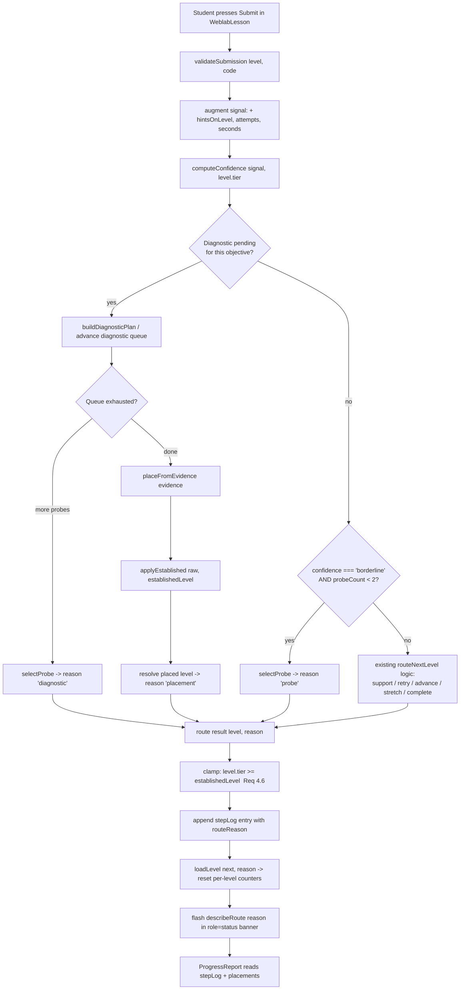
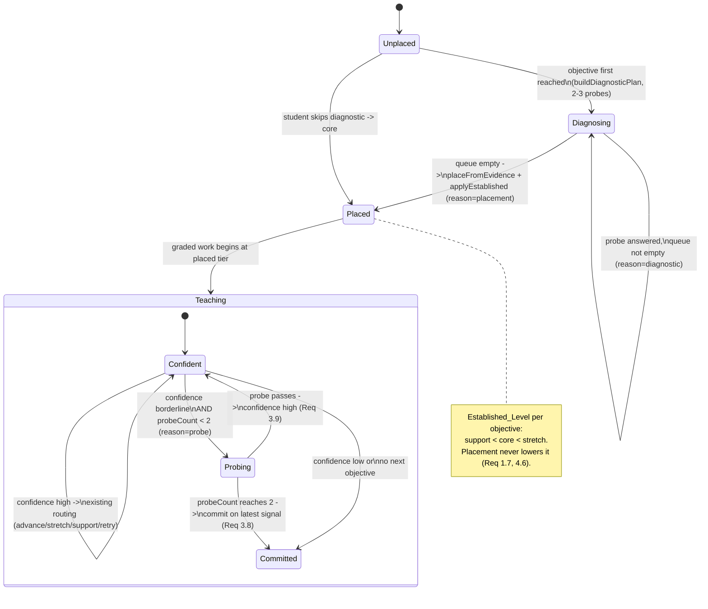

# Design Document — Adaptive Diagnostic Placement & Confidence Probing

## Overview

This feature extends the local, fully-mocked adaptive lesson engine in `src/weblab/` with two capabilities, without rewriting what exists:

1. **Diagnostic placement** — before a student starts graded teaching work on an objective, the engine runs a short diagnostic of 2–3 interchangeable probe tasks and uses the evidence to **place** them at `support`, `core`, or `stretch` for that objective (Req 1).
2. **Confidence-driven probing** — after a graded submission, the engine computes a `high | borderline | low` **confidence**. When it is `borderline` and unsure, it routes the student to **one randomized probe task** (capped at two consecutive probes) to confirm the level before it advances or stretches (Req 3).

Everything is pure JavaScript/JSX under `src/weblab/`, runs synchronously in the browser, and adds **no runtime dependency**, **no backend call**, and **no model invocation** (Req 6.1, 6.2). The work composes with the current routing so that `support`, `retry`, `advance`, `stretch`, and `complete` continue to behave exactly as they do today whenever confidence is `high` and no diagnostic is pending (Req 4).

The design binds to the real symbols already in the code and extends them:

- `src/weblab/engine.js` — `diagnose`, `validateSubmission`, `routeNextLevel(currentLevel, signal, history)`, `describeRoute(reason)`, the internal `pick(objectiveId, tier)`, and the `signal` shape `{ objectiveId, passing, score, met, total, hintsOnLevel, attempts }`. New pure helpers (`computeConfidence`, `placeFromEvidence`, `applyEstablished`, `selectProbe`, `buildDiagnosticPlan`, plus new probe data) are added to this file.
- `src/weblab/courseData.js` — `LESSON`, `LEVELS` (the 12 existing levels stay untouched and remain pool members), `getLevel`, `getObjective`, `FIRST_LEVEL_ID`. A new `PROBES` map and helper exports are added here.
- `src/weblab/WeblabLesson.jsx` — holds the React state for placement/confidence/probe counters and drives banners + `stepLog`.
- `src/weblab/ProgressReport.jsx` — reads the richer `stepLog` and renders placement + probe explanations.

**Key design decisions (stated defaults):**

- The diagnostic is a **short per-objective placement check**, not a single whole-lesson gate. It runs the first time an objective is reached and then the objective is "placed" for the rest of the session.
- The probe pool holds **2–3 interchangeable tasks per objective+tier**. The 12 existing `LEVELS` are **reused as the first member** of their matching pool; the new `PROBES` map supplies the extra 1–2 variants so no existing level is duplicated or broken.
- Placement and probe selection are **seeded/rotating** — deterministic given a seed and the prior-shown state — not truly random, so they are testable (Req 2.6).
- Pure decision logic (confidence, placement, selection, routing) lives in **`engine.js` as pure functions**; all mutable session state (which objectives are placed, per-objective confidence, probe counts, shown ids, the diagnostic queue) lives in **React state in `WeblabLesson.jsx`** and is passed into the pure helpers. The engine stays free of hidden global state.

---

## Architecture

### Submit → validate → confidence → route → load → log → report flow



### State view — per-objective placement / confidence / probe-count



---

## Components and Interfaces

All new logic is confined to `src/weblab/engine.js` and `src/weblab/courseData.js` (pure) plus state wiring in `WeblabLesson.jsx` and rendering in `ProgressReport.jsx` (Req 6.1).

### 1. Probe_Pool data structure (`courseData.js`)

The 12 existing `LEVELS` are **not** changed and are **reused as the first member** of each pool. A new `PROBES` map supplies the additional interchangeable variants, keyed by `` `${objectiveId}:${tier}` ``. Each variant is a full level object with the same shape as an existing level and **reuses the same `rubric`** as its pool's canonical level so grading is identical (Req 2.1–2.4, 2.8).

New exported symbols:

```js
// courseData.js

// Extra interchangeable variants, keyed by `${objectiveId}:${tier}`.
// Each value is an array of 1–2 variant level objects (the canonical LEVELS
// entry for that objective+tier is the implicit first pool member).
// Variants reuse the canonical rubric; they differ in title/instructions/starter.
export const PROBES = {
  'obj-structure:core': [ /* variant level object, same rubric as lvl-structure-core */ ],
  'obj-structure:support': [ /* ... */ ],
  'obj-style:core': [ /* ... */ ],
  // ... one entry per objective+tier that placement or probing uses
}

// Pool key helper.
export function poolKey(objectiveId, tier) {
  return `${objectiveId}:${tier}`
}

// Full pool = canonical LEVELS member (first) + PROBES variants.
// Returns an array of level objects, length 2–3, all sharing objectiveId+tier.
export function getPool(objectiveId, tier) {
  const canonical = LEVELS.filter((l) => l.objectiveId === objectiveId && l.tier === tier)
  const variants = PROBES[poolKey(objectiveId, tier)] || []
  return [...canonical, ...variants]
}
```

Shape of a variant level object (identical to an existing `LEVELS` entry):

```
{
  id: string,            // unique, e.g. 'lvl-structure-core-v2'
  objectiveId: string,   // MUST equal the pool's objectiveId        (Req 2.2)
  tier: 'core'|'support'|'stretch', // MUST equal the pool's tier    (Req 2.2)
  title: string,         // differs from siblings                    (Req 2.4)
  instructions: string,  // differs from siblings                    (Req 2.4)
  starter: { html, css } | null, // differs from siblings            (Req 2.4)
  rubric: object,        // SAME needle set as the canonical level   (Req 2.3)
  targets: object,
  hint: { summary, steps, stepTargets }
}
```

Pool invariants (enforced by data + verified by tests): size ∈ [2,3]; shared objectiveId+tier; rubric needle counts within 1 across members; each member differs in ≥1 of title/instructions/starter (Req 2.1–2.4).

### 2. Seeded/rotating selector `selectProbe(objectiveId, tier, shownIds, seed)` (`engine.js`)

```
selectProbe(objectiveId: string, tier: Tier, shownIds: string[], seed: number) -> level | null
```

- `shownIds` is the ordered, session-global list of level ids already shown (append order; most recent is last). The engine scopes to the relevant pool internally.
- `seed` is a deterministic integer the UI supplies (e.g. a per-objective counter), so the same `(objectiveId, tier, shownIds, seed)` always yields the same level (Req 2.6).

Algorithm:

```
1. pool = getPool(objectiveId, tier)
   if pool is empty -> return null   (Error Handling)
2. poolIds = pool.map(id)
   lastShown = the id in shownIds whose last occurrence is latest AND is in poolIds
               (the pool's most-recently-shown level), or null
3. unshown = pool members whose id never appears in shownIds
4. if unshown is non-empty:
       candidates = unshown                         // never immediate-repeat (Req 2.5)
   else:
       // every member shown -> least-recently-shown fallback (Req 2.7)
       // order pool members by the index of their LAST occurrence in shownIds, ascending
       earliest = member with the smallest "last occurrence" index
       return earliest                              // deterministic, ignores seed
5. // deterministic rotation among candidates, excluding lastShown when possible
   pickList = candidates with id !== lastShown (if that leaves ≥1, else candidates)
   idx = seed mod pickList.length                   // seeded, deterministic (Req 2.6)
   return pickList[idx]
```

- **No immediate repeat**: when an unshown member exists the pick is drawn from unshown and `lastShown` is excluded, so it is never the level just shown (Req 2.5).
- **Determinism**: the result is a pure function of `(objectiveId, tier, shownIds, seed)` — no `Math.random` (Req 2.6).
- **Least-recently-shown fallback**: when all are shown, the member whose most-recent appearance is earliest is chosen (Req 2.7).

### 3. `computeConfidence(signal, tier)` (`engine.js`)

Pure, total function returning exactly one of `'high' | 'borderline' | 'low'` (Req 3.1). Thresholds verbatim from requirements:

```js
export function computeConfidence(signal, tier) {
  if (!signal.passing) return 'low'                                   // Req 3.3
  const hints = signal.hintsOnLevel || 0
  const attempts = signal.attempts || 1
  if (hints === 0 && attempts === 1) return 'high'                    // Req 3.2
  // passing, but helped / multi-attempt / graded at support         // Req 3.4
  if (hints > 0 || attempts > 1 || tier === 'support') return 'borderline'
  return 'high'
}
```

Ordering matters: `low` (not passing) dominates; then the clean-first-try check yields `high`; otherwise `borderline`. Note that a clean pass graded at `support` tier yields `borderline` because the `hints===0 && attempts===1` branch is reached only when the earlier `low` guard is false and the `support`/help conditions are evaluated — a `support`-tier clean pass hits `tier === 'support'` and returns `borderline` (Req 3.4). To make this exact, the `high` branch is guarded against support tier:

```js
export function computeConfidence(signal, tier) {
  if (!signal.passing) return 'low'                                   // Req 3.3
  const hints = signal.hintsOnLevel || 0
  const attempts = signal.attempts || 1
  if (hints === 0 && attempts === 1 && tier !== 'support') return 'high' // Req 3.2
  return 'borderline'                                                 // Req 3.4
}
```

This is the authoritative form: `high` only when passing, hint-free, first-try, and not at support; everything else that passes is `borderline`; non-passing is `low`.

### 4. Diagnostic / placement approach (`engine.js` pure helpers + `WeblabLesson.jsx` state)

The diagnostic is **one short placement check per objective**, run the first time the objective is reached (Req 1.1). Placement state lives in `WeblabLesson.jsx`; the decisions are pure engine helpers.

**Plan builder** — how many probe tasks the diagnostic presents (2–3, hard cap 3):

```
buildDiagnosticPlan(objectiveId) -> { objectiveId, probeTierSequence: Tier[] }
```

- Returns a sequence of 2–3 tiers to probe (e.g. `['core', 'core']` or `['support','core','stretch']`), length always in [2,3] (Req 1.1, 1.8). Each entry is resolved to a concrete level at run time via `selectProbe(objectiveId, tier, shownIds, seed)`.

**Evidence → placement** — pure mapping from the collected diagnostic signals to a raw tier:

```js
// evidence: array of per-probe signals { passing, hintsOnLevel, attempts }
// `skipped` true means the student chose to skip the diagnostic.
export function placeFromEvidence(evidence, skipped = false) {
  if (skipped || !evidence || evidence.length === 0) return 'core'    // Req 1.6
  const anyMiss = evidence.some((e) => !e.passing)
  if (anyMiss) return 'support'                                       // Req 1.5
  const allClean = evidence.every(
    (e) => e.passing && (e.hintsOnLevel || 0) === 0 && (e.attempts || 1) === 1,
  )
  if (allClean) return 'stretch'                                      // Req 1.3
  return 'core'                                                       // Req 1.4 (helped pass, no miss)
}
```

**Established_Level clamp** — placement never lowers an already-earned level (Req 1.7, 4.6):

```js
const TIER_ORDER = { support: 0, core: 1, stretch: 2 }

export function applyEstablished(rawTier, establishedTier) {
  if (!establishedTier) return rawTier
  return TIER_ORDER[rawTier] >= TIER_ORDER[establishedTier] ? rawTier : establishedTier
}
```

Final placement tier = `applyEstablished(placeFromEvidence(evidence, skipped), established[objectiveId])`. The concrete placed level is `pick(objectiveId, finalTier)` (the existing internal helper), which is guaranteed non-null for the four objectives/tier combinations in the lesson (Req 1.2, 4.5).

**Where state lives (React, `WeblabLesson.jsx`):**

```
placements:   { [objectiveId]: { tier, reason } }        // set once per objective
confidence:   { [objectiveId]: 'high'|'borderline'|'low' }
probeCount:   { [objectiveId]: number }                  // consecutive probes, capped at 2
established:   { [objectiveId]: Tier }                    // highest tier demonstrably reached
shownIds:     string[]                                   // global shown-level order
diagnostic:   { objectiveId, queue: Tier[], evidence: signal[] } | null
```

Flow: when a not-yet-placed objective is first reached, the UI sets `diagnostic` from `buildDiagnosticPlan` and routes with reason `diagnostic` (one `selectProbe` per queue entry). After each diagnostic probe is graded, its signal is pushed to `evidence` and the queue shrinks. When the queue empties, the UI computes the placement, records it in `placements`, raises `established` to the placed tier, and routes with reason `placement`.

### 5. Extensions to `routeNextLevel` + `signal` (+ `seconds`) + `describeRoute` (`engine.js`)

`routeNextLevel` gains a context parameter carrying the new session state, so the engine stays pure (no hidden globals). Backward-compatible signature:

```js
routeNextLevel(currentLevel, signal, history, ctx = {}) -> { level, reason }
// ctx = { confidence, probeCount, diagnostic, established, shownIds, seed }
// When ctx is empty/omitted, behavior is identical to today.
```

Decision order (composed so legacy behavior is unchanged when `confidence === 'high'` and no diagnostic is pending — Req 3.6, 4.1–4.4):

```
1. If ctx.diagnostic is pending for currentLevel.objectiveId:
     - queue has entries  -> selectProbe(...) ; reason 'diagnostic'   (Req 1.1)
     - queue empty        -> resolve placed level ; reason 'placement'(Req 1.2)
     Both return a non-null level (Req 4.5).
2. Else if ctx.confidence === 'borderline' AND (ctx.probeCount || 0) < 2:
     - selectProbe(objectiveId, currentLevel.tier, shownIds, seed) ; reason 'probe' (Req 3.5)
     - non-null level (Req 4.5)
3. Else:
     - EXISTING logic, byte-for-byte: miss -> support/retry;
       clean first-try pass -> stretch next objective;
       other pass -> advance core / complete.                        (Req 4.2–4.4)
4. Clamp: if the chosen level is non-null and its tier < established[objectiveId],
     re-pick the same objective at the established tier.              (Req 4.6)
```

The probe cap is enforced by step 2's `probeCount < 2` guard: at `probeCount === 2` the engine falls through to the existing committing logic and never issues another probe (Req 3.7, 3.8). A passed probe sets `confidence = 'high'` in the UI before the next route, so step 2 is skipped and the legacy path resolves the level (Req 3.9).

**Signal (+ `seconds`)** — routing reads the existing `signal` augmented only with `seconds`; it preserves every existing field (`objectiveId, passing, score, met, total, hintsOnLevel, attempts`) and removes none (Req 4.7). `WeblabLesson.jsx` already computes `secondsOnStep`; it will be attached to `signal.seconds` before routing.

**`describeRoute`** — extended with non-empty messages for the three new reasons while keeping the existing five (Req 5.1):

```js
export function describeRoute(reason) {
  return {
    support: '...existing...',
    retry: '...existing...',
    advance: '...existing...',
    stretch: '...existing...',
    complete: '...existing...',
    diagnostic: "Quick check first — a couple of short tasks so the lesson can start you at the right level.",
    placement: "Based on that quick check, the lesson is starting you at the level that fits what you already can do.",
    probe: "One more quick task to confirm your level before moving on — this is a re-check, not a new step.",
  }[reason] || ''
}
```

### 6. UI / stepLog / ProgressReport changes

**`WeblabLesson.jsx`:**

- Add the state fields in §4. On submit: compute `secondsOnStep`, set `signal.seconds`, call `computeConfidence`, update `confidence[objectiveId]`, then call `routeNextLevel(level, signal, history, ctx)`.
- `stepLog` entries keep their exact existing shape `{ id, levelId, objectiveId, title, tier, score, passing, hints, attempts, seconds, routeReason }`; `routeReason` can now also be `'diagnostic' | 'placement' | 'probe'` so these steps are distinguishable from teaching steps (Req 5.4). No field is removed.
- Banners reuse the existing markup exactly: the `role="status"` status banner lives inside the `aria-live="polite"` wrapper, errors use `role="alert"` (Req 5.2, 5.3, 6.6). Placement banner names the assigned tier and reason; probe banner states it is a confirmation re-check. Both are produced via `describeRoute` + the placement tier, flashed by the existing `flash(...)` path in `loadLevel`.
- `loadLevel(next, reason)` is unchanged in contract: it resets per-level counters and flashes `describeRoute(reason)`; it now also handles the three new reasons (they carry a non-null `level`).
- Pass placements to `ProgressReport` (new `placements` prop).

**`ProgressReport.jsx`:**

- `summarize(...)` is extended to attach, per objective, the recorded placement `{ tier, reason }` from the new `placements` prop; the per-objective band rows gain a line showing the placed tier and its `describeRoute(reason)` explanation (Req 5.5).
- `adaptiveSteps` is widened from `support|stretch` to also include `probe` (and optionally `diagnostic|placement`) so probe re-checks appear in the "How the lesson adapted to you" list, rendered with the existing `describeRoute` pattern and `.pr-path-step--{routeReason}` classes (Req 5.6). All styling stays scoped under `.pr` in `progressReport.css`; new reason modifiers reuse the existing dot/step styles.

---

## Data Models

New in-memory shapes (no persistence, no backend):

**ProbePool** (derived via `getPool`, backed by `LEVELS` + `PROBES`):
```
ProbePool = Level[]            // length 2–3, all same objectiveId + tier
Level     = { id, objectiveId, tier, title, instructions, starter, rubric, targets, hint }
PROBES    = { [`${objectiveId}:${tier}`]: Level[] }   // 1–2 variant levels per key
```

**Per-objective session state** (React state in `WeblabLesson.jsx`):
```
Placement   = { tier: 'support'|'core'|'stretch', reason: 'placement' }
placements  = { [objectiveId]: Placement }
confidence  = { [objectiveId]: 'high'|'borderline'|'low' }
probeCount  = { [objectiveId]: number }               // 0..2, consecutive probes
established  = { [objectiveId]: 'support'|'core'|'stretch' }
shownIds    = string[]                                // append-ordered shown level ids
diagnostic  = { objectiveId, queue: Tier[], evidence: Signal[] } | null
```

**Signal (augmented)** — existing fields preserved, only `seconds` added (Req 4.7):
```
Signal = { objectiveId, passing, score, met, total, hintsOnLevel, attempts, seconds }
```

**RouteResult** (unchanged shape, widened reason set):
```
RouteResult = { level: Level | null,
                reason: 'support'|'retry'|'advance'|'stretch'|'complete'
                       |'diagnostic'|'placement'|'probe' }
```

**stepLog entry** (unchanged shape; `routeReason` widened):
```
{ id, levelId, objectiveId, title, tier, score, passing, hints, attempts, seconds, routeReason }
```

**TIER_ORDER** (ordering for the Established_Level clamp): `{ support: 0, core: 1, stretch: 2 }`.

---

## Correctness Properties

*A property is a characteristic or behavior that should hold true across all valid executions of a system — essentially, a formal statement about what the system should do. Properties serve as the bridge between human-readable specifications and machine-verifiable correctness guarantees.*

These properties target the pure engine helpers (`computeConfidence`, `placeFromEvidence`, `applyEstablished`, `selectProbe`, `buildDiagnosticPlan`, `routeNextLevel`, `describeRoute`) and the pure signal-augmentation and stepLog-mapping logic. Component behavior (banners, report rendering) is covered by example/component tests in the Testing Strategy, not by these properties.

*Property reflection applied:* the per-criterion prework produced many overlapping placement and routing checks. These were consolidated — the plan-length lower and upper bounds (1.1, 1.8) are one property; the three legacy-preservation criteria (4.2–4.4) are one "legacy equivalence" property; and the probe-cap criteria (3.7, 3.8) are one termination property. Redundant "adding/contains" style duplicates were removed so each property below adds unique validation value.

### Property 1: Confidence is a pure total function into a 3-element set

*For any* `signal` object and any `tier`, `computeConfidence(signal, tier)` returns exactly one of `'high'`, `'borderline'`, or `'low'`, and two calls with equal inputs return the same value.

**Validates: Requirements 3.1**

### Property 2: Clean first-try non-support pass is high confidence

*For any* `signal` with `passing === true`, `hintsOnLevel === 0`, and `attempts === 1`, and any `tier !== 'support'`, `computeConfidence(signal, tier) === 'high'`.

**Validates: Requirements 3.2**

### Property 3: Any non-passing signal is low confidence

*For any* `signal` with `passing === false` and any `tier`, `computeConfidence(signal, tier) === 'low'`.

**Validates: Requirements 3.3**

### Property 4: Helped / multi-attempt / support pass is borderline

*For any* `signal` with `passing === true` where `hintsOnLevel > 0` OR `attempts > 1` OR the grading `tier === 'support'`, `computeConfidence(signal, tier) === 'borderline'`.

**Validates: Requirements 3.4**

### Property 5: Placement maps evidence to the correct tier

*For any* diagnostic `evidence` array: if `skipped` or empty, `placeFromEvidence` returns `'core'`; else if any entry is non-passing it returns `'support'`; else if every entry is a clean first-try pass it returns `'stretch'`; otherwise it returns `'core'`. The result is always one of `'support' | 'core' | 'stretch'`.

**Validates: Requirements 1.2, 1.3, 1.4, 1.5, 1.6**

### Property 6: Placement never lowers the Established_Level

*For any* raw tier and any established tier under the order `support < core < stretch`, `applyEstablished(raw, established)` equals the maximum of the two tiers, and is therefore never below `established`.

**Validates: Requirements 1.7, 4.6**

### Property 7: Diagnostic plan length is bounded to 2–3

*For any* objective id, `buildDiagnosticPlan(objectiveId).probeTierSequence` has length greater than or equal to 2 and less than or equal to 3.

**Validates: Requirements 1.1, 1.8**

### Property 8: Every probe pool satisfies its interchangeability invariants

*For any* pool key used by placement or probing, `getPool(objectiveId, tier)` returns 2–3 levels where every member shares the key's `objectiveId` and `tier`, the member rubric-needle counts differ by at most 1, and every distinct pair differs in at least one of `title`, `instructions`, or `starter`.

**Validates: Requirements 2.1, 2.2, 2.3, 2.4**

### Property 9: Probe selection never immediately repeats when an unshown level exists

*For any* pool with at least two members, any `shownIds` history, and any `seed`, if the pool has at least one member not present in `shownIds`, then `selectProbe(objectiveId, tier, shownIds, seed)` returns a level whose id differs from the pool's most-recently-shown id.

**Validates: Requirements 2.5**

### Property 10: Probe selection is deterministic

*For any* `objectiveId`, `tier`, `shownIds`, and `seed`, repeated independent calls to `selectProbe(objectiveId, tier, shownIds, seed)` return the same level id.

**Validates: Requirements 2.6**

### Property 11: Exhausted pool selects the least-recently-shown level

*For any* pool whose every member appears in `shownIds`, `selectProbe` returns the member whose most-recent occurrence index in `shownIds` is the smallest among the pool's members.

**Validates: Requirements 2.7**

### Property 12: Borderline with budget routes to exactly one probe

*For any* graded `signal` whose computed confidence is `borderline`, when no diagnostic is pending for the objective and the objective's `probeCount < 2`, `routeNextLevel(level, signal, history, ctx)` returns `reason === 'probe'` with a non-null `level`.

**Validates: Requirements 3.5, 4.5**

### Property 13: High confidence with no diagnostic reproduces legacy routing

*For any* graded `signal` whose computed confidence is `high` and with no diagnostic pending, `routeNextLevel(level, signal, history, ctx)` returns a `reason` drawn only from `{support, retry, advance, stretch, complete}` and equals, field for field, the result of the legacy `routeNextLevel(level, signal, history)`.

**Validates: Requirements 3.6, 4.1**

### Property 14: Legacy routing decisions are preserved when no diagnostic is pending and confidence is not borderline

*For any* `signal` with confidence not `borderline` and no diagnostic pending: a miss routes to the same-objective `support` level (or `retry` when none remains); a clean first-try score-100 pass with no prior support detour routes to the next objective's `stretch`; any other pass routes to the next objective's `core` (or `complete` when none remains) — identical to the legacy function.

**Validates: Requirements 4.2, 4.3, 4.4**

### Property 15: Probe count is capped and the borderline loop terminates

*For any* sequence of borderline submissions on a single objective, `routeNextLevel` issues at most 2 consecutive `probe` routes; once `probeCount` reaches 2 it never returns `reason === 'probe'` for that objective and instead commits to a legacy reason using the most recent signal.

**Validates: Requirements 3.7, 3.8**

### Property 16: A passed probe restores high confidence

*For any* passing probe `signal` (clean first-try, non-support), `computeConfidence` returns `'high'`, so the next route for that objective uses the legacy resolution path rather than another probe.

**Validates: Requirements 3.9**

### Property 17: Diagnostic, placement, and probe routes always carry a level

*For any* `routeNextLevel` result whose `reason` is `'diagnostic'`, `'placement'`, or `'probe'`, the result's `level` is non-null.

**Validates: Requirements 4.5**

### Property 18: Every routed non-null level respects the Established_Level floor

*For any* `routeNextLevel` result with a non-null `level`, `TIER_ORDER[level.tier] >= TIER_ORDER[established[level.objectiveId]]` (treating an absent established level as no floor).

**Validates: Requirements 4.6**

### Property 19: Signal augmentation preserves all existing fields and adds only `seconds`

*For any* base `signal` produced by `validateSubmission` plus `hintsOnLevel` and `attempts`, the routing-time signal contains every original key with its original value and adds only the `seconds` key; no original key is removed.

**Validates: Requirements 4.7**

### Property 20: describeRoute returns a non-empty message for every reason

*For any* reason in `{support, retry, advance, stretch, complete, diagnostic, placement, probe}`, `describeRoute(reason)` returns a non-empty string.

**Validates: Requirements 5.1**

### Property 21: stepLog routeReason faithfully records the route decision

*For any* `routeNextLevel` result, the appended `stepLog` entry's `routeReason` equals that result's `reason`; consequently the set of entries with `routeReason === 'probe'` is exactly the set of probe steps the report lists.

**Validates: Requirements 5.4, 5.6**

---

## Error Handling

- **Empty or exhausted probe pool.** `getPool` returning an empty array makes `selectProbe` return `null`. The caller in `WeblabLesson.jsx` treats a `null` probe as "no probe available" and falls through to the legacy routing path (so the student is never stranded). When the pool is non-empty but every member has been shown, `selectProbe` deterministically returns the least-recently-shown member (Req 2.7) rather than erroring.
- **Missing variant / malformed PROBES entry.** If a `PROBES` key is absent or a variant fails a structural check, `getPool` still returns the canonical `LEVELS` member(s), and selection/placement fall back to the **existing level** for that objective+tier via the internal `pick(objectiveId, tier)`. This guarantees the 12 existing levels always remain reachable (Req 2.8, 6.5).
- **Unknown or missing route reason.** `describeRoute` returns `''` for an unrecognized reason (existing behavior preserved); `WeblabLesson.jsx` only flashes a banner when the message is non-empty, so an unknown reason degrades silently instead of showing an empty banner.
- **Placement below Established_Level.** Guarded structurally by `applyEstablished`, which clamps up to the established tier — placement can never lower an earned level (Req 1.7, 4.6).
- **Skipped diagnostic / no evidence.** `placeFromEvidence` treats skip and empty evidence as `'core'` (Req 1.6), so a student who skips is placed sensibly rather than left unplaced.
- **Banner regions.** Error states continue to use `role="alert"`; status/placement/probe banners use `role="status"` inside the `aria-live="polite"` wrapper, matching the existing accessibility treatment (Req 6.6).

---

## Testing Strategy

**Dual approach.** Pure engine logic is covered by property-based tests; UI and accessibility behavior is covered by example/component tests. Existing suites must stay green.

### Property-based tests — no new dependency (in-repo loop)

Because the project adds **no runtime or dev dependency** (Req 6.1) and ships only `vitest` (no fast-check), property tests are written as **vitest tests that run an in-repo randomized loop** of **≥100 iterations** per property, using a small seeded pseudo-random generator defined in the test file (e.g. a mulberry32-style `rng(seed)`), shrinking by logging the failing seed + input on assertion failure. Each property test:

- lives under `src/weblab/` (e.g. `src/weblab/engine.diagnostic.test.js`),
- generates ≥100 random inputs per property,
- references its design property in a comment with the tag **`Feature: diagnostic-placement, Property {number}: {property_text}`**,
- asserts the property with vitest `expect`.

Mapping: Properties 1–21 above each get exactly one property-based test. Pure targets (`computeConfidence`, `placeFromEvidence`, `applyEstablished`, `selectProbe`, `buildDiagnosticPlan`, `getPool`, `describeRoute`, signal augmentation, stepLog mapping, and `routeNextLevel` with a legacy-equivalence oracle) are all deterministic and in-memory, so 100+ iterations are cheap. The legacy-equivalence properties (13, 14) use the current `routeNextLevel(currentLevel, signal, history)` behavior as the oracle: with an empty/high-confidence `ctx` the extended function must match it exactly.

### Example / edge-case unit tests

- `placeFromEvidence(skip) === 'core'` (Req 1.6); boundary evidence mixes (one miss among passes, one helped pass among clean passes).
- `getPool` returns the 12 canonical ids among pool members; all 12 original ids resolve via `getLevel` (Req 2.8, 6.5).
- `describeRoute('bogus') === ''` (unknown reason).

### Component tests — temporary `--no-save` testing-library/jsdom pattern

Banner and report rendering (Req 5.2, 5.3, 5.5, 6.6) need DOM. The repo has no `@testing-library/react` or `jsdom`, and **must not add a dependency**. These component tests use the temporary install pattern:

1. `npm install --no-save @testing-library/react @testing-library/jest-dom jsdom` (does **not** write to `package.json`/lockfile),
2. run the component tests under vitest with the jsdom environment (set per-file via `// @vitest-environment jsdom`), with `cleanup()` after each test,
3. **restore** `package.json` and `package-lock.json` to their committed state afterward so the no-dependency constraint holds.

Component assertions: after a placement, a `role="status"` banner inside the `aria-live="polite"` region names the assigned tier and reason (Req 5.2); after a probe route, the banner conveys a confirmation re-check (Req 5.3); `ProgressReport` shows each placed objective's tier + `describeRoute` explanation (Req 5.5) and lists `routeReason === 'probe'` steps (Req 5.6); errors render `role="alert"` and controls are keyboard-operable (Req 6.6).

### Verification gates

- `npm run build` (vite build) must pass.
- `npm test` (`vitest run`) must pass, keeping the existing contract and engine suites green (Req 6.4, 6.5).
- Only files under `src/weblab/` change (Req 6.1, 6.3); the Python backend, services/contract tree, and frozen shared contracts are untouched.
- Never stage `vite.config.js` or `.vite/` — these are not part of this feature and the `.vite/` cache is build output.

### Why property-based testing applies here

The core of this feature is **pure decision logic** over a large structured input space (arbitrary signals, evidence arrays, shown-id histories, seeds), with clear universal invariants (determinism, bounded outputs, ordering, legacy equivalence, termination). That is the ideal PBT target. The surrounding React rendering and accessibility are not universal properties, so they are covered by example/component tests instead.
