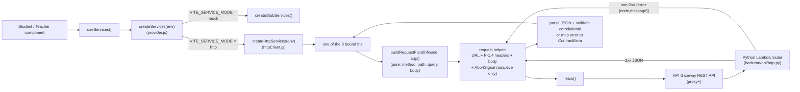
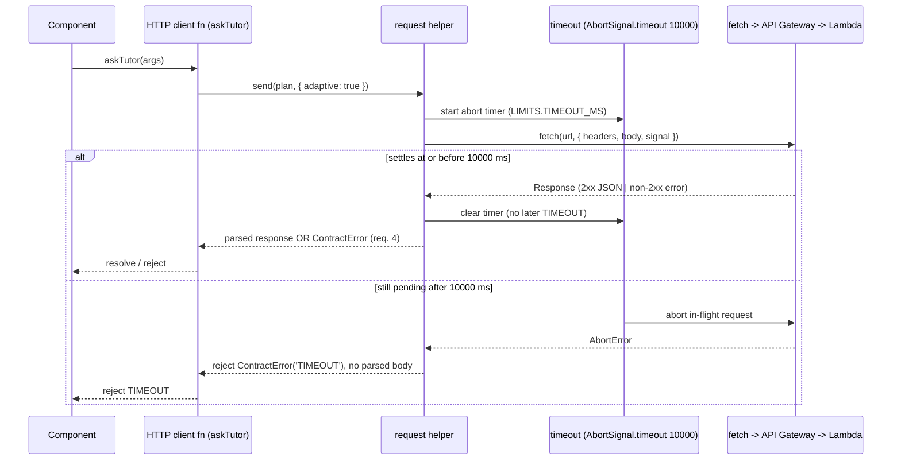

# Design Document

## Overview

This feature replaces the throwing placeholder in the `http` branch of the seam-1
services provider with a real, fetch-based HTTP client. The client implements the eight
`SERVICE_FUNCTIONS` against the live backend REST API and keeps the exact signatures the
student and teacher components already call through `useServices`, so flipping
`VITE_SERVICE_MODE=mock` to `http` connects the existing UI to the real backend with no
component change (requirement 1, requirement 8; C-28).

The design is bound to frozen, authoritative sources that this feature does **not** edit:

- **Function set / enums / limits** — `shared/contracts/seams.js`: `SERVICE_FUNCTIONS`
  (the eight names), `ENUMS.ErrorCode` (the ten codes), `LIMITS.TIMEOUT_MS` (10000).
- **Wire shapes** — `shared/contracts/schemas/services.schema.json` and
  `common.schema.json` (`additionalProperties: false` throughout;
  `CorrelationId` pattern `^[A-Za-z0-9_-]{8,64}$`). The JSDoc mirror is `src/services/types.js`.
- **Error type** — `shared/contracts/errors.js`: `ContractError`, whose `.error` is the
  C-29 wire shape `{ code, message }` and whose constructor rejects any code not in
  `ENUMS.ErrorCode`.
- **Mode selection** — `shared/contracts/modes.js`: `resolveModes` (unchanged;
  `createServices` already calls it and only the `http` branch changes).
- **Contract suite** — `shared/contracts/harness.js`: `runServicesContract`, which the
  client must pass identically to the stub (requirement 7).
- **The real backend it calls** — `backend/api/http.py` (authoritative route table,
  `_read_context` header handling, `_status_for` status map, `{ "error": { code, message } }`
  error serialization) behind a single API Gateway REST API with a `{proxy+}` catch-all to
  one Python Lambda (`infra/lib/api-stack.ts`, `infra/README.md`).

### What changes and what does not

- **Changes:** `src/services/provider.js`'s `http` branch is rewired to call a new
  `createHttpServices(env)`; new modules are added under `src/services/`.
- **Unchanged:** the mock branch, the default-to-mock and fail-loud-on-typo behavior of
  `resolveModes` (requirement 8), every file under `shared/contracts/` and its schemas
  (requirement 9.1), and every student/teacher component (requirement 9, C-28).

### Key design decisions

| Decision | Rationale |
|---|---|
| No new runtime dependency | The platform `fetch`, `AbortController`, `AbortSignal.timeout`, and `crypto.randomUUID` cover every need (requests, per-request timeout/abort, correlation ids). Requirement 9.3 is satisfied with zero additions; no 9.4 justification is required. |
| Pure request-plan builder | Mapping `(fnName, args)` to `{ method, path, query, body }` is a pure function with no I/O, so route/method/body mapping is deterministic and property-testable (requirement 2). |
| Config validated once at construction | `createHttpServices` reads and validates `VITE_` config before returning the object; invalid config throws `CONFIG_ERROR` and no function can issue a request (requirement 3.7–3.8). |
| Timeout only on adaptive calls | Only `submitStep`, `askTutor`, `verifyPrompt`, `generate` get an abort signal bounded by `LIMITS.TIMEOUT_MS`; the other four never time out on that budget (requirement 5). |
| Server stays the authority | The browser holds no AWS keys, model ids, or prompts; models and the database are reached only through the backend (C-26, C-33). The client only moves camelCase JSON over the P-1.4 headers. |

## Architecture

The client sits inside the already-built seam. Components call `useServices()`, which
returns whatever `createServices(env)` built once. In `http` mode that object is now the
real client; each function builds a request plan, sends it with `fetch`, and maps the
result to a response object or a `ContractError`.

### Call path



Mode selection (`resolveModes`) is unchanged: unset/empty/whitespace `VITE_SERVICE_MODE`
defaults to `mock`, an out-of-range value throws `CONFIG_ERROR`, and only the exact value
`http` reaches `createHttpServices` (requirement 8.1–8.3).

### One adaptive call with the timeout (sequence)



Non-adaptive calls (`getTree`, `getTeacherRoster`, `setTeacherInput`, `health`) take the
same path with `{ adaptive: false }` and no abort timer, so the timeout budget never
applies to them (requirement 5.5).

## Components and Interfaces

All new modules are JavaScript (`.js`), no TypeScript syntax, no `.ts` files (requirement
9.2, C-30). They live under `src/services/`.

### `src/services/httpClient.js` — factory

Exports `createHttpServices(env)`. Steps:

1. `readConfig(env)` → a validated, frozen `ClientConfig` (throws `CONFIG_ERROR` on any
   missing/empty/invalid value before anything else).
2. For each `name` in `SERVICE_FUNCTIONS`, create a bound async function `(args) => ...`
   that builds the request plan, sends it (marking adaptive calls), and returns the
   mapped response.
3. Return a plain object whose own-enumerable keys are exactly the eight names, each a
   function (requirement 1.2, 7.2).

```js
/**
 * @param {Record<string, string|undefined>} env  VITE_-prefixed env-like object
 * @returns {import('./types.js').Services}
 */
export function createHttpServices(env) { /* ... */ }
```

The set of adaptive function names is a frozen constant in this module:
`ADAPTIVE = new Set(['submitStep', 'askTutor', 'verifyPrompt', 'generate'])`
(requirement 5, Adaptive_Call glossary).

### `src/services/httpConfig.js` — env/config reader

Exports `readConfig(env)`. Reads **only** `VITE_`-prefixed values (requirement 3.5, C-26):

| Config field | Env key | Validation |
|---|---|---|
| `baseUrl` | `VITE_API_BASE_URL` | present, non-empty after trim |
| `token` | `VITE_DEMO_TOKEN` | present, non-empty |
| `userId` | `VITE_DEMO_USER_ID` | present, non-empty |
| `role` | `VITE_DEMO_ROLE` | present, non-empty, and exactly `student` or `teacher` |

Rules:

- Any field absent or empty string → throw `ContractError('CONFIG_ERROR', ...)` (requirement 3.7).
- `role` present but not `student`/`teacher` → throw `ContractError('CONFIG_ERROR', ...)`
  (requirement 3.8).
- The reader never reads or stores an AWS key, AWS secret, session token, model id, or
  prompt; those names are not referenced in source (requirement 3.6, C-26).
- On success returns a frozen `ClientConfig` object. No request is issued during
  construction (requirement 3.7–3.8 "SHALL not issue any backend request").

Exact env key names (`VITE_DEMO_TOKEN`, `VITE_DEMO_USER_ID`, `VITE_DEMO_ROLE`) are new
public `VITE_` config added alongside the existing `VITE_API_BASE_URL` in `.env.example`
documentation; all are public by C-26.

### `src/services/httpRoutes.js` — pure request-plan builder

Exports `buildRequestPlan(fnName, args)` returning a `RequestPlan`
(`{ method, path, query, body, adaptive }`) with **no** I/O. This is the single source of
the route/method/body mapping (requirement 2). URL path segments interpolated from args
are URL-encoded and occupy exactly one segment each (`encodeURIComponent`).

Mapping table (mirrors `_ROUTES` in `backend/api/http.py`):

| Function | Method | Path | Query | Body | Adaptive |
|---|---|---|---|---|---|
| `getTree` | GET | `/courses/{courseId}` | — | none | no |
| `submitStep` | POST | `/steps/{stepId}/submit` | — | `SubmitStepArgs` minus `stepId` | yes |
| `askTutor` | POST | `/tutor/ask` | — | all `AskTutorArgs` fields | yes |
| `verifyPrompt` | POST | `/prompts/verify` | — | all `VerifyPromptArgs` fields | yes |
| `generate` | POST | `/prompts/generate` | — | all `GenerateArgs` fields | yes |
| `getTeacherRoster` | GET | `/teacher/students` | `courseId=<encoded>` | none | no |
| `setTeacherInput` | POST | `/teacher/students/{studentId}/routing` | — | `{ input }` only (no `studentId`) | no |
| `health` | GET | `/health` | — | none | no |

Notes tying the table to the backend:

- `submitStep` omits `stepId` from the body because the router rebuilds it from the path
  (`{**b, "stepId": m.group(1)}`) — sending it in the body would be redundant and the path
  is authoritative (requirement 2.2).
- `setTeacherInput` sends `{ input }` only; the router reads `b.get("input", b)` and takes
  `studentId` from the path (requirement 2.7).
- `getTeacherRoster` sends `courseId` as a query param; the router reads `q.get("courseId")`
  (requirement 2.6).
- camelCase is preserved on the wire exactly as the frozen arg typedefs define
  (requirement 2.1–2.8); the client does not rename or recase any field.

### `src/services/httpRequest.js` — request helper (the only I/O)

Exports `sendRequest(config, plan)`. Responsibilities:

1. **URL** — join `config.baseUrl` and `plan.path` with exactly one `/` separator
   (trim a trailing `/` on the base and a leading `/` is already on the path), then append
   the query string if `plan.query` is set (requirement 2.10).
2. **Headers** — always set the three P-1.4 headers (requirement 3.1–3.3):
   `Authorization: Bearer <token>`, `X-User-Id: <userId>`, `X-Role: <role>`; add
   `X-Correlation-Id: <generated>` (requirement 6.3); when a body is sent, add
   `Content-Type: application/json` (requirement 3.4).
3. **Body** — `JSON.stringify(plan.body)` for POST plans; GET plans send no body.
4. **Timeout/abort** — for `plan.adaptive === true`, pass
   `signal: AbortSignal.timeout(LIMITS.TIMEOUT_MS)`; on `AbortError`, reject
   `ContractError('TIMEOUT', ...)` with no parsed body. A settled call needs no manual
   clear — `AbortSignal.timeout` is GC'd and never fires a late rejection (requirement 5.1–5.4).
   Non-adaptive plans pass no signal (requirement 5.5).
5. **Network failure** — a rejected `fetch` (not an abort) → `ContractError('UPSTREAM_ERROR', ...)`
   (requirement 4.5).
6. **Parse + validate** — see Error Handling. On 2xx: parse JSON; reject `UPSTREAM_ERROR`
   on invalid JSON (requirement 4.4) or on a missing/malformed `correlationId`
   (requirement 6.4); otherwise return the parsed object unchanged, preserving
   `source`, `notice`, `fallbackActive`, and `correlationId` verbatim (requirement 6.1,
   9.6–9.8).
7. **Error mapping** — on non-2xx: apply the decision in Error Handling and reject a
   `ContractError`.

A small helper `generateCorrelationId()` returns a value matching
`^[A-Za-z0-9_-]{8,64}$` (e.g. a hex/uuid-derived string); it is used for the
`X-Correlation-Id` request header only (the response `correlationId` is whatever the
backend returns, passed through unchanged).

### `src/services/provider.js` — the one-line rewire

Replace the `notImplementedServices()` branch so `http` returns
`createHttpServices(env ?? ambientEnv())`. The `resolveModes` call, the mock branch, and
the `ambientEnv()` helper stay exactly as they are (requirement 8). No other provider
behavior changes.

### Unchanged collaborators

`ServicesContext.jsx`, `treeAdapter.js`, `SourceBadge.jsx`, and every student/teacher
component are untouched. Because the client returns schema-valid objects with `source`,
`notice`, and `fallbackActive` passed through from the backend, the existing Source_Badge
and fallback labeling keep working (requirement 9.6–9.8).

## Data Models

This feature introduces **no new wire shapes**. Every request argument and response object
is exactly the frozen typedef in `src/services/types.js` / `services.schema.json`
(requirement 1.3, 1.4, 9.1). The only new models are internal, in-memory objects that
never cross the wire.

### `ClientConfig` (internal, frozen)

```
ClientConfig {
  baseUrl: string   // from VITE_API_BASE_URL, trimmed, non-empty
  token:   string   // from VITE_DEMO_TOKEN,    non-empty
  userId:  string   // from VITE_DEMO_USER_ID,  non-empty
  role:    'student' | 'teacher'   // from VITE_DEMO_ROLE
}
```

Public values only (C-26). Built once by `readConfig`; no secrets, model ids, or prompts.

### `RequestPlan` (internal, pure output of `buildRequestPlan`)

```
RequestPlan {
  method:  'GET' | 'POST'
  path:    string                      // leading '/', segments URL-encoded
  query:   Record<string,string> | null
  body:    object | null               // camelCase; null for GET
  adaptive: boolean                    // true only for the four adaptive calls
}
```

`RequestPlan` carries no identity or secret — headers are added later by the request
helper from `ClientConfig`.

### Response objects (reused, not redefined)

Returned objects are the frozen response definitions, passed through from the backend:
`TreeResponse`, `SubmitResponse`, `TutorResponse`, `VerifyResponse`, `GenerateResponse`,
`RosterResponse`, `SetTeacherInputResponse`, `HealthResponse`. The client does not add,
drop, or rename any field (`additionalProperties: false` would reject an added one).

## Correctness Properties

*A property is a characteristic or behavior that should hold true across all valid
executions of a system — essentially, a formal statement about what the system should do.
Properties serve as the bridge between human-readable specifications and
machine-verifiable correctness guarantees.*

This feature is well suited to property-based testing because the client's core is pure, input-driven
logic with large input spaces: the request-plan mapping, the error-status→code mapping,
and config validation. These are exercised with a mocked `fetch`, so 100+ iterations are
cheap and reveal edge cases (encoding, unusual statuses, malformed bodies). Infrastructure
behavior (API Gateway, the real Lambda) is **not** property-tested — it is covered by the
contract suite against an in-memory fake fetch (see Testing Strategy).

### Property 1: The factory exposes exactly the eight functions

*For any* valid `ClientConfig`, the object returned by `createHttpServices` has
own-enumerable keys equal to the set `SERVICE_FUNCTIONS` — no missing and no extra names —
and every value satisfies `typeof value === 'function'`.

**Validates: Requirements 1.2, 7.2**

### Property 2: Route and method are a pure function of `(fnName, args)`

*For any* function name in `SERVICE_FUNCTIONS` and any valid args object for it,
`buildRequestPlan(fnName, args)` returns the method and path template fixed by the mapping
table (e.g. `getTree`→`GET /courses/{courseId}`, `submitStep`→`POST /steps/{stepId}/submit`),
independent of any ambient state, and two calls with equal inputs return deep-equal plans.

**Validates: Requirements 2.1, 2.2, 2.3, 2.4, 2.5, 2.6, 2.7, 2.8**

### Property 3: Path-segment arguments are URL-encoded into exactly one segment

*For any* args whose value fills a path placeholder (`courseId`, `stepId`, `studentId`),
the built path contains the `encodeURIComponent` of that value and that value occupies
exactly one segment (it introduces no additional unescaped `/`).

**Validates: Requirements 2.1, 2.2, 2.6, 2.7**

### Property 4: Request body matches the method and omits path-only fields

*For any* valid args, a GET plan (`getTree`, `getTeacherRoster`, `health`) has a null body;
a POST plan carries the camelCase body defined for it, with `submitStep` omitting `stepId`
and `setTeacherInput` sending `{ input }` only (no `studentId`).

**Validates: Requirements 2.1, 2.2, 2.3, 2.4, 2.5, 2.6, 2.7, 2.8**

### Property 5: Every request carries the three P-1.4 headers and the correlation header

*For any* function call with a valid config, the outgoing `fetch` request sets
`Authorization` to `Bearer ` + the config token, `X-User-Id` to the config user id,
`X-Role` to the config role, and an `X-Correlation-Id` matching `^[A-Za-z0-9_-]{8,64}$`;
and whenever a body is sent, `Content-Type` is `application/json`.

**Validates: Requirements 3.1, 3.2, 3.3, 3.4, 6.3**

### Property 6: The base URL and path join with exactly one separator

*For any* config base URL (with or without a trailing `/`) and any built path, the final
request URL contains the base and the path joined by exactly one `/`, with any query
string appended after the path.

**Validates: Requirements 2.10**

### Property 7: Only adaptive calls receive an abort signal

*For any* function call, the `fetch` options include an `AbortSignal` bounded by
`LIMITS.TIMEOUT_MS` if and only if the function is one of `submitStep`, `askTutor`,
`verifyPrompt`, `generate`; the other four pass no signal.

**Validates: Requirements 5.1, 5.5**

### Property 8: An adaptive call that exceeds the budget rejects with TIMEOUT and no body

*For any* adaptive call whose underlying request stays pending strictly past
`LIMITS.TIMEOUT_MS`, the client rejects with `ContractError` code `TIMEOUT` and surfaces no
parsed response body; and a call that settles at or before the budget is never converted to
a `TIMEOUT` by the timer.

**Validates: Requirements 5.2, 5.3, 5.4**

### Property 9: The error-status → code mapping is total and deterministic

*For any* non-2xx status with a body that does not match `{ error: { code, message } }`,
the client rejects with a `ContractError` whose code is: `UNAUTHORIZED` (401),
`FORBIDDEN` (403), `NOT_FOUND` (404), `RATE_LIMITED` (429), `UPSTREAM_ERROR` (502),
`TIMEOUT` (504), and `INTERNAL` for every other non-2xx status — the same code for equal
inputs on every run.

**Validates: Requirements 4.3**

### Property 10: A well-formed error body wins over the status-derived code

*For any* non-2xx response whose body is `{ error: { code, message } }` with `code` in
`ENUMS.ErrorCode`, the client rejects with a `ContractError` carrying that exact `code` and
`message`, regardless of the HTTP status; if `code` is not in `ENUMS.ErrorCode`, the client
falls back to the status-derived code of Property 9.

**Validates: Requirements 4.1, 4.2**

### Property 11: Invalid or unparseable response bodies reject with UPSTREAM_ERROR

*For any* response whose body is present but not valid JSON, and *for any* network-layer
`fetch` failure, and *for any* 2xx response whose `correlationId` is missing or does not
match `^[A-Za-z0-9_-]{8,64}$`, the client rejects with a `ContractError` code
`UPSTREAM_ERROR`.

**Validates: Requirements 4.4, 4.5, 6.4**

### Property 12: Every rejection is a ContractError with a clean wire shape

*For any* failing call, the rejection value is a `ContractError` whose `.error` deep-equals
`{ code, message }` with `code` in `ENUMS.ErrorCode`, and whose `message` contains neither
the configured token nor any raw student text from the arguments.

**Validates: Requirements 4.6, 4.7**

### Property 13: Config validation rejects missing, empty, or invalid-role config

*For any* env where the base URL, token, user id, or role is absent or an empty string,
and *for any* env where the role is a non-empty value other than `student` or `teacher`,
`createHttpServices` throws a `ContractError` code `CONFIG_ERROR` and issues no request.

**Validates: Requirements 3.7, 3.8**

### Property 14: A 2xx response is returned unchanged, preserving labeling fields

*For any* schema-valid 2xx response, the client returns the parsed object with its
`correlationId`, and with its `source`, `notice`, and `fallbackActive` fields (when the
response definition has them) passed through byte-for-byte unchanged.

**Validates: Requirements 2.9, 6.1, 6.2, 9.6, 9.7, 9.8**

## Error Handling

All failures surface as a `ContractError` whose `.error` is `{ code, message }` and whose
`code` is a member of `ENUMS.ErrorCode` (requirement 4.7). The decision procedure, applied
in the request helper after `fetch` settles:

1. **`fetch` rejected (network layer), not an abort** → `UPSTREAM_ERROR` (requirement 4.5).
2. **`fetch` rejected with `AbortError`** (adaptive timeout fired) → `TIMEOUT`, no parsed
   body (requirement 5.2). This path exists only for adaptive calls.
3. **Response is 2xx:**
   - Body not valid JSON → `UPSTREAM_ERROR` (requirement 4.4).
   - Parsed, but `correlationId` missing or not matching `^[A-Za-z0-9_-]{8,64}$` →
     `UPSTREAM_ERROR` (requirement 6.4).
   - Otherwise resolve with the parsed object unchanged (requirement 2.9).
4. **Response is non-2xx:**
   - Body is `{ error: { code, message } }` and `code ∈ ENUMS.ErrorCode` → reject with that
     `code` and `message` (requirement 4.1), in preference to the status.
   - Body is `{ error: { code, message } }` but `code ∉ ENUMS.ErrorCode` → use the
     status-derived code below (requirement 4.2).
   - Body does not match `{ error: { code, message } }` (including non-JSON) → use the
     status-derived code below (requirement 4.3).

Status-derived code map (mirrors `_status_for` in `backend/api/http.py`, read in reverse):

| HTTP status | ErrorCode |
|---|---|
| 401 | `UNAUTHORIZED` |
| 403 | `FORBIDDEN` |
| 404 | `NOT_FOUND` |
| 429 | `RATE_LIMITED` |
| 502 | `UPSTREAM_ERROR` |
| 504 | `TIMEOUT` |
| any other non-2xx (e.g. 400, 500) | `INTERNAL` |

The backend may also return `VALIDATION_ERROR`, `CONTENT_BLOCKED`, `CONFIG_ERROR` — those
arrive in the error body and are honored verbatim via rule 4a; the status-derived fallback
is only for responses with no recognizable error body, matching requirement 4.3's explicit
list.

**Message hygiene (requirement 4.6):** every message the client itself constructs is a
fixed, generic string (e.g. "The request timed out.", "The server returned an unreadable
response."). The client never interpolates the configured token or the args' student text
(`text`, `prompt`, `question`, project source) into a message. A `message` that arrives
inside a backend error body is passed through as-is — the backend is already bound by the
same hygiene rule (C-29) and its `Notice.message` is capped at 300 chars by schema.

## Testing Strategy

The client is proven with a **dual approach**: property-based tests for the pure,
input-driven logic and example/integration-style tests for specific behaviors and the
contract suite. No new PBT dependency is added; properties are expressed as plain Vitest
tests that iterate over generated inputs in a loop (≥100 iterations each), seeded by a
small local generator. This keeps requirement 9.3 intact (platform `fetch`/`AbortController`
suffice; no runtime dependency) and adds no dev dependency beyond the existing `vitest`.

### Test doubles

- **Mocked `fetch`:** unit and property tests install a stub for the global `fetch` that
  records the `(url, options)` it was called with and returns a caller-supplied
  `Response`-like object (`{ ok, status, async json(), async text() }`). This lets a test
  assert the URL, method, headers, body, and abort signal without a network.
- **In-memory fake endpoint:** for the contract run, a `fetch` stub routes by
  `(method, path)` using the same table as `buildRequestPlan` and returns schema-valid
  canned bodies. Fixtures are reused from
  `shared/contracts/fixtures/services/responses.json` for submit/tutor/verify/generate/
  roster/routing/health, and `database/sample-skilltree.json` for the `getTree` tree
  payload. Each canned body carries a `correlationId` matching the required pattern.

### Contract test (requirement 7)

A new `src/services/httpClient.contract.test.js` mirrors the existing
`provider.contract.test.js` pattern and runs `runServicesContract` against the client
pointed at the in-memory fake fetch:

```js
runServicesContract('http client (fake fetch)', () =>
  createHttpServices({
    VITE_API_BASE_URL: 'https://fake.local/prod',
    VITE_DEMO_TOKEN: 'demo-token',
    VITE_DEMO_USER_ID: 'stu-quick',
    VITE_DEMO_ROLE: 'student',
  }),
)
```

The suite must pass with zero failing and zero skipped assertions (requirement 7.1): the
eight-function enumeration (7.2), each response validating against its
`services.schema.json` definition with a pattern-valid `correlationId` (7.4), the panels
`submitStep` returning `outcome: 'recorded'`, `evidence: null`, `masteryDisplay: null`
(7.5), and — by construction — a deliberately malformed canned response producing at least
one failing assertion for the affected function (7.6, exercised in a separate negative test
so the green run stays green).

### Property tests (requirement-mapped)

One property-based test per Correctness Property above, each tagged:

```
// Feature: http-services-client, Property 9: The error-status -> code mapping is total and deterministic
```

Each runs ≥100 iterations over generated inputs (function names, arg values with tricky
characters for encoding, HTTP statuses across the full non-2xx range, well-formed and
malformed error bodies, valid/invalid correlation ids, and missing/empty/invalid config).
Properties 1–7, 9–14 use the mocked `fetch`; Property 8 (timeout) uses Vitest fake timers
to advance past `LIMITS.TIMEOUT_MS` deterministically without real waiting.

### Example / edge-case unit tests

- `readConfig` happy path and each `CONFIG_ERROR` trigger (missing base URL, empty token,
  empty user id, missing role, role `admin`).
- `provider.js` returns the HTTP client (not the stub) for `VITE_SERVICE_MODE: 'http'`, and
  still returns the stub for unset/empty/whitespace, and throws `CONFIG_ERROR` for a typo
  (requirement 8.1–8.3) — reusing the existing provider behavior.
- A representative adaptive timeout and a representative network-failure case as concrete
  examples alongside the properties.

### Component tests (only if needed)

The components are unchanged (C-28), so no component test is required for this feature. If
a smoke test of a screen in `http` mode is added later, use the temporary
`npm install --no-save @testing-library/react jsdom` pattern, set that test file's
environment to `jsdom`, and remove the packages after the run so no dev dependency is
persisted. This feature does not add such a test.

### Verification gates

Before this feature is considered done, all of the following must pass:

- `npm run build` — Vite build succeeds (requirement 9.2: JS/JSX only, no TS).
- `npm test` — the full Vitest run is green, including every pre-existing test
  (`provider.contract.test.js`, `stubs.test.js`, backend and shared suites) plus the new
  client unit, property, and contract tests.
- `npm run test:contracts` — the seam-1 contract suites remain green.

No file under `shared/contracts/` or `shared/contracts/schemas/` is edited by this feature
(requirement 9.1); no new runtime dependency is added to `package.json` (requirement 9.3).
