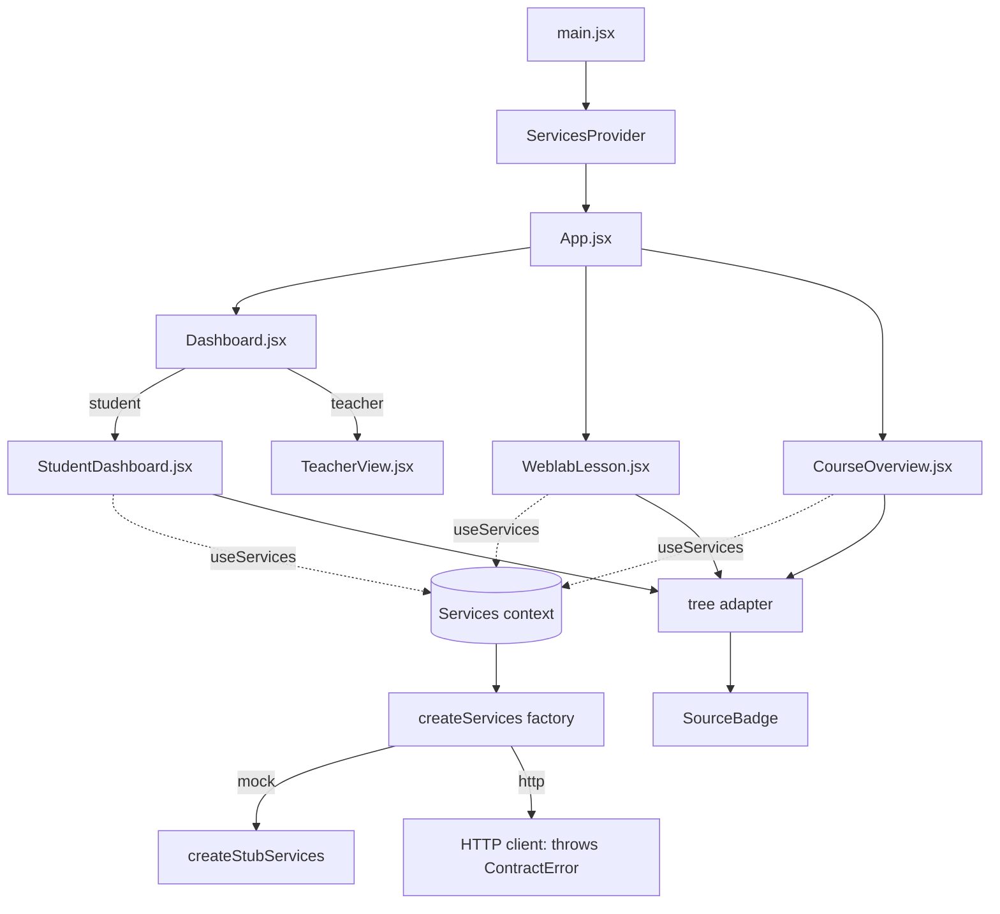
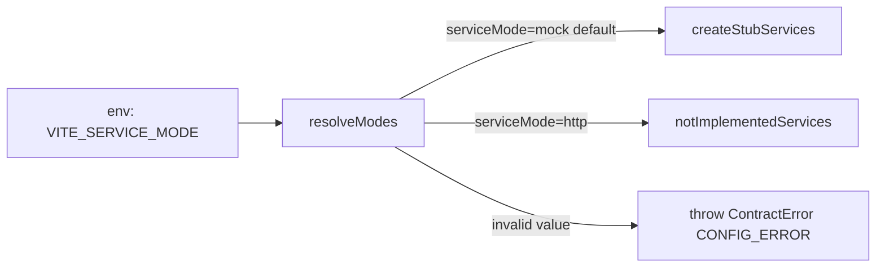

# Design Document

## Overview

This design adds a **services provider** at seam 1 and rewires the student screens to consume it, without touching the frozen `shared/contracts`. The provider is a thin selector: it reads `VITE_SERVICE_MODE` through `resolveModes` and returns either the existing stub (`createStubServices`) or a not-yet-implemented HTTP client that throws a `ContractError`. A React context (`ServicesProvider` + `useServices`) distributes the object so no screen imports a mock module directly.

The hard part is model translation. The contract tree is a checkpoint/step/skill model with `evidenceLevels`; the existing student components (`WeblabLesson`, `StudentDashboard`, `CourseOverview`) are built around the four-objective `courseData` model. Rather than rewrite the components' markup, a pure **adapter** maps `TreeResponse` + `SubmitResponse` into the prop shapes those components already expect. This keeps the visual design intact and confines the model difference to one module.

Every rendered model-derived value is labeled with its `source`, and any `notice` / `fallbackActive` is surfaced through a small accessible **SourceBadge** banner, satisfying architecture 1.8 (stub data must never pass as live). `masteryDisplay` is treated as display-only and never shown decreasing.

### Design decisions and rationale

- **Factory + injected env (not a singleton reading `import.meta.env` at import time).** `import.meta.env` is only defined under Vite. Taking `env` as a parameter (defaulting to the ambient env) lets the contract test build the provider in mock mode under the Node test environment. Rationale: Requirement 1.7 / 7.3.
- **Delegate to `createStubServices`, do not reimplement.** The stub already passes `runServicesContract`. Wrapping it means the new provider inherits that guarantee; the provider test re-asserts it against the provider surface. Rationale: Requirement 7, architecture 1.8.
- **Adapter is pure and separate from React.** A pure function is trivially property-testable and keeps the mapping logic out of component state. Rationale: Requirement 3, testability.
- **Adapt, do not rewrite.** The adapter produces `{ objectives, progressPercent, ... }` shaped like `LESSON`/`courseData`, so `StudentDashboard`, `CourseOverview`, and the lesson left-rail keep their existing JSX. Rationale: "preserve the existing visual design".
- **Keep `engine.js`/`tools.js` as local fallback behavior only where the services layer has no equivalent.** The build log checker (`buildProject`) and the inline "show me where" hint targets are UI-local concerns with no seam-1 function; they stay. The data and the four graded actions (validate→`submitStep`, tutor→`askTutor`, generate→`verifyPrompt`+`generate`) move to services. Rationale: scope is "source content from getTree and send actions through services".

## Architecture



Mode selection flow:



The provider is the only module that knows which implementation is live. Components know only the `Services` shape (JSDoc in `src/services/types.js`) and the adapter output. Swapping the stub for a real client is a change in one file plus a mode switch.

## Components and Interfaces

### `src/services/provider.js` (Services_Provider)

```js
import { resolveModes } from '../../shared/contracts/modes.js'
import { createStubServices } from '../../shared/contracts/stubs/services.stub.js'
import { ContractError } from '../../shared/contracts/errors.js'
import { SERVICE_FUNCTIONS } from '../../shared/contracts/seams.js'

/** Reject helper: every HTTP function throws the same not-implemented error. */
function notImplementedServices() { /* build object over SERVICE_FUNCTIONS, each async throws ContractError('INTERNAL', ...) */ }

/**
 * Build the eight-function Services object for the active mode.
 * @param {Record<string,string|undefined>} [env] defaults to the ambient import.meta.env.
 * @returns {import('./types.js').Services}
 */
export function createServices(env) { /* resolveModes(env); mock -> createStubServices(); http -> notImplementedServices() */ }
```

- `env` defaults to `import.meta.env` when available, else `{}` (so Node tests and SSR don't crash). The default is read lazily inside the function, never at module top level.
- `http` branch returns an object whose keys are exactly `SERVICE_FUNCTIONS`, each an `async` function that `throw new ContractError('INTERNAL', 'HTTP services client is not implemented yet (seam 1). Set VITE_SERVICE_MODE=mock.')`. A `// TODO` marks where the real fetch client lands.

### `src/services/ServicesContext.jsx` (Services_Context + useServices)

```js
const ServicesContext = createContext(null)
export function ServicesProvider({ services, env, children }) { /* value = services ?? useMemo(() => createServices(env), [env]) */ }
export function useServices() { /* const v = useContext(...); if (!v) throw new Error('useServices must be used within <ServicesProvider>'); return v */ }
```

- `services` prop lets tests/stories inject a ready object; otherwise it builds one via `createServices(env)` memoized once.
- `main.jsx` wraps `<App/>` in `<ServicesProvider>`.

### `src/services/treeAdapter.js` (Tree_Adapter)

Pure functions, no React:

```js
/** Map a TreeResponse into the shape the student screens render. */
export function adaptTree(treeResponse) {
  // returns {
  //   courseId, title,
  //   objectives: [{ id, title, status, skillIds, minutes? }],  // one per non-intro checkpoint, in tree order
  //   progressPercent,            // round(100 * completed / total), 0..100
  //   evidence: { [skillId]: level },
  //   current: { checkpointId, stepId } | null,
  //   fallbackActive,
  //   source: 'stub'|'none'|...,  // tree is content; label as 'stub' when fallbackActive or stub-derived
  // }
}

/** Map a SubmitResponse into the lesson's post-submit view. */
export function adaptSubmit(submitResponse) {
  // returns {
  //   stepId, outcome, completed,
  //   mastery: number | null,     // === masteryDisplay (display only; null stays null)
  //   next: { checkpointId, stepId, reason } | null,
  //   hint, passive, notice, source,
  // }
}

/** Objective completion state label the components already use. */
export function statusToUiState(progressStatus) { /* completed|tested_out -> 'done'; current -> 'progress'; else 'todo' */ }
```

- Objectives are the checkpoints excluding the `intro` checkpoint (or: all checkpoints with `skillIds`), mapped to `{ id, title }` with `status` taken from `progress[checkpointId]` (default `locked`→`todo`).
- `progressPercent` counts checkpoints whose status is `completed` or `tested_out` over the total adapted objective count, rounded.
- `mastery` is passed through verbatim from `masteryDisplay`; `null` stays `null`. The lesson never recomputes a lower number.

### `src/services/SourceBadge.jsx` (Source_Badge)

A small, scoped-CSS banner/badge. Props: `{ source, notice, fallbackActive, health }`.

- Renders a visible badge when `source === 'stub'` (e.g. "Sample data") or `source === 'rules'`/`'none'` on a fallback.
- Renders the `notice.message` for `ADAPTIVE_UNAVAILABLE` / `CONTENT_BLOCKED`.
- Renders a "Adaptive features unavailable" line when `fallbackActive` or `health.status !== 'ok'`.
- Root has `role="status"` and `aria-live="polite"`. New `sourceBadge.css` with scoped classes (`sb-*`), matching the existing CSS approach.

### Rewired student screens

- **`WeblabLesson.jsx`**: on mount, `getTree` → `adaptTree` fills the left rail (objectives, progress) and seeds `current`. `submit()` calls `submitStep` (kind from step type) and routes using `adaptSubmit(...).next`; mastery comes from `masteryDisplay`. `generate(text)` calls `verifyPrompt` then (if `ok`) `generate`. The Tutor's `ask` path calls `askTutor`. The local build log (`buildProject`) and inline hint targets remain. A `SourceBadge` sits under the top bar.
- **`StudentDashboard.jsx`**: on mount, `getTree` → `adaptTree`; course progress ring and objective list read from the adapted objectives and `progressPercent`. Loading state while pending. `SourceBadge` in the hero area.
- **`CourseOverview.jsx`**: accepts adapted progress/objectives (via `getTree` in the screen or passed from `App`), keeps all sections. `SourceBadge` near the hero.
- **`App.jsx` / `Dashboard.jsx`**: unchanged routing; teacher path untouched. `App` may fetch `getTree` once and pass adapted progress to `CourseOverview`/`StudentDashboard`, or each screen fetches independently — each screen fetching keeps coupling low and is the chosen approach.

## Data Models

Consumed (frozen, from `services.schema.json` / `types.js`):

- **TreeResponse**: `{ tree, progress: Record<slug,ProgressStatus>, evidence: Record<slug,Level>, current: {checkpointId,stepId}|null, fallbackActive: boolean, correlationId }`.
- **SubmitResponse**: `{ stepId, outcome: 'scored'|'recorded'|'blocked'|'fallback', evidence: Evidence|null, masteryDisplay: int0..100|null, completed, next: {checkpointId,stepId,reason}|null, hint, passive, notice: Notice|null, source: Source, correlationId }`.
- **TutorResponse / VerifyResponse / GenerateResponse / HealthResponse**: as in the schema.

Produced (new, UI-internal — not crossing any seam):

- **AdaptedTree**: `{ courseId, title, objectives: Array<{id,title,status,skillIds}>, progressPercent: 0..100, evidence: Record<skillId,level>, current, fallbackActive, source }`.
- **AdaptedSubmit**: `{ stepId, outcome, completed, mastery: number|null, next, hint, passive, notice, source }`.
- **SourceBadge props**: `{ source, notice, fallbackActive, health }`.

No new persisted shapes. No client telemetry fields are introduced (ADR-006).

## Correctness Properties

*A property is a characteristic or behavior that should hold true across all valid executions of a system — essentially, a formal statement about what the system should do. Properties serve as the bridge between human-readable specifications and machine-verifiable correctness guarantees.*

The property-testable surface is the **provider** (mode selection, exact function set) and the **pure adapter** (progress bounds, mastery pass-through, evidence preservation, status mapping). These are pure, input-varying, in-memory, and cheap to run 100+ times, so property-based testing applies. The React components, context wiring, CSS, and the stub's network-free delegation are verified by example/integration tests instead.

### Property 1: Provider exposes exactly the eight service functions

*For any* valid service mode (`mock` or `http`), the object returned by `createServices` has exactly the function names in `SERVICE_FUNCTIONS` and no others.

**Validates: Requirements 1.1, 1.3, 1.5**

### Property 2: Default and invalid mode selection

*For any* environment object, `createServices` returns a mock-backed Services object when `VITE_SERVICE_MODE` is absent, empty, or `mock`; returns a throwing HTTP object when it is `http`; and propagates a `ContractError` when it is any other non-empty value.

**Validates: Requirements 1.2, 1.4, 1.5, 1.6**

### Property 3: HTTP-mode functions reject as not implemented

*For any* of the eight service functions in `http` mode, calling it rejects with a `ContractError` whose code is `INTERNAL`.

**Validates: Requirements 1.5**

### Property 4: Adapted progress percent is a bounded integer

*For any* TreeResponse, `adaptTree` returns a `progressPercent` that is an integer in the range 0–100 inclusive.

**Validates: Requirements 3.3**

### Property 5: Mastery display passes through without decreasing

*For any* SubmitResponse, `adaptSubmit` returns `mastery` equal to the response's `masteryDisplay` when it is a number, and `null` when `masteryDisplay` is `null` — never a substituted lower or zero value.

**Validates: Requirements 3.4, 3.5**

### Property 6: Evidence levels are preserved by the adapter

*For any* TreeResponse, every skill level in the response `evidence` map appears unchanged in the adapted `evidence`, so no displayed skill level is lower than what getTree reported.

**Validates: Requirements 3.7, 5.3**

### Property 7: Objective status reflects the progress map

*For any* TreeResponse, each adapted objective's state equals the UI state derived from that checkpoint's entry in the `progress` map (`completed`/`tested_out` → done, `current` → in progress, otherwise not started).

**Validates: Requirements 3.1, 3.2**

## Error Handling

- **Invalid mode**: `resolveModes` throws `ContractError('CONFIG_ERROR', ...)`; `createServices` lets it propagate so a misconfigured deploy fails loudly (Requirement 1.6). This surfaces at app start, not silently.
- **HTTP mode**: every function rejects with `ContractError('INTERNAL', 'HTTP services client is not implemented yet…')` (Requirement 1.5). Screens catch it like any service rejection.
- **useServices outside a Provider**: throws a descriptive `Error` (Requirement 2.4) — a developer error caught in dev.
- **Service call rejection in a screen**: each `await svc.xxx(...)` is wrapped in `try/catch`; on failure the screen shows an accessible error message via an `aria-live` region and leaves the editor contents intact (Requirement 4.9).
- **`needs_narrowing` verdict**: treated as a normal branch, not an error — show `guidance`, skip `generate` (Requirement 4.7).
- **`blocked` / `fallback` outcomes**: surfaced through `SourceBadge` (notice) and the lesson continues along `next` for `fallback` (Requirements 6.2, 6.3, 6.6).

## Testing Strategy

**Dual approach.** Property tests cover the pure provider and adapter logic; example/integration and (optional) component tests cover wiring, rendering, and accessibility.

**Property-based tests** (library: `fast-check` is not a dependency and must not be added — instead use a small in-repo generator loop driven by `vitest`, running ≥100 iterations per property, consistent with "do not add dependencies"). Each property test runs ≥100 randomized iterations and is tagged:

- Tag format: `// Feature: wire-student-services, Property N: <text>`
- Generators build synthetic `TreeResponse`/`SubmitResponse` objects (varying checkpoint counts, progress statuses, evidence levels, `masteryDisplay` number|null) and env objects (`mock`/`http`/absent/invalid `VITE_SERVICE_MODE`).
- Properties 1–3 target `createServices`; Properties 4–7 target the adapter.

> Note: Because no PBT library may be added, each property is implemented as a single `it(...)` that loops ≥100 times over randomly generated inputs using `Math.random`-seeded helpers, asserting the property each iteration. This satisfies the "single property-based test per property, ≥100 iterations" rule without a new dependency.

**Contract test (Requirement 7).** `src/services/provider.contract.test.js` calls `runServicesContract('provider (mock)', () => createServices({ VITE_SERVICE_MODE: 'mock' }))`. It lives under `src/` so the existing `vitest.config.js` `include` globs (`src/**/*.test.js`) pick it up under `npm test`.

**Example/unit tests.**
- `createServices({})` and `createServices({ VITE_SERVICE_MODE: 'mock' })` return objects whose `getTree` resolves a schema-valid tree (spot check).
- `createServices({ VITE_SERVICE_MODE: 'bad' })` throws.
- Adapter example: the stub's `getTree` output adapts to objectives with expected statuses and a sane percent.

**Component/accessibility tests (optional).** If added, use a throwaway vitest config plus temporarily installed `@testing-library/react@16`, `@testing-library/dom@10`, `jsdom@25` with `--no-save`, then delete the temp files and run `npm install` to restore; confirm `package.json` and `package-lock.json` are unchanged. These verify: loading `aria-live` state, `SourceBadge` renders a stub label and notice message, and `useServices` throws outside a Provider.

**Verification gates.** `npm run build` passes; `npm test` keeps the 87 existing tests green and adds the new tests; `npm run test:contracts` passes. `vite.config.js` and `.vite/` are never staged.
