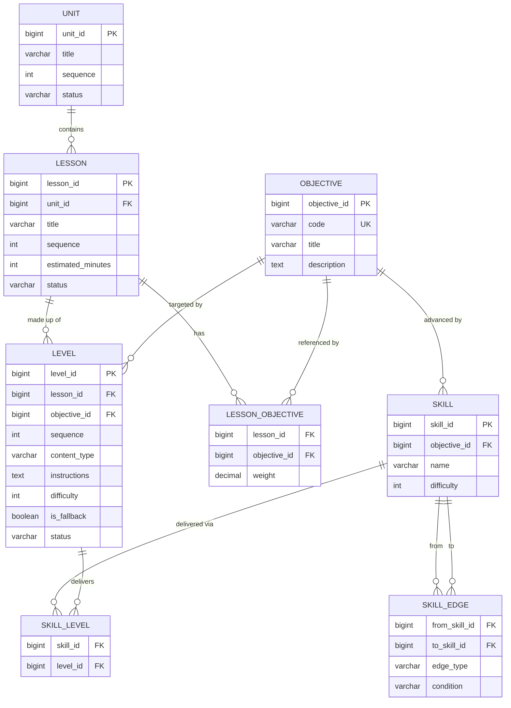

# Breaking Barriers — Team 10 — CodeAI

## Our goal

Help students learn to code with AI. We're building a guided learning interface
for our beneficiary organization, **CodeAI**, where students pick up coding and
AI concepts by building a small website or app.

Students move through a lesson with clear learning objectives while they work.
Within a single screen they can:

- **Describe requirements** in plain language and have the AI help turn them
  into code.
- **Ask questions** and get scaffolded guidance that teaches rather than just
  hands over answers.
- **Build and deploy live**, seeing their project update as they develop it.
- **Measure and report outcomes** — the platform tracks mastery, time on task,
  and hints used so progress is visible to students and mentors.

An AI tutor agent watches for signs that a student is stuck or not learning and
offers proactive **hints and nudges** to keep them moving without doing the work
for them.

## What's here

- [`wireframe-design.md`](./wireframe-design.md) — the wireframe design for the
  learning interface, including the full layout and a component reference.
- [`teacher-view-design.md`](./teacher-view-design.md) — the teacher's view of a
  lesson: class roster plus a per-student detail panel (skills, code, CS-standards
  grade, and the scaffolded help timeline).
- [`database/data-model.mmd`](./database/data-model.mmd) — the data model as a
  Mermaid ER diagram (rendered below).
- [`CONTRIBUTING.md`](./CONTRIBUTING.md) — how the team branches, reviews, and
  merges work.

## Data model

The entities and relationships behind lessons, objectives, levels, and skills:

The source lives in [`database/data-model.mmd`](./database/data-model.mmd).

## Team

Breaking Barriers Hackathon — Team 10.

## CS Teacher Requirements
https://csteachers.org/pk12standards/view/?sa=Artificial%2520Intelligence%2CCybersecurity 
