# CodeAI Architecture

A living document. If you change a component, a flow, a table or a decision, change this file in the
same PR (C-36).

| | |
|---|---|
| Status | **Draft, pending team review.** Every design below is *Proposed* unless it says *Built*. |
| Last reviewed | 2026-11-04 |
| Applies to | CodeAI Adaptive Learning Engine, AWS Breaking Barriers 2026 (Team 10) |
| Precedence | Sits under the platform requirements and the content model, over the frontend docs (C-1) |

Cite requirements as `P-<n>` (platform), `F-<n>` (frontend) and constraints as `C-<n>`.

## How to keep this document current

- Changing a component's behavior, interface, data or failure handling: edit its section in section 2.
- Moving something between MVP, stretch and full: edit the table in section 3.
- Making or reversing a significant decision: add an ADR in section 4. **Never edit an accepted ADR.**
  Add a new one that supersedes it, and set the old one's status to `Superseded by ADR-nnn`.
- Add a row to the change log at the bottom with the date, the PR and a one-line summary.
- Mark a design `Built` only when the code is merged and the demo path works.

---

## 1. System overview

### 1.1 What we are building

CodeAI is a guided learning platform. A student builds a small website by writing prompts to an AI,
inside a live-preview IDE. An adaptive layer watches how the student is doing, adjusts the hints and
pacing, and routes the student to the next checkpoint. A teacher can see progress and influence
routing. The lesson content is a human-authored skill tree (`database/sample-skilltree.json`).

The lesson is about **prompting**, not hand-coding (C-7). Students are minors, so safety and data
handling come first (P-18, P-13).

### 1.2 Design principles

1. **Deterministic where it matters.** Routing, mastery levels, completion and fallback are plain,
   tested code. No model decides routing (C-18).
2. **Models advise, code decides.** Model output is schema-validated and can only select from approved
   content (C-16, C-20).
3. **Safe by default, fail closed.** Every student input and every model output is filtered
   server-side. A filter error blocks the content but never the lesson (C-25).
4. **Never a broken state.** Any failure falls back to a working pre-authored path and is recorded
   (C-21, C-22, P-20).
5. **Explainable.** Every routing, validation, fallback, safety and Passive decision stores a reason a
   human can read (C-19.5, P-12.2).
6. **Cheap and small.** The smallest model that meets the quality bar, with hard token and spend
   limits (P-16, P-17).

### 1.3 Actors and participants

| Name | Role |
|---|---|
| Student | Builds the project, reads hints. Only ever hears the Active agent. |
| Teacher | Reads the roster, holds or assigns routing. No agent runs in the teacher view (diagram 12). |
| Active | The only student-facing voice: hints, answers, walkthroughs. |
| Passive | Background evaluator. Emits signals only. Never talks to the student (C-27). |
| Verifier | Checks a prompt's scope and clarity before codegen. |
| Codegen | Generates code from a verified prompt. A different model from the Verifier (P-7.2). |
| Validator | Scores a project submission against the skill rubric (P-19). |
| Routing | Pure function that picks the next checkpoint (C-18). |
| Safety | Guardrail screening on input and output (C-25). |

### 1.4 System context

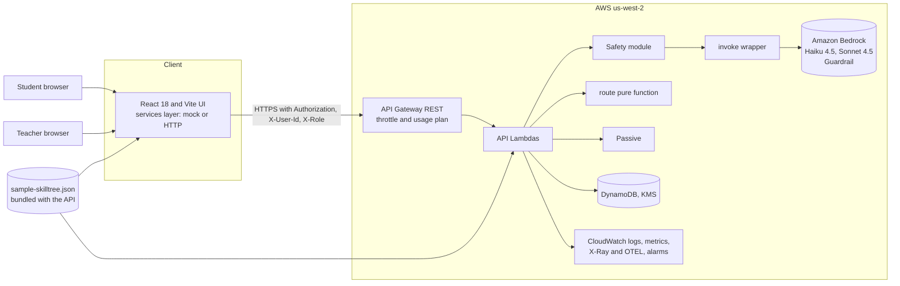

The browser never calls a model and holds no AWS keys or prompts (C-26).

### 1.5 The core flow: submit a step

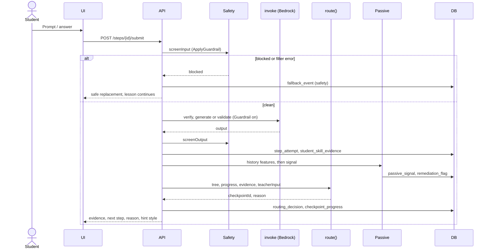

On a timeout (10 s), a validation error, or confidence below 0.6, the API takes the fallback path
instead (section 2.6, C-22).

### 1.6 Well-Architected mapping

| Pillar | How this design addresses it | Where |
|---|---|---|
| Operational excellence | IaC, CI on every PR, structured logs, dashboards, decision records | 2.10, 2.11 |
| Security | Guardrails both ways, least-privilege IAM, KMS, no browser-side model calls, throttled API, secrets kept out of the repo | 2.3, 2.12, 2.14 |
| Reliability | Linear fallback path, 10 s timeouts, work persisted on every submit, health re-check | 2.6, 2.2 |
| Performance efficiency | Haiku for checks, Sonnet for codegen and hints, 10 s adaptive budget | 2.4 |
| Cost optimization | $500 account cap, token limits, response cache, two-model allow-list | 2.4, 2.7 |
| Sustainability | Serverless, pay-per-use, smallest viable model, cached assessments | 2.4, 2.7 |

### 1.7 Environment and verification status

| Fact | Status |
|---|---|
| Hackathon account (id kept out of the repo), region `us-west-2`, role `WSParticipantRole` | Verified (2026-11-04) |
| Budget `hackathon-budget-<account-id>`, $500/month, about $3.79 spent | Verified |
| No Bedrock Guardrails exist yet | Verified |
| CDK not bootstrapped in `us-west-2` (`CDKToolkit` absent) | Verified |
| `us.` Haiku 4.5 and Sonnet 4.5 inference profiles are listed | Verified (listed only) |
| Model invocation actually allowed | **Unverified** (smoke test pending) |
| Role can create IAM roles, Lambda, DynamoDB, Guardrail, CloudFormation stacks | **Unverified** (IAM simulation pending) |
| Who is notified when the budget trips | **Unverified** |

### 1.8 Seams, contracts and modes

**Status:** Proposed. **Serves:** C-16, C-28, C-29, C-30, ADR-014.

Components meet at five **seams**. Each seam has a written contract, a **stub** so the consuming side
can work before the real implementation exists, and a **contract test** that runs against both. Swapping
a stub for the real thing is then a mode switch plus a green test run, not a rewrite. This is what lets
several people build different components at the same time (see the parallel work plan in
[`implementation-plan.md`](./implementation-plan.md)).

| # | Seam | Between | Contract | Stub | Contract test |
|---|---|---|---|---|---|
| 1 | Services API | UI and backend | The eight `src/services/` functions and the C-29 HTTP shapes, including the error shape | Mock services (today's `engine.js`) | The same response-shape tests run against the mock and the HTTP handlers |
| 2 | Domain core | Backend and mock, and `shared/core` | `route`, `applyEvidence`, `extractFeatures`, `ruleSignal`, tree loader | None needed: it is pure and is built first. Until it lands, consumers use a stub that returns the first available checkpoint | Table-driven tests, one case per C-19 rule |
| 3 | Model access | Backend and AI components | `invoke(task, prompt, opts)`, `screenInput`, `screenOutput`, `validateProject`, `reasonPassive`, plus the JSON Schemas for the validator output (C-16) and the Passive signal | `invoke` returns canned outputs by task from fixtures: valid, invalid JSON, low confidence, blocked | Every stub and real output is checked against its schema |
| 4 | Store | Backend and data | A repository interface: `getProgress`, `upsertProgress`, `appendEvidence`, `saveAttempt`, `getHistory`, `writeRoutingDecision`, `writeFallbackEvent`, `writePassiveSignal`, `listStudents`, `getTeacherConfig` | JSON-file adapter (demo mode, C-8) | One suite runs against both the JSON and the DynamoDB adapter |
| 5 | Config and secrets | Every Lambda and AWS | `getConfig(name)`, `getSecret(name)` (2.14) | Environment variables or a local JSON file | Missing-value and cache tests |

**Modes.** Three switches choose stub or real, so a half-finished component never blocks a demo:

| Switch | Values | Scope |
|---|---|---|
| `VITE_SERVICE_MODE` | `mock` (default), `http` | Front end. Public config only (C-26) |
| `MODEL_MODE` | `stub`, `bedrock` | Backend `invoke`. A Lambda environment value, not a secret |
| `STORE_MODE` | `json`, `dynamodb` | Backend store. A Lambda environment value |

Anything produced in `stub` mode carries `source: "stub"` in its response and shows a visible label in
the UI, so a recorded or canned result can never be mistaken for a live model result in the demo.

**Where contracts live.** JSDoc typedefs for the service functions stay in `src/services/types.js` (C-30).
JSON Schemas, fixtures and the contract test suites live in `shared/contracts/`. Backend code reuses the
typedefs with `@typedef {import('../../src/services/types.js').X}`, which is erased at runtime.

**Proposed repo layout.** Directories double as ownership boundaries, which keeps parallel PRs from
colliding. It is a proposal for the team to confirm in Task 0.5.

| Path | Holds | Track |
|---|---|---|
| `infra/` | CDK app and stacks | A |
| `.github/` | CI workflows | A |
| `shared/core/` | Pure domain logic: tree loader, evidence, `route`, Passive features and rules | B |
| `shared/contracts/` | Schemas, fixtures, contract tests | Everyone, by the contract-change rule |
| `backend/ai/` | `invoke`, safety, validator, Passive reasoner, tutor | C |
| `prompts/` | Versioned prompts | C |
| `backend/api/` and `backend/store/` | Handlers, orchestration, repository and adapters | D |
| `src/services/` and student UI | Services layer, tree, workspace, preview | E |
| Teacher UI, persona fixtures, demo director | Roster, replay, scripted demo | F |

**Changing a contract.** A contract change is one PR that edits the contract, the stub and the contract
test together, names the consumers, and is announced to the team before merging. Nobody changes a shape
on one side only.

---

## 2. Component designs

Each design uses the same shape: purpose, interface, behavior, data, failure handling, and the
constraints it serves. Status is **Proposed** unless marked.

### 2.1 Frontend and services layer

**Status:** Proposed. **Serves:** C-28, C-30, C-31, C-32, F-14.

- React 18 + Vite, JavaScript (JSX), plain `index.css` (C-30). No TypeScript, MUI or CSS Modules.
- All I/O goes through `src/services/`, one function per call: `getTree`, `submitStep`, `askTutor`,
  `verifyPrompt`, `generate`, `getTeacherRoster`, `setTeacherInput`, `health` (C-28). Components never
  call `fetch`.
- Each function has a **mock** implementation (today's `engine.js`, with latency and error/hang
  toggles) and an **HTTP** implementation with the same signature. An env switch chooses between them.
- JSDoc typedefs live in `src/services/types.js`.
- Layout: tutor left, workspace centre, preview right (C-31).
- Preview: iframe with `srcdoc` and `sandbox="allow-scripts"`, never `allow-same-origin` (C-32). The
  Deploy button is hidden.
- Skill tree and node states come from the JSON and the student's progress. UI-only data (x/y, icons)
  is keyed by checkpoint id (C-5, C-6).
- Fallback: the UI shows "adaptive feedback temporarily unavailable" and keeps the lesson working on
  the linear path. It re-checks `health` every 30 s or less and resumes automatically (C-22, C-23).
- The UI shows a 0 to 100 mastery number for display only (C-11), plus "why this checkpoint" and
  "why this hint" panels.
- The UI sends no client telemetry. See ADR-006.

### 2.2 API

**Status:** Proposed. **Serves:** C-29, P-11, P-1.4, C-24.

API Gateway **REST** API, chosen so usage plans and throttling can protect spend. Lambda handlers,
plain JS ESM.

| Endpoint | Purpose |
|---|---|
| `POST /login`, `GET /courses`, `GET /courses/{id}`, `GET/POST /courses/{id}/lessons/{id}` | P-11 endpoints (course means tree, lesson means checkpoint, C-4) |
| `POST /steps/{step_id}/submit` | Filter, validate or direct-map, persist, Passive, route. Returns evidence and next. |
| `POST /tutor/ask` | Active agent answer |
| `POST /prompts/verify`, `POST /prompts/generate` | Verifier and Codegen |
| `GET /teacher/students`, `POST /teacher/students/{id}/routing` | Roster and hold/assign |
| `GET /health` | Dependency health for the UI re-check |

- Headers: `Authorization: Bearer <token>`, `X-User-Id`, `X-Role` (P-1.4). Demo mode skips real
  authentication (C-33).
- JSON is camelCase on the wire, snake_case in the database. Errors are
  `{ "error": { "code", "message" } }`.
- **Spend protection:** stage throttling, a usage plan, and a per-student call cap in the handler,
  because a public demo API with no real auth could otherwise run up Bedrock cost.
- Student work (prompts, attempts, project snapshot reference) is persisted on every submit, before
  any model call returns (C-24).
- Timeouts: 10 s for adaptive calls (C-29).

### 2.3 Safety

**Status:** Proposed. **Serves:** C-25, C-26, P-18, P-13.5.

Layered, server-side, and fail closed.

1. **Pre-screen:** `ApplyGuardrail` on every student free-text input (requirement prompt, question,
   chat, free response) before any model call.
2. **Blanket protection:** `guardrailConfig` on every Converse call, using a **pinned numbered
   Guardrail version** (never `DRAFT`) and `trace` disabled.
3. **Selective evaluation:** all untrusted text (student text, retrieved context, tool results) goes in
   `guardContent` blocks. Trusted rubrics and system prompts stay outside them. Note that when
   `guardContent` blocks are present, most filters check only those blocks.
4. **Output screening:** every model output is filtered before display.

Guardrail policy: content filters (hate, insults, sexual, violence, misconduct) at strict K-12
strengths, the prompt-attack filter, and the PII filter. Strengths are tuned against the red-team
fixtures (section 3, Task 5).

**Failure handling:** if the filter errors, block the content, write `fallback_event` with component
`safety`, show a safe replacement, and keep the lesson running. Streaming, if ever used, must use
`sync` mode.

**Privacy:** Guardrail masking changes only the API response. Raw text still reaches CloudWatch if
model-invocation logging is on, so full-body invocation logging stays **off** (ADR-011).

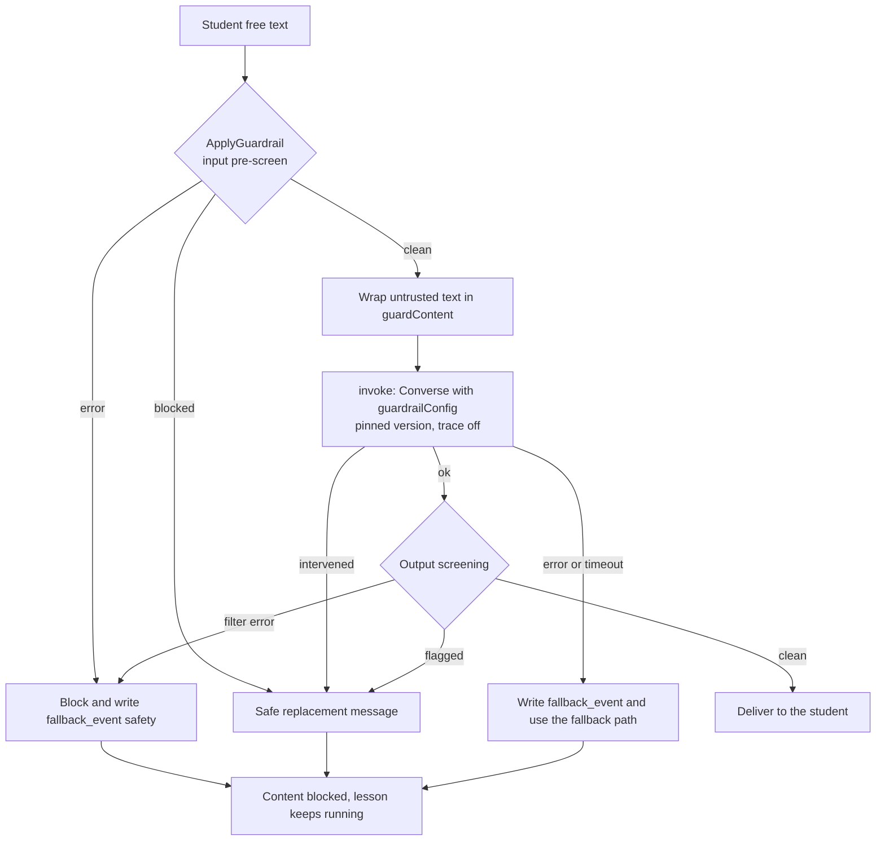

### 2.4 Model access (`invoke`)

**Status:** Proposed. **Serves:** C-27, P-7.2, P-15.3, P-16.

One wrapper, `invoke(task, prompt)`, is the only code that calls Bedrock.

| Task | Model profile (`us-west-2`) |
|---|---|
| verify, validate, Passive reasoner | `us.anthropic.claude-haiku-4-5-20251001-v1:0` |
| codegen, hints, tutor | `us.anthropic.claude-sonnet-4-5-20250929-v1:0` |

- Model ids are read from SSM parameters (2.14), never hard-coded. Nothing in front-end code
  references a model (C-26).
- Verify and codegen use **different models** (P-7.2).
- Every call sets `maxTokens` explicitly and a 10 s timeout. The Bedrock default is the model maximum,
  which wastes quota and cost.
- Runtime IAM allows **only these two profiles**. Both the inference-profile ARN and the
  foundation-model ARN with a wildcard region are required, or calls fail with `AccessDeniedException`.
  The account exposes Opus profiles too, so the allow-list is a cost control.
- `us.` profiles keep inference in US regions (ADR-001). `global.` profiles are not used.
- Newer profiles (`haiku-5-5`, `sonnet-5-5`) are a config swap once the golden set confirms them.
- Each call writes a decision log with: correlation id, task, model id, prompt version hash, Guardrail
  version, guardrail action, latency, token counts. **No student text.**
- Prompts live in `prompts/` and are hashed so every output can be tied to the prompt that produced it.

### 2.5 Validator

**Status:** Proposed. **Serves:** C-13 to C-17, P-19.

- **Multiple choice** with `measures.evidenceLevels`: deterministic map from choice to level. No model
  call (C-13).
- **Project steps:** the LLM judge gets the step condition, the skill's evidence descriptors, the
  student's prompts, and a before/after summary of the project (C-14). The condition comes from
  `validation.condition`, or the `Evidence:` line of `instructionsPrompt` for the project steps
  without one. The skill is `validation.measures.skillId`, else the checkpoint's `skillIds[0]`.
- **Not scored:** `panels` steps, free-response without `measures`, `intro-starter`, `show-it-off`.
  They record completion only (C-15).
- **Output contract** (JSON Schema enforced at runtime, C-16):
  `{ skillId, evidenceLevel (int 0..max), conditionMet, confidence (0..1), evidence (≤240 chars) }`.
  Invalid JSON gets one repair retry, then fallback. `confidence < 0.6` triggers fallback.
- **Launch gate (C-17, P-19.2):** at least 15 human-rated submissions, reporting exact agreement,
  within-1 agreement and quadratic weighted kappa. Default gate: kappa ≥ 0.70. A CI job on `main`
  re-runs the golden set on the pinned model and prompt version and fails below the gate.

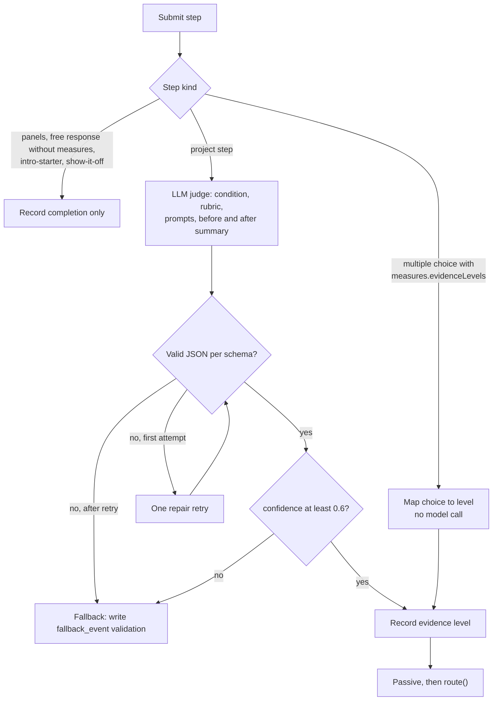

### 2.6 Routing and fallback

**Status:** Proposed. **Serves:** C-18 to C-23, P-8, P-20, P-21.

`route(tree, progress, evidence, teacherInput) -> { checkpointId, reason }` is a **pure function** in
`shared/`, used by both the mock and the backend. No model is involved.

Rules (C-19):
1. *Available* = not completed, and every `requires` checkpoint is completed or tested out.
2. After `intro` (`routeAfterCompletion`), any `skippable` checkpoint whose target is already met by
   diagnostic evidence becomes `tested_out` and counts as done (depth not volume, P-6.5). In the
   current tree the skippable checkpoints are `steer-it` (build ≥ 2), `use-the-lingo` (language ≥ 2)
   and `give-context` (debug ≥ 2).
3. Proposal = the available checkpoint whose skill has the largest gap to target. Ties go to JSON
   order.
4. Teacher input `{ mode: auto | hold | assign, checkpointId? }`. `assign` picks that checkpoint if
   available, `hold` stays, `auto` takes the proposal (P-8.2).
5. Every call writes a `routing_decision` row with a readable `reason`, shown in the UI.

Returned ids must exist in the tree (C-20). Mastery is the per-skill evidence level, which never
decreases (C-9, C-10). A checkpoint completes when its project step is validated at or above target
(default target 1, C-12).

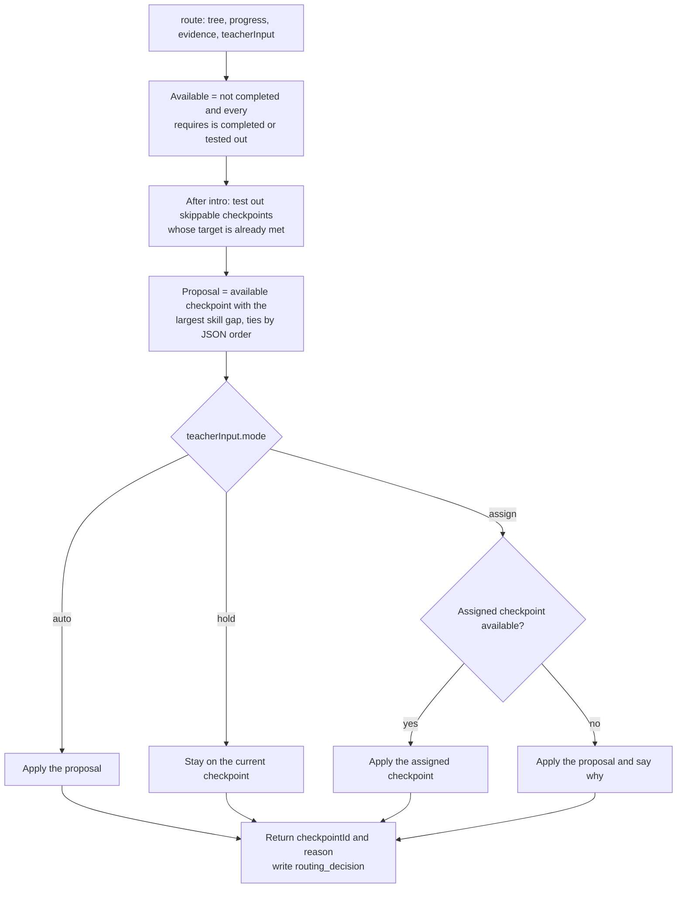

C-19 does not say what happens when a teacher assigns a checkpoint that is not available. The diagram
shows the proposed behavior (keep the proposal and record why in `reason`). **The team should
confirm this**, and the answer goes into C-19 or an ADR.

Checkpoint status in `checkpoint_progress`:

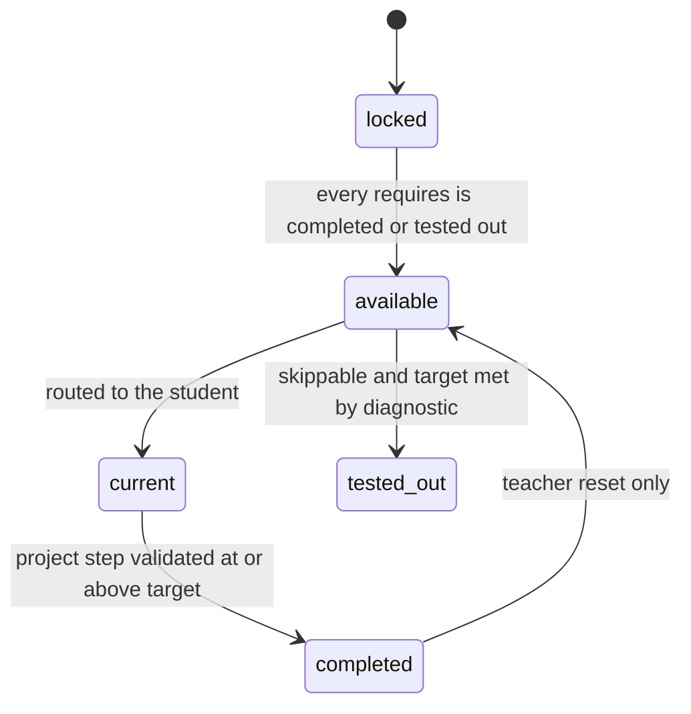

**Fallback** (C-21 to C-23):
- Linear path: JSON checkpoint order, respecting `requires`, no skipping, pre-authored steps only.
- Triggers: validation error, timeout (10 s) or low confidence; routing error or timeout; generation
  failure; safety service error; Passive reasoner failure (rules take over).
- Each trigger writes a `fallback_event` and shows the notice. The UI re-checks health every 30 s or
  less and resumes adaptive mode.

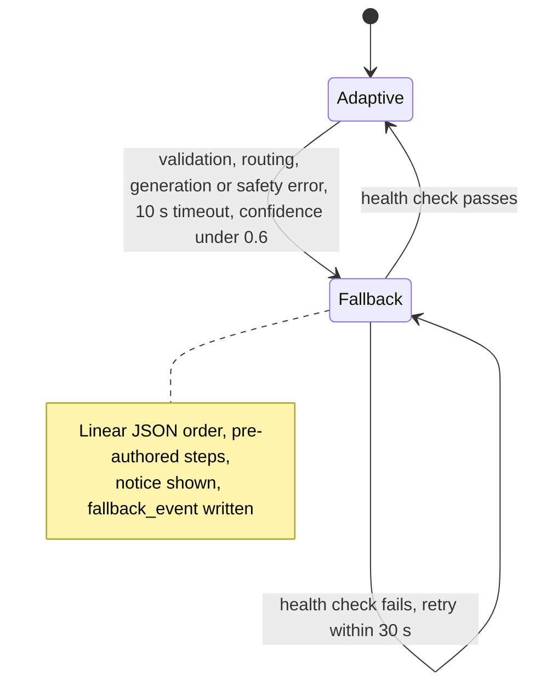

### 2.7 Passive

**Status:** Proposed. **Serves:** C-10, C-27, P-5, P-6, P-8, diagrams 3, 6 to 9, 11.

Passive evaluates a student's **history** and emits a signal. It never talks to the student and never
picks a checkpoint.

**Stage 1, features (deterministic, unit-tested):** per skill and step, derived only from attempt
content and server-side timestamps:
- attempts, time per step against the cohort median, and evidence trend
- hints used, and which explanation angles were already tried
- share of cosmetic edits (colors, fonts), from prompt content
- gaps between attempts, and rapid low-effort submissions

**Stage 2, reasoner (one Haiku call, `temperature 0`):** input is the features, the last ~10 events and
the hint log. Output, schema-validated and restricted to enums:

```
{ signal:    speed_up | slow_down | redirect | reengage | steady,
  hintStyle: guiding_question | example | analogy | step_by_step,
  angleToTry, reason (≤240), evidenceRefs[], confidence }
```

- Results are cached by `features_hash + prompt_version` (cost, repeatability for the demo).
- Confidence below 0.6, or any error, falls back to a **rule-based** version using fixed thresholds,
  and writes `fallback_event` with component `passive`. The rule version is also the CI baseline.
- The model cannot return a checkpoint id. Routing consumes only evidence and teacher input.

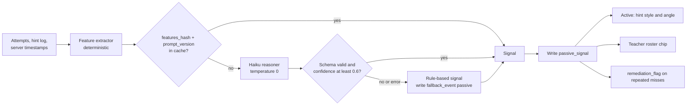

**Effects (the visible adaptation, P-5.3):**
- `speed_up`: fewer scaffolds, guiding questions. The existing test-out rule (not Passive) is what
  skips checkpoints. The teacher sees a "suggest assign" hint.
- `slow_down`: examples, and a rotating explanation angle that has not been used yet. The 2nd
  consecutive miss on a skill creates a `remediation_flag`, severity `high` after four, which alerts
  the teacher (C-10). The skill level never drops.
- `redirect`: a visible nudge away from a non-essential detail, with a 60 s cooldown per checkpoint
  (C-34).
- `reengage`: a gentle check-in.

**Known limitation (ADR-006):** the UI sends no client telemetry (no idle time, tab visibility or
keystroke counts). Inattention is inferred from attempt content and server timestamps only, so it can
look like slow thinking. `reengage` is therefore a low-confidence, gentle check-in and is shown to the
teacher as an observation, not a flag.

**Demo personas:** hand-authored synthetic histories for a quick, a slow and a distracted learner.
Real Passive reasoning runs over them. An LLM student simulator is a stretch goal. Synthetic histories
are labeled as such on screen.

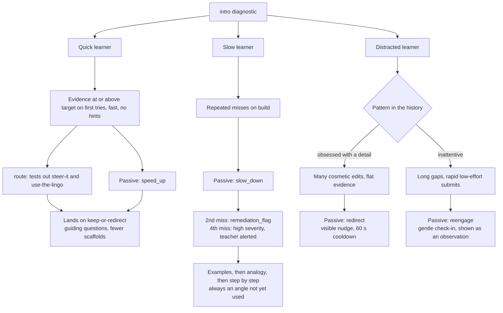

### 2.8 Active agent (tutor, hints, help ladder)

**Status:** Proposed. **Serves:** C-27, C-34, P-5, P-10, diagrams 5, 6, 10, 13.

Active is the only voice the student hears. For Wednesday it is **not** a tool-using agent loop:
- The prompt flow (filter, verify, generate, filter) is a fixed, deterministic pipeline in code
  (diagram 5).
- `/tutor/ask` is a single Sonnet Converse call. Skill level, hint style, angle and recent attempts are
  assembled in code from Passive's signal.
- The help ladder is one ladder (C-34): inline hint, point to the preview, extra hint, "See the answer"
  after the timeout, then an iteration step. The timeout comes from `teacher_config`
  (default 180 s). The teacher can reveal now or send a custom hint.
- Deferred: a Strands tool-using tutor on AgentCore Harness, with Memory (ADR-002).

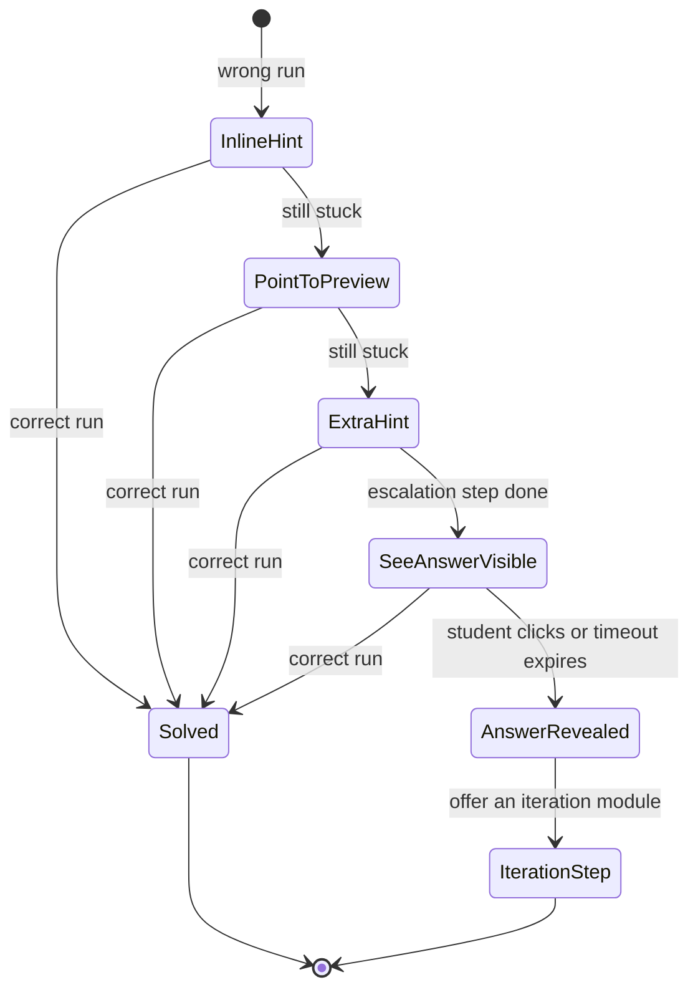

At any rung the teacher can reveal the answer now or send a custom hint. "See the answer" stays hidden
until the escalation step has happened (P-10.5).

### 2.9 Database

**Status:** Proposed. **Serves:** C-8, C-5, C-6, P-14.

**Content** is data in `database/sample-skilltree.json`, bundled with the API and the UI. It is not
copied into JS (C-6). The relational reference model is `database/data-model.mmd`
(`SKILL_TREE`, `SKILL`, `SKILL_EVIDENCE_LEVEL`, `CHECKPOINT`, `CHECKPOINT_REQUIRES`,
`CHECKPOINT_TARGET`, `STEP`, `MEASURE`). IDs are the JSON string slugs (C-5).

**Student state** (snake_case, C-8) lives in DynamoDB, or a JSON file in demo mode. The shapes are the
contract either way.

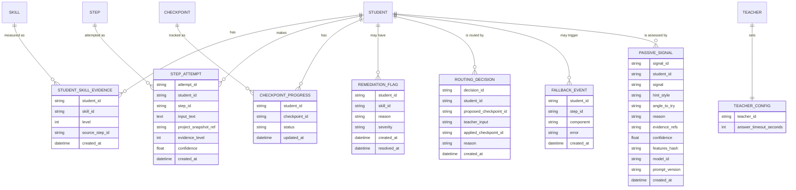

| Table | Notes |
|---|---|
| `student_skill_evidence` | Append-only. Student skill level = max level observed (C-10). |
| `step_attempt` | One row per submit. Holds the input text, so access is restricted and encrypted. |
| `checkpoint_progress` | `status` is `locked`, `available`, `current`, `completed` or `tested_out`. Completion reverses only on a teacher reset (C-12). |
| `remediation_flag` | Two consecutive misses on a skill create one. Severity `high` after four raises a teacher flag. |
| `routing_decision` | Written on every route call, with the reason (C-19.5). |
| `fallback_event` | `component` is `validation`, `routing`, `generation`, `safety` or `passive`. |
| `passive_signal` | **New.** Added by this design (see "Edits to constraints" below). |
| `teacher_config` | `answer_timeout_seconds` defaults to 180. |

**DynamoDB layout (proposed):** partition key `student_id` on every student table, with a sort key of
the form `<kind>#<id>#<timestamp>` so a student's history is one query. A sparse GSI on open
`remediation_flag` rows by severity feeds the teacher roster. `passive_signal` has a lookup on
`features_hash` for the cache. On-demand billing, KMS encryption, point-in-time recovery. The tables are
small, so a single-table design is not needed.

**Edits to constraints** this design depends on, made explicitly in the PR that first needs them:
- C-8: add the `passive_signal` table, and add `passive` to `fallback_event.component`.
- C-33: add Passive reasoning, the three personas and the demo director to the in-scope list.

**Stale doc:** `database/data-model.mmd` does not yet include the student-state tables
(discrepancy checklist item 3).

### 2.10 Observability and explainability

**Status:** Proposed. **Serves:** P-12, C-19.5, C-22.

| Decision | Recorded in | The "why" |
|---|---|---|
| Routing | `routing_decision` and the UI panel | proposal, teacher input, applied checkpoint, reason |
| Validation | `step_attempt` | evidence level, confidence, evidence text, prompt version hash |
| Passive signal | `passive_signal` and the teacher chip | signal, reason, evidence refs, features hash |
| Fallback | `fallback_event` and an alarm | component, error |
| Safety block | structured log and `fallback_event` | Guardrail version, action, category only (no raw text) |
| Agent turn | structured JSON log and X-Ray/OTEL trace | task, model id, prompt hash, Guardrail version, latency, tokens |

- Each request carries a correlation id from the API through every model call and DB write.
- **Dashboard:** error rate, model latency, guardrail blocks, fallbacks, Passive cache hit rate.
- **Alarms:** on the C-22 triggers, plus a cost alarm. The existing account budget is reused.
- **Logs:** KMS-encrypted, 14-day retention, and no student text in logs.
- AgentCore metrics and evaluations arrive with the Harness move (deferred, ADR-002).

### 2.11 Infrastructure as code and CI/CD

**Status:** Proposed. **Serves:** C-38, P-12.3, C-36, C-37.

- One **CDK app** (TypeScript) in one account (`us-west-2`; the account id comes from the
  environment, never the repo), stacks by concern:
  `DataStack`, `AgentsSafetyStack` (Guardrail plus pinned version, model Lambdas, IAM), `ApiStack`,
  `ObservabilityStack`, and later `WebStack` and `PipelineStack` (ADR-007).
- Lambda handlers are plain JS ESM. Shared logic (routing, scoring, schemas) lives in `shared/` and is
  imported by the backend and the front-end mock.
- cdk-nag runs on synth. Runtime roles are separate per function and least-privilege.
- **CI (GitHub Actions, no AWS credentials needed):** lint, unit tests, front-end build, `cdk synth`,
  cdk-nag. Persona regression tests run against the rule baseline. The golden-set kappa gate runs on
  `main` only, to limit model spend.
- **CD:** deploy through CDK Pipelines with a manual approval is a stretch. The fallback is a GitHub
  Actions deploy using an OIDC role. Rollback is redeploying the previous commit.
- Workflow follows CONTRIBUTING.md: short branches, one review, squash merge. Feature freeze at
  3:30 pm Wednesday, after which only fixes land (C-37).
- CDK needs `cdk bootstrap` in `us-west-2` first, which creates IAM roles. It runs only after explicit
  confirmation and a successful permissions check.

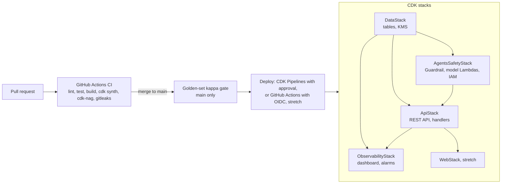

### 2.12 Security and privacy (cross-cutting)

**Serves:** P-13, P-18.5.

- Role-based access: a student cannot read another student's data. Only teachers reach the teacher
  routes. Demo mode relaxes authentication only (C-33).
- Encryption in transit (TLS) and at rest (KMS).
- No secrets, tokens or passwords in logs. Secrets are never committed. Local credentials stay in the
  shell or in `.env.local`, which is gitignored (C-38). Where configuration and secrets live, and the
  rules for handling them, are in 2.14.
- Student code runs only in the sandboxed preview iframe, with no access to platform secrets
  (C-32, P-13.5).
- Student data is not shared commercially (P-18.5). Collect only what is needed (P-13.6).
- Demo histories are synthetic. No real minors' data is used in the demo.

### 2.13 Demo director

**Status:** Proposed. **Serves:** C-33 (to be extended).

A scripted mode for recording a click-through with voiceover, about 6 to 8 minutes:
1. Roster of three students with Passive chips and reasons.
2. Quick learner replay, then test-out and the routing "why".
3. Slow learner misses, then the flag and the angle rotation.
4. Distracted learner, then the redirect nudge.
5. An unsafe prompt is blocked and the lesson continues.
6. An induced outage shows the fallback notice, then recovery.
7. Dashboard and trace of a decision.
8. The kappa number.

Requirements: a scene index with fixed timings, `temperature 0`, a pre-warmed cache, a live-model toggle
that shows when cached results are used, an on-screen "synthetic student histories" label, and a
pre-recording checklist (reset state, warm cache, no credentials on screen).

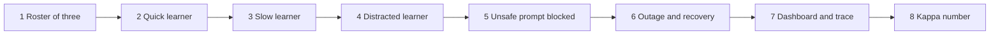

### 2.14 Configuration and secrets

**Status:** Proposed. **Serves:** P-13.4, C-26, C-38, ADR-013. **Related:** 2.4, 2.11, 2.12.

Nothing secret lives in the repo, in the browser bundle, in a CloudFormation template, or in a log.
Anything that varies by environment or that we may need to change lives in AWS.

**Two stores, chosen by what a leak would cost:**
- **SSM Parameter Store** for configuration that is not secret but should change without a code change
  or redeploy.
- **AWS Secrets Manager** for real secrets, encrypted with the project's KMS key. It adds a small
  per-secret monthly charge, so we create one only when a value is genuinely secret.

**Inventory:**

| Item | Kind | Where it lives | Notes |
|---|---|---|---|
| Developer AWS credentials | Secret | Not stored. `aws login` / SSO, or shell environment variables | Short-lived. Never in a file, commit or chat |
| CI access to AWS | Credential | GitHub Actions OIDC role, no stored keys | Only if Task 13 goes the GitHub route |
| Guardrail id and pinned version | Config | SSM parameters, written by `AgentsSafetyStack` | Missing or unreadable means fail closed (see below) |
| Model profile ids (Haiku, Sonnet) | Config | SSM parameters | A model swap is a parameter change (ADR-001, ADR-002) |
| Table, bucket and queue names | Config | CDK references passed as Lambda environment variables | Not secret |
| API base URL | Public config | `VITE_API_BASE_URL` in the front end | Anything `VITE_` is public by design (C-26) |
| Demo API key (usage plan) | Identifier, **not a secret** | API Gateway | It ships in the browser. Treat it as public. Protection comes from throttling and the per-student cap (ADR-012) |
| JWT signing key, third-party tokens | Secret | Secrets Manager | Only needed with real authentication (FULL, Task 19) |
| Password hashes | Data | DynamoDB, salted one-way hash (P-13.4) | Not a secrets-store item |
| GitHub connection for CDK Pipelines | Managed | AWS CodeConnections | Authorized by hand in the console |

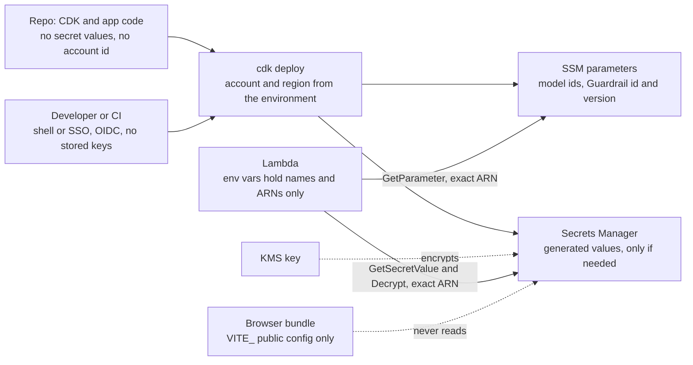

**Rules:**
1. The repo holds no secret values and no AWS account ids. The account and region come from the
   environment at synth time.
2. Front-end configuration is public. Only non-secret `VITE_` values go in the bundle (C-26).
3. A secret value is created in AWS, either generated by Secrets Manager through CDK
   (`generateSecretString`) or set out of band with the CLI. It is never a literal in CDK code, CDK
   context or a CloudFormation parameter, because those appear in templates and the console.
4. Lambda environment variables carry parameter names or ARNs, never secret values.
5. Least privilege per function: `ssm:GetParameter` or `secretsmanager:GetSecretValue` on exact ARNs,
   plus `kms:Decrypt` on the project key. No wildcards.
6. Read once per cold start and cache with a short TTL, so a rotation takes effect without a redeploy
   and without a call per request.
7. Never log a secret, token or password (P-13.4). Decision logs hold ids and hashes only (2.4).
8. Local development: mock mode needs no secrets. Deploy credentials live in the shell, or in
   `.env.local`, which is gitignored (C-38). A committed `.env.example` lists variable **names** only.
   The current `.gitignore` rule `.env.*` also ignores `.env.example`, so add `!.env.example`.
9. Detection in CI: secret scanning with gitleaks on every PR, plus GitHub secret scanning and push
   protection on the repo. A finding fails the build. If a secret is committed, **rotate it**.
   Deleting the commit is not enough.
10. Workshop session credentials are short-lived. Do not paste them into chats, issues or PRs.

**Failure handling:** if the Guardrail parameter cannot be read, the safety module fails closed. It
blocks the content, writes a `fallback_event` with component `safety`, and the lesson continues on the
fallback path (2.3, 2.6). If a model-id parameter cannot be read, the last cached value is used. With
no cached value, `GET /health` reports unhealthy and the UI shows the fallback notice (C-22, C-23).

**Open question:** whether the workshop role may create Secrets Manager secrets and SSM parameters
(Task 0 simulation). If not, non-secret config falls back to Lambda environment variables set by CDK,
and the secret inventory above is empty for the MVP, which is acceptable.

---

## 3. MVP and deferred items

Tags: **MVP** is for Wednesday, **STRETCH** if time allows Wednesday, **FULL** is the later roadmap.
Task numbers match the [implementation plan](./implementation-plan.md), which is the living checklist
for status, owners and blockers. Keep this table and that file in step.

### 3.1 Scope table

| Task | Item | Tier | Notes |
|---|---|---|---|
| 0 | Account preflight (model smoke test, IAM simulation) | MVP | Decides CDK deploy path vs fallbacks |
| 0.5 | Contracts and stubs (five seams, mode switches) | MVP | ADR-014. Gates the parallel work plan, checkpoint IC0 |
| 1 | Repo hygiene and CI skeleton | MVP | C-35, C-36, C-38 |
| 1.5 | This document | MVP | Living doc, C-1 entry, steering pointer |
| 2 | Shared domain core (`route`, evidence, tree loader) | MVP | C-9 to C-12, C-18 to C-20 |
| 3 | Validator contract and eval harness | MVP | C-16, C-17. Start human ratings now |
| 4 | CDK app and `DataStack` | MVP | Bootstrap needs confirmation |
| 4.5 | Configuration and secrets (SSM, Secrets Manager, secret scanning) | MVP | ADR-013, P-13.4, C-26, C-38 |
| 5 | Safety module and Guardrail | MVP | C-25 |
| 6 | `invoke` wrapper and model Lambdas | MVP | C-27 |
| 7 | API stack and submit orchestration | MVP | C-29, spend protection |
| 8a | Passive features, rule baseline, `passive_signal` | MVP | Constraint edits to C-8, C-33 |
| 8b | Passive Haiku reasoner with rule fallback | MVP | |
| 8c | Persona fixtures and visible adaptation | MVP | Roster chips, replay |
| 9 | Frontend services and fallback behavior | MVP | C-28, C-21 to C-23 |
| 10 | Observability and "why" panels | MVP | Reuses the account budget |
| 11 | Golden-set kappa gate in CI | MVP | C-17 |
| 12 | Demo director and recording script | MVP | |
| 13 | Web hosting and deploy pipeline | STRETCH | CDK Pipelines or OIDC deploy |
| 14 | LLM student simulator | STRETCH | Hand-authored fixtures stay the default |
| 15 | AgentCore Harness (Strands) for Active, Verifier, Codegen, with Memory and ADOT | FULL | Behind the same `invoke` signature |
| 16 | Red-team safety evals and agent-quality evals in CI | FULL | Adds per-PR model spend |
| 17 | Passive as an EventBridge-driven service | FULL | Richer classifier |
| 18 | `agent_decision` table, Athena queries, replay view | FULL | Requires a C-8 edit |
| 19 | Cognito auth, multi-environment stages, generated-content path with a quality gate | FULL | Diagram 18 |

### 3.2 Out of scope for the hackathon (from C-33)

Real authentication (demo mode only), CS-standards grading (P-9.3, P-9.4, placeholder only),
teacher help-ladder configuration UI (fixed timeout from `teacher_config`), generated lesson content,
cross-lesson adaptivity, the Progress_Report page, and Deploy.

### 3.3 Deferred decisions and revisit triggers

| Item | Why deferred | Revisit when |
|---|---|---|
| AgentCore Harness / Strands tutor | Preview tooling, session handling and the 10 s budget are risky in one day | The MVP loop is stable and the golden set can score a swap |
| Newer model profiles (`haiku-5-5`, `sonnet-5-5`) | Unknown latency, price and quality | Golden-set kappa on the candidate is at least the current model's |
| Client telemetry for inattention | Questionable value and a privacy cost for minors | There is evidence the signal is useful and a privacy review |
| Full-body invocation logging | Raw minors' text would land in CloudWatch | A redaction pipeline and retention policy exist |
| Multi-account / multi-environment | One workshop account, one day | Post-hackathon hardening |

### 3.4 Open items and risks

- IAM create permissions, model invocation access and who is notified at the budget threshold are
  unverified (section 1.7).
- The golden set needs 15+ human ratings from people. This is the slowest dependency.
- A public demo API without real authentication can burn budget. Throttling and the per-student cap are
  required, not optional.
- CDK Pipelines needs a manual GitHub connection step that may not be permitted.

---

## 4. Architecture decision records

Format: context, decision, alternatives considered, consequences. Status values: `Proposed`,
`Accepted`, `Superseded by ADR-nnn`, `Rejected`. The initial records below were agreed in the planning
session on 2026-11-04 and are **Proposed** until the team reviews them.

### ADR-001: Region `us-west-2` with `us.` inference profiles
- **Status:** Proposed. **Date:** 2026-11-04.
- **Context:** The hackathon account is in `us-west-2`. Students are minors, so data residency matters.
  Claude models in the account are reached through inference profiles.
- **Decision:** Deploy in `us-west-2` and use `us.`-prefixed profiles, not `global.` ones.
- **Alternatives:** `global.` profiles (route anywhere, weaker residency story).
- **Consequences:** Inference stays in US regions. Capacity is limited to the US profile pool.

### ADR-002: Lambda plus Bedrock Converse behind `invoke`; AgentCore Harness deferred
- **Status:** Proposed. **Date:** 2026-11-04.
- **Context:** The original intent was AgentCore Harness (Strands) for the model-backed agents. A
  one-day build with a hard 10 s adaptive timeout makes preview tooling a risk.
- **Decision:** Active, Verifier, Codegen, Validator and Passive's reasoner are Lambdas calling Converse
  through one `invoke(task, prompt)` wrapper (C-27). Harness is the full-solution target. The prompt
  flow stays a fixed pipeline, and `/tutor/ask` is a single call.
- **Alternatives:** Harness on day one. Strands in a Python Lambda for the tutor.
- **Consequences:** Simpler and more predictable now. The later move changes the implementation behind
  one function. Tool-use agent behavior is not demonstrated on Wednesday.

### ADR-003: Layered Guardrails that fail closed
- **Status:** Proposed. **Date:** 2026-11-04.
- **Context:** Req 18 and C-25 require filtering both ways, server-side, without breaking the lesson.
- **Decision:** `ApplyGuardrail` pre-screen, a blanket `guardrailConfig` on every model call, and
  untrusted text in `guardContent`. Pinned numbered Guardrail version, trace off. On filter error,
  block the content, log a `fallback_event`, and keep the lesson running.
- **Alternatives:** A single blanket config. `guardContent` only.
- **Consequences:** Defense in depth and an early cheap rejection, at some extra calls and latency.

### ADR-004: Routing is a pure deterministic function
- **Status:** Proposed. **Date:** 2026-11-04.
- **Context:** P-8.2 requires a precise combining rule. P-21 requires approved content only.
- **Decision:** `route()` is plain code with unit tests and a logged reason (C-18, C-19). No model
  decides routing, and a model cannot return a checkpoint id.
- **Alternatives:** An AI advisor choosing from the available list (validated).
- **Consequences:** Fully explainable and testable. Less flexible than a model-suggested path.

### ADR-005: Passive reasons over history using features plus a Haiku signal, with a rule fallback
- **Status:** Proposed. **Date:** 2026-11-04.
- **Context:** Detecting "over-focused on a non-essential detail" and similar patterns needs judgement
  over a student's history.
- **Decision:** Deterministic feature extraction, then one schema-validated Haiku call at
  `temperature 0`, cached by features hash. Rules take over on error or confidence below 0.6.
- **Alternatives:** Rules only. A full tool-using agent.
- **Consequences:** Real model reasoning that is bounded, repeatable and has a baseline. Passive stays
  signal-only.

### ADR-006: No client telemetry; distraction inferred from content and server timing only
- **Status:** Proposed. **Date:** 2026-11-04.
- **Context:** Idle and revision counters from the browser were considered for detecting inattention.
  They may not be reliable indicators, and the users are minors.
- **Decision:** The UI sends no counters. Passive uses attempt content and server timestamps.
- **Alternatives:** Client idle, tab-visibility and revision counters.
- **Consequences:** Less intrusive and simpler. Inattention can look like slow thinking, so `reengage` is
  low-confidence and shown as an observation.

### ADR-007: One CDK app in one account, stacks split by concern
- **Status:** Proposed. **Date:** 2026-11-04.
- **Context:** C-38 requires infrastructure in CDK. The hackathon has one account.
- **Decision:** One CDK app, with separate stacks for data, agents and safety, API, observability, and
  later web and pipeline. Stacks are separate so a bad deploy cannot take out the tables.
- **Alternatives:** One stack per environment. Multi-account.
- **Consequences:** Clear boundaries and safer rollback. No account-level isolation.

### ADR-008: GitHub Actions for CI; CDK Pipelines for deploy as a stretch
- **Status:** Proposed. **Date:** 2026-11-04.
- **Context:** The repo is on GitHub with a PR workflow. A CodeConnection and extra IAM may not be
  available.
- **Decision:** CI on GitHub Actions needs no AWS credentials. CDK Pipelines handles deploy, approval
  and rollback when permitted. Fallback: GitHub Actions deploy via an OIDC role.
- **Alternatives:** CodePipeline only. GitHub Actions only.
- **Consequences:** PR checks stay where the team works. Deploy may slip to a manual `cdk deploy`.

### ADR-009: Golden-set kappa gate for the validator
- **Status:** Proposed. **Date:** 2026-11-04.
- **Context:** P-19.2 and C-17 require measured agreement with human raters.
- **Decision:** At least 15 human-rated submissions. Report exact, within-1 and quadratic weighted
  kappa. Default gate: kappa ≥ 0.70, run on `main` against a pinned model and prompt version.
- **Alternatives:** Deterministic tests only. Run on every PR.
- **Consequences:** A visible quality number for the demo. Model spend is limited to `main`. Needs human
  rating effort.

### ADR-010: TypeScript for CDK, plain JS ESM for Lambdas and shared code
- **Status:** Proposed. **Date:** 2026-11-04.
- **Context:** The front end is JavaScript (C-30). Routing and scoring must run in both the mock and
  the backend.
- **Decision:** CDK in TypeScript. Lambdas and `shared/` in plain JS ESM with JSDoc types.
- **Alternatives:** Python Lambdas. TypeScript Lambdas.
- **Consequences:** One language for runtime code, shared with the UI. Type safety comes from JSDoc and
  tests.

### ADR-011: No full-body Bedrock invocation logging
- **Status:** Proposed. **Date:** 2026-11-04.
- **Context:** Guardrail PII masking changes only the API response. Invocation logging would write raw
  minors' text to CloudWatch.
- **Decision:** Leave full-body invocation logging off. Log ids, hashes and decisions. KMS-encrypt logs
  and keep them 14 days.
- **Alternatives:** Full logging with redaction.
- **Consequences:** Strong privacy position. Debugging relies on hashes, decision records and traces
  instead of replaying raw prompts.

### ADR-012: Spend protection for a public demo API
- **Status:** Proposed. **Date:** 2026-11-04.
- **Context:** Demo mode has no real authentication, and the account cap is $500.
- **Decision:** REST API with stage throttling and a usage plan, a per-student call cap, `maxTokens` on
  every call, an IAM allow-list of only the two model profiles, and reuse of the existing account
  budget.
- **Alternatives:** WAF. Real authentication.
- **Consequences:** A bounded worst case at low cost. Real authentication stays in the full roadmap.
- **Aurora note (ADR-016):** Aurora is the most expensive item in the account, so the demo default is
  `STORE_MODE=json` and the Aurora cluster is scale-to-zero. Deploy it when needed and tear it down
  after the demo. If a live demo must hit Aurora, the 0.5-ACU floor avoids the resume delay at the cost
  of always-on spend; set a teardown reminder either way.

### ADR-013: Configuration in SSM Parameter Store, secrets in Secrets Manager, nothing in the repo
- **Status:** Proposed. **Date:** 2026-11-04.
- **Context:** The repo is meant to go public before judging (C-38). Students are minors and the
  account has a spend cap. Account ids, model ids, the Guardrail id and any future signing keys must
  not be hard-coded, and a leaked key must be recoverable.
- **Decision:** Non-secret configuration that should change without a redeploy lives in SSM Parameter
  Store. Real secrets live in Secrets Manager, encrypted with the project KMS key, and are generated in
  AWS rather than written in code. Lambda environment variables hold names and ARNs, never secret
  values. Per-function least-privilege IAM, short-TTL caching, gitleaks in CI, and GitHub push
  protection. Developers and CI use short-lived credentials (shell/SSO, OIDC), never stored keys.
- **Alternatives:** Secret values in Lambda environment variables (visible in the console and in
  templates). Secrets Manager for everything (extra cost for non-secrets). Encrypted secrets committed
  with SOPS (keeps secrets in the repo).
- **Consequences:** Config is changeable without redeploy and a leak has a rotation path. It adds IAM
  and a small cold-start fetch, and it is only as strong as the role permissions Task 0 confirms. The
  demo API key ships in the browser, so it is an identifier and not a secret. This is a known limit
  that ADR-012's throttling and per-student cap exist to cover.

### ADR-014: Contracts first, with stubs and mode switches, so components build in parallel
- **Status:** Proposed. **Date:** 2026-11-04.
- **Context:** The first plan chained most tasks (domain core, then models, then API, then UI), which
  lets only two or three people work at once. The hackathon has about five people and one day.
- **Decision:** Freeze thin contracts at five seams (1.8) at the start (Task 0.5, checkpoint IC0). Every
  seam gets a stub and a contract test that runs against both stub and real. Three mode switches
  (`VITE_SERVICE_MODE`, `MODEL_MODE`, `STORE_MODE`) choose stub or real. Work is split into tracks that
  own directories, and tracks meet at numbered integration checkpoints.
- **Alternatives:** Keep the sequential order. Vertical slices per person (each person builds one
  feature through every layer), which avoids early contracts but collides in shared files.
- **Consequences:** A short serial step (the contracts) at the start, in return for most work running
  in parallel afterwards. A working mock-only demo exists from the first integration checkpoint, which is
  a fallback if AWS access never works. The cost is discipline: contract changes need a coordinated PR,
  and stubs must be kept honest by running the same contract tests against them.

### ADR-015: Python for the backend domain core and store; front end stays JavaScript
- **Status:** Proposed. **Date:** 2026-11-04.
- **Context:** The customer technical document lists Python as a permitted language and Rails as the
  production framework; the customer confirmed Python is acceptable in place of Rails. Amending the
  backend-language half of ADR-010 (which assumed JS Lambdas).
- **Decision:** The backend domain core (`shared/core/`) and the store adapters (`backend/store/`) are
  Python. The front end stays React 18 + Vite + JavaScript (C-30 unchanged). CDK stays TypeScript
  (ADR-010 for infra is unaffected). The merged contract **schemas** in `shared/contracts/schemas/` are
  language-neutral JSON Schema and remain the single source of truth; Python validates against them with
  `jsonschema`, the JS side with Ajv. The front-end mock keeps a JS implementation of the domain core.
- **Alternatives:** Keep the whole backend in JS (less aligned with the customer stack). Rewrite the
  merged JS contract layer in Python (throws away working, tested code).
- **Consequences:** Two implementations of `route()` and the feature extractor exist — Python for the
  backend, JS for the front-end mock — but both are validated against one set of schemas and fixtures,
  so they cannot drift in shape. CI gains a Python job (pytest) alongside the JS job. This supersedes the
  Lambda-language part of ADR-010; ADR-010's CDK-in-TypeScript decision stands.

### ADR-016: Aurora as the system of record
- **Status:** Proposed. **Date:** 2026-11-04.
- **Context:** The customer technical document states "Aurora is the system of record" (Aurora-compatible
  SQL, accessed from the application tier). This outranks the earlier DynamoDB default, because the
  customer technical document sits high in the C-1 precedence order. The account has a $500 cap and the
  design favours scale-to-zero.
- **Decision:** Student state lives in **Aurora Serverless v2 (PostgreSQL), scale-to-zero, accessed via
  the RDS Data API**. The C-8 tables map to SQL tables (they were always snake_case). The store seam is
  unchanged: the repository interface already abstracts storage, so only the adapter changes
  (`aurora-repository`), and `STORE_MODE` gains `aurora` while `json` stays the demo default. The Data
  API means no connection pooling, no VPC access for Lambdas, and no DB password in anyone's hands (IAM
  plus a Secrets Manager secret).
- **Alternatives:** DynamoDB on-demand (cheaper at rest, but not the customer's system of record).
  Aurora Serverless v2 with a 0.5-ACU floor (no resume delay, but always-on cost). Provisioned Aurora
  (always-on, least aligned with sustainability).
- **Consequences:** Honors the customer preference and keeps the relational model. The tradeoff is a
  resume delay on the first query after idle, which can touch the 10 s adaptive budget (C-22) in a demo
  that sits idle; if a live demo must hit Aurora, switch to the 0.5-ACU floor and set a teardown
  reminder. Aurora is the most expensive item in the account, so the demo default stays `STORE_MODE=json`
  and Aurora is the deployed, proven path. Spend protection in ADR-012 gains an Aurora note.

### ADR template

```
### ADR-nnn: Title
- **Status:** Proposed | Accepted | Superseded by ADR-nnn | Rejected. **Date:** YYYY-MM-DD.
- **Context:** What forces this decision? Cite P-, F- and C- ids.
- **Decision:** What we chose.
- **Alternatives:** What else we considered.
- **Consequences:** What gets easier, what gets harder, what we now must do.
```

---

## Change log

| Date | PR | Change |
|---|---|---|
| 2026-11-04 | (initial) | First draft from the planning session. All designs Proposed, ADR-001 to ADR-012 Proposed. |
| 2026-11-04 | #11 | Redacted the AWS account id. Added 2.14 Configuration and secrets, ADR-013, and Task 4.5. |
| 2026-11-04 | #11 | Added 11 diagrams (safety, validator, routing, checkpoint status, fallback, Passive pipeline, personas, help ladder, stacks and CI/CD, demo scenes, secrets). Fixed a syntax error in the system context diagram. All 15 diagrams parse. |
| 2026-11-04 | #11 | Added 1.8 Seams, contracts and modes, ADR-014, and Task 0.5, to support parallel work by component with integration checkpoints. |
| 2026-11-04 | (domain core PR) | Added ADR-015 (Python backend) and ADR-016 (Aurora system of record). Noted C-30 governs the front end only. Aurora note on ADR-012. The 2.9 Database and 2.11 IaC rewrites and the data-model diagram come in the Aurora data PR. |
