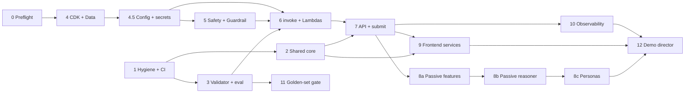

# CodeAI Implementation Plan

A living checklist. Tick items as they land and keep this file in step with the work, in the same PR
that does the work (C-36). The design behind each task is in
[`architecture.md`](./architecture.md). The rules are in
[`../constraints/implementation-constraints.md`](../constraints/implementation-constraints.md).

| | |
|---|---|
| Status | **Draft, pending team review.** |
| Last updated | 2026-11-04 |
| Target | Working demo by the 3:30 pm Wednesday feature freeze (C-37), full roadmap after |
| Account | Hackathon account (id kept out of the repo), `us-west-2`, $500 cap (budget `hackathon-budget-<account-id>`) |

## How to use this file

- `- [ ]` is open and `- [x]` is done. Tick the box in the PR that completes the item.
- Put your name on a task before you start it (`Owner:`), and note a blocker inline as `BLOCKED: reason`.
- Tiers: **MVP** is for Wednesday. **STRETCH** only if MVP is demoable. **FULL** is the later roadmap.
- A task is done when its deliverables are ticked, its tests pass in CI, and its **Demo** line works.
- Moving work between tiers, adding a task, or changing a task's scope: edit this file and the table
  in `architecture.md` section 3 together.
- Every PR names the P-/F- requirements and C- constraints it touches (C-36).
- Do not tick a box you have not verified. If you could not verify something, say so next to it.

## Progress

| Tier | Done | Total |
|---|---|---|
| MVP | 0 | 17 |
| STRETCH | 0 | 2 |
| FULL | 0 | 5 |

Update the counts when you tick a task's top-level box.

## Order of work and dependencies



Tasks 1, 2, 3 and 9's mock side need no AWS access, so they can start immediately. Tasks 4 to 7 wait
on Task 0.

---

## MVP

### Task 0: Account preflight (MVP)
Owner: ____ · Serves: ADR-001, ADR-007, ADR-008 · Architecture: 1.7

Run these in your own shell. They only read, apart from one tiny model call. Never paste keys into the
repo or a chat.

- [x] Identity: `aws sts get-caller-identity` returns `WSParticipantRole` in the hackathon account
- [x] Region is `us-west-2`
- [x] Claude `us.` inference profiles are listed (Haiku 4.5, Sonnet 4.5)
- [x] `aws bedrock list-guardrails` works and returns none
- [x] Budget `hackathon-budget-<account-id>` exists ($500/month)
- [x] `CDKToolkit` is absent in `us-west-2` (not bootstrapped)
- [ ] Model access: Haiku smoke test succeeds
  `aws bedrock-runtime converse --region us-west-2 --model-id us.anthropic.claude-haiku-4-5-20251001-v1:0 --messages '[{"role":"user","content":[{"text":"Say OK"}]}]' --inference-config '{"maxTokens":10}'`
- [ ] Sonnet 4.5 smoke test succeeds (same command, Sonnet profile id)
- [ ] `aws iam simulate-principal-policy` for `iam:CreateRole`, `iam:PassRole`, `lambda:CreateFunction`,
  `dynamodb:CreateTable`, `apigateway:POST`, `bedrock:CreateGuardrail`, `cloudformation:CreateStack`,
  `s3:CreateBucket`, `kms:CreateKey`, `ssm:PutParameter`, `secretsmanager:CreateSecret` is recorded
  below
- [ ] `aws iam list-attached-role-policies --role-name WSParticipantRole` is recorded below
- [ ] Ask the organizers who is notified when the budget trips
- [ ] Decide the path from the answers (go/no-go below)

Results (fill in, no secrets):

| Check | Result |
|---|---|
| Haiku invoke | |
| Sonnet invoke | |
| `iam:CreateRole` | |
| `bedrock:CreateGuardrail` | |
| `ssm:PutParameter` | |
| `secretsmanager:CreateSecret` | |
| `cloudformation:CreateStack` | |
| Attached policies | |
| Budget notification contact | |

Fallbacks:
- `iam:CreateRole` denied: use organizer-provided roles, and keep CDK synth-only in CI.
- `bedrock:CreateGuardrail` denied: an organizer creates the Guardrail, and we reference its id in
  config.
- `ssm:PutParameter` or `secretsmanager:CreateSecret` denied: non-secret config falls back to Lambda
  environment variables set by CDK. The MVP has no true secrets, so nothing else is lost (Task 4.5).
- Model invoke denied: complete the Anthropic use-case form first, or develop on mocks.

**Demo:** a go/no-go list in the PR description.

### Task 1: Repo hygiene and CI skeleton (MVP)
Owner: ____ · Serves: C-35, C-36, C-37, C-38 · Discrepancy items 1, 2

- [x] `.gitattributes` with `* text=auto eol=lf` pushed to `main` (`f67c681`)
- [x] Confirmed no CRLF churn in this checkout (`git add --renormalize .` is a no-op here)
- [ ] Teammates with CRLF churn have synced (`git diff --ignore-cr-at-eol` is empty, then discard)
- [ ] Rename `package.json` `name` from `login-app` to `codeai-adaptive`
- [ ] Add Vitest and a first passing test
- [ ] Add lint (ESLint) and a `npm run lint` script
- [ ] GitHub Actions workflow on PRs: lint, test, `vite build`
- [ ] `.env.local` is in `.gitignore` (the `.env.*` rule already covers it)
- [ ] Add `!.env.example` to `.gitignore` and commit an `.env.example` with variable **names** only
- [ ] Docs check in CI: parse every ```` ```mermaid ```` block in `docs/` so a broken diagram fails the PR
  (a syntax error in the system context diagram was caught by hand on 2026-11-04)
- [ ] Secret scanning in CI: gitleaks on every PR, failing the build on a finding
- [ ] GitHub secret scanning and push protection enabled on the repo (needs repo admin)
- [ ] Scan the existing history once for leaked keys or the AWS account id and report the result
- [ ] Add a `LICENSE` (default MIT-0) before judging
- [ ] Branch protection expectations agreed (one review, squash merge)

**Tests:** the workflow passes on a trivial test. **Demo:** a PR with a green check.

### Task 1.5: Architecture and plan documents (MVP)
Owner: ____ · Serves: C-1, C-36

- [x] `docs/architecture/architecture.md` drafted (overview, 13 components, MVP table, ADR-001 to 012)
- [x] `docs/architecture/implementation-plan.md` drafted (this file)
- [x] C-1 precedence lists the architecture document
- [x] `.kiro/steering/architecture.md` pointer added
- [ ] Team review of both documents; ADRs moved from Proposed to Accepted or revised
- [ ] Mermaid diagrams render in GitHub preview
- [ ] Each component section marked `Built` as its task lands

**Demo:** the documents are on `main` and linked from the README.

### Task 2: Shared domain core (MVP)
Owner: ____ · Serves: C-5, C-6, C-9 to C-12, C-18 to C-20 · Discrepancy items 7, 9 · Architecture: 2.6

- [ ] `shared/` module (plain JS ESM with JSDoc types)
- [ ] Tree loader and validator for `database/sample-skilltree.json`
- [ ] Monotonic evidence per skill (max observed, never decreases)
- [ ] Display-only 0 to 100 score (`round(100 × level / max)`)
- [ ] `route(tree, progress, evidence, teacherInput)` returns `{ checkpointId, reason }`
- [ ] Available = not completed and every `requires` is completed or tested out
- [ ] Skippable test-out after `intro` (`steer-it`, `use-the-lingo`, `give-context`)
- [ ] Largest skill gap wins, ties go to JSON order
- [ ] Teacher `hold` and `assign` (assign only if available)
- [ ] Returned ids verified to exist in the tree (C-20)
- [ ] Default target 1 when a checkpoint has no `targetEvidenceLevels` (C-12)

**Tests:** table-driven, one case per C-19 rule, plus the id-exists check.
**Demo:** `npm test` prints routing decisions with reasons.

### Task 3: Validator contract and eval harness (MVP)
Owner: ____ · Serves: C-13 to C-17, P-19 · Discrepancy items 8, 16 · Architecture: 2.5

- [ ] JSON Schema for `{ skillId, evidenceLevel, conditionMet, confidence, evidence }`
- [ ] Parse with one repair retry, then fallback
- [ ] `confidence < 0.6` triggers fallback
- [ ] Multiple-choice answers map to levels with no model call (C-13)
- [ ] Not-scored steps record completion only (C-15)
- [ ] Condition source: `validation.condition`, else the `Evidence:` line of `instructionsPrompt`
- [ ] Metrics: exact agreement, within-1 agreement, quadratic weighted kappa
- [ ] Golden-set runner
- [ ] Prompts in `prompts/` with version hashes
- [ ] Human rating started: 15+ project submissions rated by people (**slowest dependency**)
- [ ] `codeai-starter/contracts/model-contract.yaml` located and re-shaped (not in this repo; find it or
  create the contract here and note it)

**Tests:** kappa against hand-computed values, schema accept and reject cases, stubbed retry and
fallback paths. **Demo:** the eval prints three agreement numbers on fixtures.

### Task 4: CDK app and DataStack (MVP)
Owner: ____ · Serves: C-8, C-38, P-13 · Discrepancy item 3 · Architecture: 2.9, 2.11 · Blocked by: Task 0

- [ ] CDK app skeleton (TypeScript), stacks by concern
- [ ] `DataStack`: the C-8 tables plus `passive_signal`, on-demand, KMS, point-in-time recovery
- [ ] JSON-file adapter for demo mode with the same shapes
- [ ] cdk-nag and `cdk synth` in CI
- [ ] `database/data-model.mmd` gains the student-state tables
- [ ] `cdk bootstrap` for `us-west-2` (**needs explicit confirmation first; creates IAM roles**)
- [ ] First deploy of `DataStack` (if Task 0 allows)

**Tests:** CDK assertion tests for tables and encryption. **Demo:** synth passes in CI; deploy if
permitted.

### Task 4.5: Configuration and secrets (MVP)
Owner: ____ · Serves: P-13.4, C-26, C-38 · ADR-013 · Architecture: 2.14 · Blocked by: Task 4

Keeps secrets and environment-specific values out of the repo and in AWS.

- [ ] KMS key for config and secrets (in `DataStack`, shared by the other stacks)
- [ ] SSM parameters for the model profile ids (Haiku 4.5, Sonnet 4.5)
- [ ] SSM parameters for the Guardrail id and pinned version, written by `AgentsSafetyStack`
- [ ] Account id and region read from the environment at synth time; none in the repo or in CDK context
- [ ] Shared `getConfig(name)` and `getSecret(name)` helpers: read at cold start, short-TTL cache, never
  log values
- [ ] Per-function IAM on exact parameter and secret ARNs, plus `kms:Decrypt` (no wildcards)
- [ ] Lambda environment variables hold names and ARNs only
- [ ] Secrets Manager secret created through CDK with a **generated** value, added only when a real
  secret exists (none required for the MVP; the mechanism must be ready for Task 19)
- [ ] Failure behavior: unreadable Guardrail parameter fails closed with a `fallback_event` (safety);
  unreadable model id uses the cached value, else `GET /health` reports unhealthy
- [ ] Front end reads only `VITE_`-prefixed public config (`VITE_API_BASE_URL`)
- [ ] Document the "demo API key is public" limitation next to the throttling setup (Task 7)
- [ ] Fallback path if Task 0 denies SSM or Secrets Manager: Lambda environment variables from CDK

**Tests:** CDK assertions that no Lambda environment variable holds a secret-looking value and that no
policy grants wildcard parameter or secret access; helper tests for caching and for a missing value;
gitleaks passes on the branch. **Demo:** change the model id parameter, show the next call use the new
model with no redeploy.

### Task 5: Safety module and Guardrail (MVP)
Owner: ____ · Serves: C-25, C-26, P-18 · Discrepancy item 10 · Architecture: 2.3 · Blocked by: Task 4.5

- [ ] Guardrail in `AgentsSafetyStack`: content filters, prompt-attack filter, PII filter, K-12 strengths
- [ ] Pinned numbered Guardrail version (never `DRAFT`)
- [ ] `screenInput` using `ApplyGuardrail`
- [ ] `guardContent` wrapping for all untrusted text
- [ ] `screenOutput` before display
- [ ] Fail closed: block, write `fallback_event` (safety), keep the lesson running
- [ ] `trace` disabled
- [ ] Red-team fixture set (injection, age-inappropriate, PII)

**Tests:** mocked-client tests for block, pass and error. **Demo:** an unsafe prompt yields a safe
replacement and the lesson continues.

### Task 6: `invoke` wrapper and model Lambdas (MVP)
Owner: ____ · Serves: C-14, C-27, P-7.2 · Discrepancy item 11 · Architecture: 2.4, 2.5, 2.8

- [ ] `invoke(task, prompt)` is the only Bedrock caller
- [ ] Model ids read through `getConfig` from SSM (Haiku 4.5 for verify/validate/Passive, Sonnet 4.5 for
  codegen/hints), never hard-coded (Task 4.5)
- [ ] `maxTokens` and a 10 s timeout on every call
- [ ] `guardrailConfig` on every call
- [ ] Verify and codegen use different models
- [ ] Runtime IAM allows only the two profiles (inference-profile ARN and wildcard-region model ARN)
- [ ] Decision log per call: correlation id, task, model id, prompt hash, Guardrail version, latency,
  tokens, and no student text
- [ ] Verifier, Codegen, Validator and Active Lambdas

**Tests:** wrapper tests for timeout, throttle and guardrail block. **Demo:** a prompt goes through
verify, generate and validate.

### Task 7: API stack and submit orchestration (MVP)
Owner: ____ · Serves: C-24, C-29, P-11, P-1.4 · Architecture: 2.2

- [ ] REST API with stage throttling and a usage plan
- [ ] Per-student call cap in the handler
- [ ] `POST /steps/{id}/submit`: filter, validate or direct-map, persist, Passive, route
- [ ] `POST /tutor/ask`, `POST /prompts/verify`, `POST /prompts/generate`
- [ ] `GET /teacher/students`, `POST /teacher/students/{id}/routing`, `GET /health`
- [ ] P-11 endpoints
- [ ] Headers per P-1.4; error shape `{ "error": { "code", "message" } }`; camelCase JSON
- [ ] Student work persisted before any model call returns (C-24)
- [ ] 10 s timeouts on adaptive calls

**Tests:** handler tests with stubs and a response-shape contract test.
**Demo:** one `curl` returns evidence, next checkpoint and the reason.

### Task 8a: Passive features, rule baseline and store (MVP)
Owner: ____ · Serves: C-10, C-27, P-5, P-6 · Architecture: 2.7, 2.9

- [ ] Constraints edit: add the `passive_signal` table and the `passive` component to C-8
- [ ] Constraints edit: add Passive reasoning, personas and demo director to C-33
- [ ] Feature extractor from attempt content and server timestamps only (ADR-006)
- [ ] Rule thresholds producing the signal
- [ ] `passive_signal` writes
- [ ] `remediation_flag`: 2nd consecutive miss creates it, `high` after four
- [ ] Wired after submit

**Tests:** unit tests per feature; sequence tests where the skill level never drops and two misses
raise a flag. **Demo:** repeated misses produce a flag in the roster.

### Task 8b: Passive Haiku reasoner (MVP)
Owner: ____ · Serves: C-27, ADR-005 · Architecture: 2.7

- [ ] One Haiku call at `temperature 0` over features, ~10 recent events and the hint log
- [ ] Output schema-validated and restricted to enums
- [ ] Cache by `features_hash + prompt_version`
- [ ] Confidence below 0.6 or any error falls back to rules and writes `fallback_event` (passive)
- [ ] The model cannot return a checkpoint id

**Tests:** stubbed-model tests, a schema fuzz test, and a check that no checkpoint id can leak.
**Demo:** the same history gives the same signal and reason; a forced failure falls back to rules.

### Task 8c: Persona fixtures and visible adaptation (MVP)
Owner: ____ · Serves: P-5.3, C-34 · Discrepancy item 14 · Architecture: 2.7, 2.8

- [ ] Hand-authored synthetic histories: quick, slow, distracted (obsessed and inattentive variants)
- [ ] Teacher roster chips: signal, reason, evidence
- [ ] Active hint style and angle rotation driven by the signal
- [ ] Visible redirect nudge with a 60 s cooldown per checkpoint
- [ ] Replay control that steps through a persona's events
- [ ] Quick learner is tested out of `steer-it` and `use-the-lingo` and lands on `keep-or-redirect`
- [ ] Slow learner gets a flag and an angle not yet used
- [ ] On-screen "synthetic student histories" label

**Tests:** persona regression tests asserting expected signal and route; rule baseline in CI, live
model on `main`. **Demo:** the roster shows three different paths with reasons.

### Task 9: Frontend services and fallback (MVP)
Owner: ____ · Serves: C-21 to C-23, C-28, C-30, C-32 · Discrepancy items 4, 5, 6, 12, 13, 15 · Architecture: 2.1, 2.6

- [ ] `src/services/` with one function per call and `types.js` (JSDoc)
- [ ] Mock implementations (move `engine.js` in; routing swapped for `shared/route`)
- [ ] HTTP implementations behind the same signatures; env switch
- [ ] Mock error and hang toggles
- [ ] Components no longer call the engine or `fetch` directly
- [ ] Replace `courseData.js` with checkpoints and steps loaded from the JSON (C-6, C-7)
- [ ] `skillTreeData.js` keyed by checkpoint id; fix "Load with the point" to "Lead with the point";
  node state computed from progress (C-5)
- [ ] Mastery shown as evidence levels; 0 to 100 is display only
- [ ] Preview iframe uses `srcdoc` with `sandbox="allow-scripts"`, never `allow-same-origin` (C-32)
- [ ] Deploy button hidden
- [ ] `Login.jsx` becomes an explicit demo mode with both roles side by side
- [ ] Fallback notice, linear path, 30 s health re-check, automatic resume
- [ ] Teacher view: roster with mastery and flags, plus hold/assign control

**Tests:** service tests with a mocked `fetch`; a fallback state-machine test.
**Demo:** API off shows the notice while the lesson keeps working; then it recovers.

### Task 10: Observability and "why" surfaces (MVP)
Owner: ____ · Serves: P-12, C-22 · Architecture: 2.10

- [ ] `ObservabilityStack`: dashboard (error rate, model latency, guardrail blocks, fallbacks)
- [ ] Alarms on the C-22 triggers
- [ ] Cost alarm; reuse the existing account budget
- [ ] KMS-encrypted logs, 14-day retention, no student text
- [ ] Full-body Bedrock invocation logging left off (ADR-011)
- [ ] X-Ray/OTEL traces with a correlation id across calls
- [ ] UI "why this checkpoint" and "why this hint" panels

**Tests:** assertion tests for alarms and retention. **Demo:** trigger a fallback and see it on the
alarm, the dashboard and the UI.

### Task 11: Golden-set gate in CI (MVP)
Owner: ____ · Serves: C-17, P-19.2 · Architecture: 2.5

- [ ] CI job on `main` runs the validator on the pinned model and prompt version
- [ ] Fails below kappa 0.70 (exact, within-1 and quadratic weighted kappa reported)
- [ ] The kappa number is available for the demo

**Tests:** the gate passes and fails correctly on fixtures. **Demo:** the pipeline shows the value.

### Task 12: Demo director and recording script (MVP)
Owner: ____ · Serves: C-33 (extended) · Architecture: 2.13

- [ ] Scene index with fixed timings
- [ ] `temperature 0` and a pre-warmed cache
- [ ] Live-model toggle that shows when a cached result is used
- [ ] Written scene script with voiceover cues (about 6 to 8 minutes)
- [ ] Pre-recording checklist: reset state, warm cache, no credentials on screen
- [ ] Two consecutive runs produce identical scene outputs

Scenes: roster of three · quick learner · slow learner · distracted learner · unsafe prompt blocked ·
induced outage and recovery · dashboard and trace · kappa number.

**Demo:** the full run, recorded.

---

## STRETCH

### Task 13: Web hosting and deploy pipeline (STRETCH)
Owner: ____ · Serves: P-12.3 · ADR-008 · Blocked by: Task 0

- [ ] `WebStack` (S3 and CloudFront)
- [ ] `PipelineStack` with CDK Pipelines and a manual approval (or a GitHub Actions deploy via an OIDC
  role if the connection or IAM is blocked)
- [ ] Rollback by redeploying the previous commit
- [ ] Post-deploy smoke test on `GET /health`

**Demo:** merge to `main` and watch the app update.

### Task 14: LLM student simulator (STRETCH)
Owner: ____

- [ ] Haiku plays each persona against the live system
- [ ] Outputs pass the Guardrail and a human review before becoming fixtures
- [ ] Schema and persona-consistency checks
- [ ] Hand-authored fixtures remain the demo default

**Demo:** a freshly generated history produces the expected signal.

---

## FULL (after Wednesday)

- [ ] **Task 15:** AgentCore Harness (Strands) for Active, Verifier and Codegen behind the same `invoke`
  signature, with Memory and ADOT traces (supersedes ADR-002)
- [ ] **Task 16:** red-team safety evals and agent-quality evals in CI
- [ ] **Task 17:** Passive as an EventBridge-driven service with a richer classifier
- [ ] **Task 18:** `agent_decision` table, Athena queries, replay view (needs a C-8 edit)
- [ ] **Task 19:** Cognito authentication, multi-environment stages, generated-content path with a
  quality gate (diagram 18)

---

## Constraint and document edits to make explicitly

Make each in the PR that first needs it, and say so in the PR description.

- [x] C-1: architecture document added to precedence
- [ ] C-8: add the `passive_signal` table and `passive` to `fallback_event.component` (Task 8a)
- [ ] C-33: add Passive reasoning, personas and the demo director to in-scope (Task 8a)
- [ ] C-33: record "no client telemetry" as a decision (Task 8a)
- [ ] Discrepancy items 17 and 18 (stale data-model docs, frontend spec) after the demo

## Discrepancy checklist mapping

The 18 items in [`../constraints/discrepancy-checklist.md`](../constraints/discrepancy-checklist.md)
are done inside these tasks. Tick them there as well.

| Item | Task |
|---|---|
| 1 Line endings | 1 |
| 2 Rename package | 1 |
| 3 Student-state tables | 4 |
| 4 Service layer | 9 |
| 5 Replace invented lesson | 9 |
| 6 Skill-tree ids and states | 9 |
| 7 Evidence-level mastery | 2, 9 |
| 8 Validation for the real tree | 3, 6 |
| 9 Routing rewrite | 2 |
| 10 Content filtering | 5 |
| 11 Split verify and codegen | 6 |
| 12 Preview runs JavaScript | 9 |
| 13 Hide Deploy | 9 |
| 14 Minimal teacher view | 8c, 9 |
| 15 Demo-mode login | 9 |
| 16 Model contract | 3 |
| 17, 18 Doc updates | After the demo |

## Risks and open items

- [ ] IAM create permissions and model access unverified until Task 0 is finished
- [ ] 15+ human ratings for the golden set (people, start in the morning)
- [ ] Budget notification contact unknown
- [ ] Public demo API without real authentication can burn budget; throttling and the per-student cap
  (Task 7) are required
- [ ] CDK Pipelines needs a manual GitHub connection step that may not be permitted
- [ ] `codeai-starter/contracts/model-contract.yaml` is not in this repo (Task 3)

## Change log

| Date | PR | Change |
|---|---|---|
| 2026-11-04 | (initial) | First draft from the planning session. |
| 2026-11-04 | #11 | Redacted the AWS account id. Added Task 4.5 (config and secrets), secret-scanning items in Task 1, and SSM/Secrets Manager checks in Task 0. |
