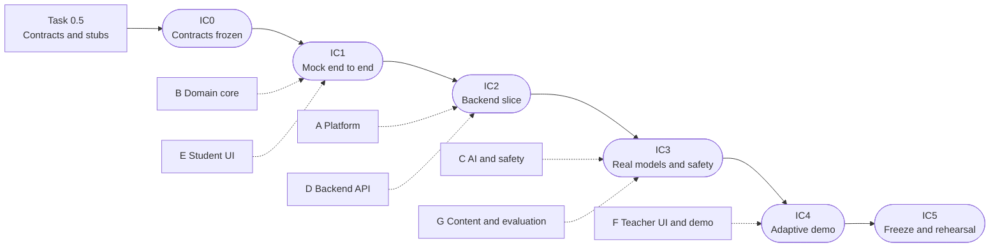

# CodeAI Implementation Plan

A living checklist. Tick items as they land and keep this file in step with the work, in the same PR
that does the work (C-36). The design behind each task is in
[`architecture.md`](./architecture.md). The rules are in
[`../constraints/implementation-constraints.md`](../constraints/implementation-constraints.md).

| | |
|---|---|
| Status | **Draft, pending team review.** |
| Last updated | 2026-11-04 |
| Target | Working demo by the 3:30 pm Wednesday feature freeze (C-37), full roadmap after |
| Account | Hackathon account (id kept out of the repo), `us-west-2`, $500 cap (budget `hackathon-budget-<account-id>`) |

## How to use this file

- `- [ ]` is open and `- [x]` is done. Tick the box in the PR that completes the item.
- Put your name on a task before you start it (`Owner:`), and note a blocker inline as `BLOCKED: reason`.
- Tiers: **MVP** is for Wednesday. **STRETCH** only if MVP is demoable. **FULL** is the later roadmap.
- A task is done when its deliverables are ticked, its tests pass in CI, and its **Demo** line works.
- Moving work between tiers, adding a task, or changing a task's scope: edit this file and the table
  in `architecture.md` section 3 together.
- Every PR names the P-/F- requirements and C- constraints it touches (C-36).
- Do not tick a box you have not verified. If you could not verify something, say so next to it.

## Progress

| Tier | Done | Total |
|---|---|---|
| MVP | 0 | 19 |
| STRETCH | 0 | 2 |
| FULL | 0 | 5 |

Update the counts when you tick a task's top-level box.

## Parallel work plan

The task list below is organized by component. To let several people work at once, the work is split
into **tracks** that own separate directories, and the tracks meet at **integration checkpoints**
(IC0 to IC5). This works because every seam between components has a contract, a stub and a contract
test (architecture 1.8, ADR-014), so a track never has to wait for another track's real code.

Percentages below are shares of the build window between kickoff and the 3:30 pm feature freeze. I do
not know the kickoff time or the team's pace, so treat them as a starting guess and write real clock
times in the checkpoint table once the team has agreed them.

### Tracks

| Track | Focus | Tasks | Directories | Can start |
|---|---|---|---|---|
| A. Platform | Preflight, CI, CDK, data, config and secrets, observability stacks, deploy | 0, 1, 4, 4.5, 10a, 13 | `infra/`, `.github/` | Now |
| B. Domain core | Tree loader, evidence, `route`, Passive features and rules | 2, 8a | `shared/core/` | Now. Its signatures are already fixed by C-18 and C-19 |
| C. AI and safety | `invoke`, Guardrail and safety module, validator, Passive reasoner, tutor, golden-set gate | 3, 5, 6, 8b, 11 | `backend/ai/`, `prompts/` | Now for schemas and logic against stubs. Live model calls wait for Task 0 |
| D. Backend API | Handlers, submit orchestration, store and adapters, teacher endpoints, spend protection | 7 | `backend/api/`, `backend/store/` | At IC0, against stubs |
| E. Student UI | Services layer, tree, workspace, preview, fallback UX, "why" panels | 9a, 10b | `src/services/`, student UI | At IC0, against mock services |
| F. Teacher UI and demo | Roster, hold and assign, persona fixtures, replay, nudge, demo director | 8c, 9b, 12 | Teacher UI, persona fixtures | At IC0, against mock services |
| G. Content and evaluation | Human ratings, red-team strings, persona histories, demo script and voiceover | 3 (ratings), 5 (red-team set), 12 (script) | `shared/contracts/fixtures/`, `docs/` | Now. Needs no code, so anyone can pick it up |

Not in the table: Task 0.5 is done by the IC0 integrator, who can come from any track. Task 1.5 is these
documents, which everyone maintains. Task 14 (stretch) belongs to Track C. Tasks 15 to 19 are the later
roadmap and have no track yet.

### Who does what

The git history shows about five contributors. Pick the layout that matches who is in the room, and
write names in each task's `Owner:` line.

| People | Suggested split |
|---|---|
| 3 | A and D, then B and C, then E, F and G |
| 4 | A, then B and D, then C, then E, F and G |
| 5 | A, then B and D, then C, then E, then F and G |

Whoever has the least code-heavy role starts Track G immediately. The human ratings are the slowest
dependency in the whole plan (C-17), and they need no code.

### What each track delivers at each checkpoint

| Track | By IC1: mock end to end | By IC2: backend slice | By IC3: real models and safety | By IC4: adaptive demo | By IC5: freeze |
|---|---|---|---|---|---|
| A | Preflight done, CI green, DataStack synths | DataStack deployed (or JSON store chosen), config helpers | Guardrail and SSM parameters deployed, model IAM | Observability stack and alarms | Deploy pipeline (stretch), docs current |
| B | `route`, evidence, tree loader, Passive features and rules, all tested | Fallback logic used by the API | Support | Persona regression tests | Fixes only |
| C | Schemas, validator logic, safety module and `invoke` wrapper against stubs | Prompts v1, golden-set runner | Real Bedrock calls, Guardrail wired in, verify, generate and validate | Passive reasoner with cache, tutor | Kappa gate on `main` |
| D | Handler skeleton on stubs | Submit orchestration, JSON and Aurora adapters, contract tests green | Real `invoke` wired in, throttling and per-student cap | Teacher endpoints | `GET /health`, hardening |
| E | Tree, workspace and preview on mock services | HTTP service implementations and the mode switch | Prompt flow with real responses and hints | "Why" panels | Polish |
| F | Roster with rule-based chips and persona fixtures on mocks | Replay control | Hold and assign over HTTP | Live chips and the redirect nudge | Demo director and recording |
| G | Ratings started, red-team strings | 8 or more ratings | 15 or more ratings | Persona scripts | Voiceover script |

Dotted lines show the checkpoint each track's main deliverable must reach. Tracks run in parallel
between checkpoints.

### Integration checkpoints

A checkpoint is a short sync (about 15 minutes) where the integrator runs the criteria **live**. Do not
tick a box from memory. If a checkpoint is missed, use its fallback and carry on, so one late track
never stalls the others.

**IC0: Contracts frozen** · Target: first ~10% · Clock time: ____ · Integrator: ____
- [ ] Task 0.5 complete: typedefs, schemas, repository interface, `invoke` signature, fixtures
- [ ] Contract test harness runs green against every stub
- [ ] Repo layout and directory ownership agreed (architecture 1.8)
- [ ] Contract-change rule agreed
- Fallback if missed: freeze whatever exists and finish the rest as contract-change PRs. Do not hold
  everyone.

**IC1: Mock end to end, no AWS** · Target: ~35% · Clock time: ____ · Integrator: ____
- [ ] The browser runs the student loop on mock services, with the tree and node states computed from
  the JSON (C-6)
- [ ] A submit uses the real `route()` and shows the "why this checkpoint" reason
- [ ] The quick-learner persona replays to `keep-or-redirect`
- [ ] The fallback toggle shows the notice and the lesson keeps working
- [ ] The roster shows three personas with rule-based chips
- [ ] `main` builds and CI is green
- Why it matters: this is a complete demo with no AWS dependency. If everything else fails, it still
  ships.
- Fallback if missed: cut scope to the quick-learner path and the roster, and keep going.

**IC2: Backend vertical slice** · Target: ~50% · Clock time: ____ · Integrator: ____
- [ ] One `curl` to `POST /steps/{id}/submit` returns evidence, next checkpoint and the reason, with
  `MODEL_MODE=stub`
- [ ] `step_attempt`, `routing_decision` and `fallback_event` rows are written through the store
- [ ] The store contract suite passes on the JSON adapter, and on Aurora if Task 0 allowed a deploy
- [ ] The UI can flip `VITE_SERVICE_MODE=http` for the non-model calls
- Fallback if missed: stay on the JSON adapter and run the API locally. Revisit Aurora after IC3.

**IC3: Real models and safety** · Target: ~65% · Clock time: ____ · Integrator: ____
- [ ] `MODEL_MODE=bedrock` runs one real prompt through verify, generate and validate
- [ ] The Guardrail is deployed with a pinned numbered version, and an unsafe prompt is blocked while the
  lesson continues
- [ ] A forced timeout produces the fallback notice and a `fallback_event`
- [ ] Model ids come from SSM parameters (or Lambda environment variables if Task 0 denied SSM)
- [ ] No response in this mode carries `source: "stub"`
- Fallback if missed: keep `MODEL_MODE=stub` and say so on screen. Never present stub output as live.

**IC4: Adaptive demo** · Target: ~80% · Clock time: ____ · Integrator: ____
- [ ] The Passive reasoner runs on the three personas and produces the expected signals, with the rule
  fallback proven by a forced failure
- [ ] The teacher roster works over the real API, including hold and assign
- [ ] The dashboard shows the decisions made in the run
- [ ] Persona regression tests are green in CI
- Fallback if missed: ship rule-based Passive signals, labeled as rules, and keep the reasoner as a
  stretch.

**IC5: Freeze and rehearsal** · Target: feature freeze, 3:30 pm (C-37) · Clock time: 3:30 pm · Integrator: ____
- [ ] The demo director runs twice with identical output
- [ ] The kappa number is reported (or the gap is stated if fewer than 15 ratings exist)
- [ ] A fallback drill (API off, then back on) works
- [ ] Documents are current: this plan, architecture sections marked `Built`, ADRs
- [ ] `main` builds and the demo works from a clean checkout
- After this: fixes only.

### Rules for working in parallel

- Stay in your track's directories. Edits outside them go through the owner or a small, announced PR.
- Build against the stub for any seam you consume. Do not wait for the real component.
- A contract change is one PR that updates the contract, the stub and the contract test, and is
  announced first (architecture 1.8).
- `main` builds and demos at every merge (C-37). Short branches and squash merges (C-36).
- Tick only your own track's boxes, and only for verified work. Plan-file conflicts are likely when
  many people tick boxes, so keep each tick in the PR that does the work and rebase often.
- When you finish early, help the track that is behind the next checkpoint.
- The integrator for a checkpoint is a different person from the one who built most of it, where
  possible.

### What is still serial

- Task 0.5 (contracts) comes first, but it is thin: signatures and shapes, not behavior.
- Task 0 (preflight) gates anything that touches the real account: deploys, live model calls, the
  Guardrail. Everything else proceeds on stubs.
- Task 4's `cdk bootstrap` needs your explicit confirmation before it runs.
- The human ratings take people's time, not engineering time. Start them first.

---

## MVP

### Task 0: Account preflight (MVP)
Owner: ____ · Serves: ADR-001, ADR-007, ADR-008 · Architecture: 1.7

Run these in your own shell. They only read, apart from one tiny model call. Never paste keys into the
repo or a chat.

- [x] Identity: `aws sts get-caller-identity` returns `WSParticipantRole` in the hackathon account
- [x] Region is `us-west-2`
- [x] Claude `us.` inference profiles are listed (Haiku 4.5, Sonnet 4.5)
- [x] `aws bedrock list-guardrails` works and returns none
- [x] Budget `hackathon-budget-<account-id>` exists ($500/month)
- [x] `CDKToolkit` is absent in `us-west-2` (not bootstrapped)
- [ ] Model access: Haiku smoke test succeeds
  `aws bedrock-runtime converse --region us-west-2 --model-id us.anthropic.claude-haiku-4-5-20251001-v1:0 --messages '[{"role":"user","content":[{"text":"Say OK"}]}]' --inference-config '{"maxTokens":10}'`
- [ ] Sonnet 4.5 smoke test succeeds (same command, Sonnet profile id)
- [ ] `aws iam simulate-principal-policy` for `iam:CreateRole`, `iam:PassRole`, `lambda:CreateFunction`,
  `dynamodb:CreateTable`, `apigateway:POST`, `bedrock:CreateGuardrail`, `cloudformation:CreateStack`,
  `s3:CreateBucket`, `kms:CreateKey`, `ssm:PutParameter`, `secretsmanager:CreateSecret` is recorded
  below
- [ ] `aws iam list-attached-role-policies --role-name WSParticipantRole` is recorded below
- [ ] Ask the organizers who is notified when the budget trips
- [ ] Decide the path from the answers (go/no-go below)

Results (fill in, no secrets):

| Check | Result |
|---|---|
| Haiku invoke | |
| Sonnet invoke | |
| `iam:CreateRole` | |
| `bedrock:CreateGuardrail` | |
| `ssm:PutParameter` | |
| `secretsmanager:CreateSecret` | |
| `cloudformation:CreateStack` | |
| Attached policies | |
| Budget notification contact | |

Fallbacks:
- `iam:CreateRole` denied: use organizer-provided roles, and keep CDK synth-only in CI.
- `bedrock:CreateGuardrail` denied: an organizer creates the Guardrail, and we reference its id in
  config.
- `ssm:PutParameter` or `secretsmanager:CreateSecret` denied: non-secret config falls back to Lambda
  environment variables set by CDK. The MVP has no true secrets, so nothing else is lost (Task 4.5).
- Model invoke denied: complete the Anthropic use-case form first, or develop on mocks.

**Demo:** a go/no-go list in the PR description.

### Task 0.5: Contracts and stubs (MVP)
Owner: ____ (integrator for IC0) · Serves: C-16, C-28, C-29, C-30 · ADR-014 · Architecture: 1.8

Keep this thin. Define signatures and shapes, not behavior. It runs alongside Tasks 0, 1, 2 and 3, and
it gates only Tracks D, E and F.

- [ ] Repo layout and directory ownership agreed (architecture 1.8), with a one-line README in each
  new directory stating its owner track and boundary
- [ ] `src/services/types.js`: JSDoc typedefs for the eight service functions and their inputs and
  outputs (C-28, C-30)
- [ ] `shared/contracts/` JSON Schemas: validator output (C-16), Passive signal, error shape (C-29),
  submit response
- [ ] Repository interface (JSDoc) for the store seam
- [ ] `invoke(task, prompt, opts)`, `screenInput`, `screenOutput` signatures and the task names
- [ ] `getConfig` and `getSecret` signatures
- [ ] Fixtures: draft histories for the three personas, canned model outputs per task (valid, invalid
  JSON, low confidence, blocked), and a sample submit response
- [ ] Contract test harness: each seam has a suite that takes an implementation and runs against the
  stub today
- [ ] Mode switches defined: `VITE_SERVICE_MODE`, `MODEL_MODE`, `STORE_MODE`, with `source: "stub"` on
  stub output
- [ ] Contract-change rule written down and agreed

**Tests:** each schema validates its own fixtures, and every stub passes its seam's contract suite.
**Demo:** `npm test` runs the contract suites green against the stubs.

### Task 1: Repo hygiene and CI skeleton (MVP)
Owner: ____ · Serves: C-35, C-36, C-37, C-38 · Discrepancy items 1, 2

- [x] `.gitattributes` with `* text=auto eol=lf` pushed to `main` (`f67c681`)
- [x] Confirmed no CRLF churn in this checkout (`git add --renormalize .` is a no-op here)
- [ ] Teammates with CRLF churn have synced (`git diff --ignore-cr-at-eol` is empty, then discard)
- [ ] Rename `package.json` `name` from `login-app` to `codeai-adaptive`
- [ ] Add Vitest and a first passing test
- [ ] Add lint (ESLint) and a `npm run lint` script
- [ ] GitHub Actions workflow on PRs: lint, test, `vite build`
- [ ] `.env.local` is in `.gitignore` (the `.env.*` rule already covers it)
- [ ] Add `!.env.example` to `.gitignore` and commit an `.env.example` with variable **names** only
- [ ] Docs check in CI: parse every mermaid code block in `docs/` so a broken diagram fails the PR
  (a syntax error in the system context diagram was caught by hand on 2026-11-04)
- [ ] Secret scanning in CI: gitleaks on every PR, failing the build on a finding
- [ ] GitHub secret scanning and push protection enabled on the repo (needs repo admin)
- [ ] Scan the existing history once for leaked keys or the AWS account id and report the result
- [ ] Add a `LICENSE` (default MIT-0) before judging
- [ ] Branch protection expectations agreed (one review, squash merge)

**Tests:** the workflow passes on a trivial test. **Demo:** a PR with a green check.

### Task 1.5: Architecture and plan documents (MVP)
Owner: ____ · Serves: C-1, C-36

- [x] `docs/architecture/architecture.md` drafted (overview, 13 components, MVP table, ADR-001 to 012)
- [x] `docs/architecture/implementation-plan.md` drafted (this file)
- [x] C-1 precedence lists the architecture document
- [x] `.kiro/steering/architecture.md` pointer added
- [ ] Team review of both documents; ADRs moved from Proposed to Accepted or revised
- [ ] Mermaid diagrams render in GitHub preview
- [ ] Each component section marked `Built` as its task lands

**Demo:** the documents are on `main` and linked from the README.

### Task 2: Shared domain core (MVP)
Owner: ____ · Serves: C-5, C-6, C-9 to C-12, C-18 to C-20 · Discrepancy items 7, 9 · Architecture: 2.6

- [ ] `shared/` module (plain JS ESM with JSDoc types)
- [x] Tree loader and validator for `database/sample-skilltree.json` (`shared/core/tree.py`)
- [x] Monotonic evidence per skill (max observed, never decreases)
- [x] Display-only 0 to 100 score (`round(100 × level / max)`)
- [x] `route(tree, progress, evidence, teacherInput)` returns `{ checkpointId, reason }`
- [x] Available = not completed and every `requires` is completed or tested out
- [x] Skippable test-out after `intro` (`steer-it`, `use-the-lingo`, `give-context`)
- [x] Largest skill gap wins, ties go to JSON order
- [x] Teacher `hold` and `assign` (assign only if available; unavailable -> proposal, C-19 open q)
- [x] Returned ids verified to exist in the tree (C-20)
- [x] Default target 1 when a checkpoint has no `targetEvidenceLevels` (C-12)
- Note: built in **Python** (ADR-015); the front-end mock keeps the JS implementation.

**Tests:** table-driven, one case per C-19 rule, plus the id-exists check.
**Demo:** `pytest shared/core` -> 33 passing. (Done in PR #14.)

### Task 3: Validator contract and eval harness (MVP)
Owner: ____ · Serves: C-13 to C-17, P-19 · Discrepancy items 8, 16 · Architecture: 2.5
Track: C builds the schema, judge and metrics. Track G does the human ratings.

- [ ] JSON Schema for `{ skillId, evidenceLevel, conditionMet, confidence, evidence }`
- [ ] Parse with one repair retry, then fallback
- [ ] `confidence < 0.6` triggers fallback
- [ ] Multiple-choice answers map to levels with no model call (C-13)
- [ ] Not-scored steps record completion only (C-15)
- [ ] Condition source: `validation.condition`, else the `Evidence:` line of `instructionsPrompt`
- [ ] Metrics: exact agreement, within-1 agreement, quadratic weighted kappa
- [ ] Golden-set runner
- [ ] Prompts in `prompts/` with version hashes
- [ ] Human rating started: 15+ project submissions rated by people (**slowest dependency**)
- [ ] `codeai-starter/contracts/model-contract.yaml` located and re-shaped (not in this repo; find it or
  create the contract here and note it)

**Tests:** kappa against hand-computed values, schema accept and reject cases, stubbed retry and
fallback paths. **Demo:** the eval prints three agreement numbers on fixtures.

### Task 4: CDK app and DataStack (MVP)
Owner: ____ · Serves: C-8, C-38, P-13 · Discrepancy item 3 · Architecture: 2.9, 2.11 · ADR-016

- [x] CDK app skeleton (TypeScript) in `infra/`, stacks by concern
- [x] `DataStack`: Aurora Serverless v2 (PostgreSQL, scale-to-zero, Data API) + KMS (cluster only)
- [x] JSON-file adapter for demo mode with the same shapes (`backend/store/json_repository.py`)
- [x] cdk-nag runs on synth (0 findings; suppressions carry written reasons)
- [x] `database/data-model.mmd` carries the student-state tables (discrepancy item 3; data track's
  version is authoritative after PR #13, my duplicate block removed)
- [x] `cdk synth` verified locally (template produced, scale-to-zero + Data API + KMS confirmed)
- [x] Schema of record is `database/schema.sql` (PR #13, data track), loaded with `database/seed.sql` by
  the `DbLoader` custom resource in `DataStack` (loaded and verified through the Data API on the
  2026-11-04 deploy)
- [x] **Aurora store adapter — built** (`backend/store/aurora_repository.py`, ADR-017). Schema reconciled
  (Task 4.6): string student ids and the agreed teacher-input model, so no id translation (see
  `backend/store/README.md`). Passes the store contract suite with the JSON adapter; `STORE_MODE=aurora`
  is wired end to end (factory + `ApiStack` env/IAM). Live contract test runs post-deploy.
- [x] `cdk bootstrap` for `us-west-2` (run 2026-11-04 with the user's go-ahead)
- [x] First deploy of `DataStack` (2026-11-04): Aurora PostgreSQL 16.13, schema and master data loaded and
  checked through the Data API
- [ ] CDK assertion tests (`infra` test script present; assertions still to write)

**Tests:** `pytest backend/store` -> both the JSON and Aurora adapters pass the contract suite (the
Aurora adapter via a fake Data API client; the live suite runs post-deploy). **Demo:** `DataStack`
deployed 2026-11-04 (Aurora live, schema + master data loaded); `STORE_MODE=aurora` serves the same
submit flow as `STORE_MODE=json`.

### Task 4.5: Configuration and secrets (MVP)
Owner: ____ · Serves: P-13.4, C-26, C-38 · ADR-013 · Architecture: 2.14 · Blocked by: Task 4

Keeps secrets and environment-specific values out of the repo and in AWS.

- [ ] KMS key for config and secrets (in `DataStack`, shared by the other stacks)
- [ ] SSM parameters for the model profile ids (Haiku 4.5, Sonnet 4.5)
- [ ] SSM parameters for the Guardrail id and pinned version, written by `AgentsSafetyStack`
- [ ] Account id and region read from the environment at synth time; none in the repo or in CDK context
- [ ] Shared `getConfig(name)` and `getSecret(name)` helpers: read at cold start, short-TTL cache, never
  log values
- [ ] Per-function IAM on exact parameter and secret ARNs, plus `kms:Decrypt` (no wildcards)
- [ ] Lambda environment variables hold names and ARNs only
- [ ] Secrets Manager secret created through CDK with a **generated** value, added only when a real
  secret exists (none required for the MVP; the mechanism must be ready for Task 19)
- [ ] Failure behavior: unreadable Guardrail parameter fails closed with a `fallback_event` (safety);
  unreadable model id uses the cached value, else `GET /health` reports unhealthy
- [ ] Front end reads only `VITE_`-prefixed public config (`VITE_API_BASE_URL`)
- [ ] Document the "demo API key is public" limitation next to the throttling setup (Task 7)
- [ ] Fallback path if Task 0 denies SSM or Secrets Manager: Lambda environment variables from CDK

**Tests:** CDK assertions that no Lambda environment variable holds a secret-looking value and that no
policy grants wildcard parameter or secret access; helper tests for caching and for a missing value;
gitleaks passes on the branch. **Demo:** change the model id parameter, show the next call use the new
model with no redeploy.

### Task 4.6: Reconcile the store schema with the contracts (MVP, cross-track)
Owner: ____ (data track + whoever owns the store adapter) · Serves: C-4, C-5, C-8, C-29 · Architecture: 2.9 · Blocks: the Aurora store adapter and `STORE_MODE=aurora`

`database/schema.sql` (merged, data track) and `shared/contracts/schemas/records.schema.json` (merged,
contracts) describe the same student state differently. They must agree before the Aurora adapter can be
built, because the adapter maps one to the other. Pick a resolution per row, update the losing side, and
record it in an ADR. Until then the backend runs on `JsonRepository` (STORE_MODE=json), which satisfies
the whole contract with no AWS.

| Mismatch | `database/schema.sql` | Contract record | Decision (ADR-017) |
|---|---|---|---|
| Student id type | `StudentId` INTEGER, FK to `STUDENT_PROFILE` | `studentId` string (`stu-quick`) | **String wins.** `StudentId` and `TeacherId` are TEXT everywhere. No id mapping at the edge |
| Column case | lowercase (Postgres folds unquoted ids) | camelCase records | **Keep unquoted names.** Every column is the record key in lower case, so the adapter maps with `key.lower()`. Renamed `Name` to `DisplayName`, `HintEventId` to `HintId`, `HintStyle` to `Style` on `HINT_EVENT` |
| Teacher input | `ROUTING_DECISION.TeacherInput` enum + `TeacherId` FK | a `teacher_input` record + JSON on the decision | **Contract wins.** New `TEACHER_INPUT` table holds the standing hold or assign. `ROUTING_DECISION.TeacherInput` is a JSONB snapshot `{mode, checkpointId}`. `ROUTING_DECISION.TeacherId` removed |
| `synthetic` flag | not present | `student.synthetic` (demo personas) | **Column added:** `STUDENT_PROFILE.Synthetic` BOOLEAN, default false |
| Evidence range | `Level` 0..4 (competence scale) | 0..max per skill (build 2, language 3, debug 3) | **0..3 in the student tables**, per-skill maximum checked at runtime (C-9). The 0..4 competence scale stays only on the master-data `STUDENT` table |
| Proposed tables | `HINT_EVENT`, `PASSIVE_SIGNAL` present; no `TEACHER_INPUT` | `hint_event`, `passive_signal`, `teacher_input` | **All three, plus `student`**, added to C-8 |
| Skill id (not in the original list) | `SkillId` INTEGER on evidence and flags | `skillId` slug (`build`) | **Slug wins.** `SKILLS.Slug` added; student tables reference `SKILLS (Slug)` |

- [ ] One decision per row above, agreed by the data track and the store-adapter owner
  (decisions proposed in ADR-017 by the data track; needs the store-adapter owner's sign-off on the PR)
- [x] Update the losing side (schema, contracts, or both) in one coordinated PR. The schema lost every
  row; the contracts are unchanged. Every seeded row validates against `records.schema.json` after the
  `key.lower()` mapping (checked on PostgreSQL 16, not on Aurora)
- [x] Make the C-8 edit for any agreed new tables/columns (ties in with Task 8a)
- [x] Write an ADR recording the student-id decision (it has the widest blast radius): ADR-017
- [ ] Then build the Aurora adapter against the agreed shape and run the store contract suite against a
  live cluster (unblocks Task 4's deferred item)

**Tests:** the store contract suite passes on both the JSON and the Aurora adapter after reconciliation.
**Demo:** `STORE_MODE=aurora` serves the same submit flow as `STORE_MODE=json`.

### Task 5: Safety module and Guardrail (MVP)
Owner: ____ · Serves: C-25, C-26, P-18 · Discrepancy item 10 · Architecture: 2.3

- [x] Guardrail in `infra/GuardrailStack`: content filters (HIGH), prompt-attack, PII block, K-12 strengths
- [x] Pinned numbered Guardrail version (never `DRAFT`), id+version published to SSM
- [x] `screen_input` using `ApplyGuardrail` (`backend/ai/safety.py`)
- [x] `wrap_untrusted` builds `guardContent` blocks for all untrusted text
- [x] `screen_output` before display
- [x] Fail closed: block on error, never raise, safe replacement, lesson continues
- [x] `BedrockModelPort` skeleton fills seam 3; `invoke`/`validate_project` raise until built
- [ ] Wire `fallback_event` (safety) write at the call site (belongs with the `invoke`/submit path)
- [ ] `trace` disabled on the live `guardrailConfig` path (set when `invoke` adds Converse)
- [ ] Red-team fixture set (injection, age-inappropriate, PII) run against the live Guardrail
- [ ] Live `ApplyGuardrail` smoke test after deploy

**Tests:** `pytest backend/ai` -> 15 passing; fake-client block/pass/PII/error paths, each validated
against `ScreenResult`. Guardrail `cdk synth` clean (0 nag findings). **Demo:** an unsafe prompt yields a
safe replacement and the lesson continues (once wired into `invoke`/submit).

### Task 6: `invoke` wrapper and model Lambdas (MVP)
Owner: ____ · Serves: C-14, C-27, P-7.2 · Discrepancy item 11 · Architecture: 2.4, 2.5, 2.8

- [ ] `invoke(task, prompt)` is the only Bedrock caller
- [ ] Model ids read through `getConfig` from SSM (Haiku 4.5 for verify/validate/Passive, Sonnet 4.5 for
  codegen/hints), never hard-coded (Task 4.5)
- [ ] `maxTokens` and a 10 s timeout on every call
- [ ] `guardrailConfig` on every call
- [ ] Verify and codegen use different models
- [ ] Runtime IAM allows only the two profiles (inference-profile ARN and wildcard-region model ARN)
- [ ] Decision log per call: correlation id, task, model id, prompt hash, Guardrail version, latency,
  tokens, and no student text
- [ ] Verifier, Codegen, Validator and Active Lambdas

**Tests:** wrapper tests for timeout, throttle and guardrail block. **Demo:** a prompt goes through
verify, generate and validate.

### Task 7: API stack and submit orchestration (MVP)
Owner: Track D · Serves: C-24, C-29, P-11, P-1.4 · Architecture: 2.2

Application layer built in `backend/api/` (Python, ADR-015) against the frozen seams; passes
the seam-1 services contract. Consumes `shared/core` (Track B) directly and the seam-3
`ModelPort` (Track C) by injection. The API Gateway stack + usage plan is Track A's CDK
(`infra/`); the transport-agnostic router here is ready to drop behind it.

- [ ] REST API with stage throttling and a usage plan — BLOCKED: CDK is Track A (`infra/`, Task 4). Router is stack-ready.
- [x] Per-student call cap in the handler (`backend/api/http.py`, `per_student_cap`; RATE_LIMITED)
- [x] `POST /steps/{id}/submit`: filter, validate or direct-map, persist, route (`backend/api/submit.py`). Passive hook left for Task 8a/8b (Track B/C seam).
- [x] `POST /tutor/ask`, `POST /prompts/verify`, `POST /prompts/generate` (`backend/api/services.py`)
- [x] `GET /teacher/students`, `POST /teacher/students/{id}/routing`, `GET /health` (`backend/api/services.py`, `http.py`)
- [x] P-11 endpoints (routed in `backend/api/http.py`)
- [x] Headers per P-1.4; error shape `{ "error": { "code", "message" } }`; camelCase JSON (`http.py`, `util.py`)
- [x] Student work persisted before any model result is used (C-24) (`submit.py`; tested)
- [~] 10 s timeouts on adaptive calls — the timeout budget is passed in the invoke `opts`; enforcement lives in Track C's `invoke` (model seam).

**Tests:** handler tests with stubs and a response-shape contract test — DONE
(`backend/api/tests/`: `test_http.py`, `test_services_contract.py`, `test_submit.py`,
`test_app.py`): 38 Track D API tests, all green via `pytest`. Responses validated against the
JSON Schemas in `shared/contracts/schemas/` (`schema_validate.py`).
**Demo:** `build_app()["router"]` (or `lambda_handler.handler`) handles one submit and returns
evidence, next checkpoint and the reason, and writes attempt/routing_decision/progress rows.
Verified at IC2 with `STORE_MODE=json` + the stub model, driving the real `shared.core.route`.

> Track D note: the backend is Python (ADR-015). `shared/core` (Track B) is a merged
> dependency used directly; the bedrock `ModelPort` (Track C) is injected via
> `backend/api/model.py`. Until it lands, `MODEL_MODE=stub` uses `StubModel` (from the
> contract fixtures); `MODEL_MODE=bedrock` fails fast without an injected port. The store is
> `STORE_MODE=json` by default; the `aurora` adapter is built (ADR-016/017) and the API reaches it
> only through the Data API (boto3), never a direct DB connection. The earlier JS
> backend draft was replaced to match ADR-015/016.

### Task 8a: Passive features, rule baseline and store (MVP)
Owner: ____ · Serves: C-10, C-27, P-5, P-6 · Architecture: 2.7, 2.9

- [ ] Constraints edit: add the `passive_signal` table and the `passive` component to C-8
- [ ] Constraints edit: add Passive reasoning, personas and demo director to C-33
- [ ] Feature extractor from attempt content and server timestamps only (ADR-006)
- [ ] Rule thresholds producing the signal
- [ ] `passive_signal` writes
- [ ] `remediation_flag`: 2nd consecutive miss creates it, `high` after four
- [ ] Wired after submit

**Tests:** unit tests per feature; sequence tests where the skill level never drops and two misses
raise a flag. **Demo:** repeated misses produce a flag in the roster.

### Task 8b: Passive Haiku reasoner (MVP)
Owner: ____ · Serves: C-27, ADR-005 · Architecture: 2.7

- [ ] One Haiku call at `temperature 0` over features, ~10 recent events and the hint log
- [ ] Output schema-validated and restricted to enums
- [ ] Cache by `features_hash + prompt_version`
- [ ] Confidence below 0.6 or any error falls back to rules and writes `fallback_event` (passive)
- [ ] The model cannot return a checkpoint id

**Tests:** stubbed-model tests, a schema fuzz test, and a check that no checkpoint id can leak.
**Demo:** the same history gives the same signal and reason; a forced failure falls back to rules.

### Task 8c: Persona fixtures and visible adaptation (MVP)
Owner: ____ · Serves: P-5.3, C-34 · Discrepancy item 14 · Architecture: 2.7, 2.8
Track: F, using the rule-based signals from Track B. Track G writes the persona histories.

- [ ] Hand-authored synthetic histories: quick, slow, distracted (obsessed and inattentive variants)
- [ ] Teacher roster chips: signal, reason, evidence
- [ ] Active hint style and angle rotation driven by the signal
- [ ] Visible redirect nudge with a 60 s cooldown per checkpoint
- [ ] Replay control that steps through a persona's events
- [ ] Quick learner is tested out of `steer-it` and `use-the-lingo` and lands on `keep-or-redirect`
- [ ] Slow learner gets a flag and an angle not yet used
- [ ] On-screen "synthetic student histories" label

**Tests:** persona regression tests asserting expected signal and route; rule baseline in CI, live
model on `main`. **Demo:** the roster shows three different paths with reasons.

### Task 9: Frontend services and fallback (MVP)
Owner: ____ · Serves: C-21 to C-23, C-28, C-30, C-32 · Discrepancy items 4, 5, 6, 12, 13, 15 · Architecture: 2.1, 2.6
Track: this task is split. **9a** (Track E): the services layer, tree, workspace, preview, content from the
JSON, fallback UX. **9b** (Track F): the teacher view and the demo-mode login.

- [ ] `src/services/` with one function per call and `types.js` (JSDoc)
- [ ] Mock implementations (move `engine.js` in; routing swapped for `shared/route`)
- [ ] HTTP implementations behind the same signatures; env switch
- [ ] Mock error and hang toggles
- [ ] Components no longer call the engine or `fetch` directly
- [ ] Replace `courseData.js` with checkpoints and steps loaded from the JSON (C-6, C-7)
- [ ] `skillTreeData.js` keyed by checkpoint id; fix "Load with the point" to "Lead with the point";
  node state computed from progress (C-5)
- [ ] Mastery shown as evidence levels; 0 to 100 is display only
- [ ] Preview iframe uses `srcdoc` with `sandbox="allow-scripts"`, never `allow-same-origin` (C-32)
- [ ] Deploy button hidden
- [ ] `Login.jsx` becomes an explicit demo mode with both roles side by side
- [ ] Fallback notice, linear path, 30 s health re-check, automatic resume
- [ ] Teacher view: roster with mastery and flags, plus hold/assign control

**Tests:** service tests with a mocked `fetch`; a fallback state-machine test.
**Demo:** API off shows the notice while the lesson keeps working; then it recovers.

### Task 10: Observability and "why" surfaces (MVP)
Owner: ____ · Serves: P-12, C-22 · Architecture: 2.10
Track: this task is split. **10a** (Track A): the stack, dashboard, alarms, logs. **10b** (Track E): the "why
this checkpoint" and "why this hint" panels.

- [ ] `ObservabilityStack`: dashboard (error rate, model latency, guardrail blocks, fallbacks)
- [ ] Alarms on the C-22 triggers
- [ ] Cost alarm; reuse the existing account budget
- [ ] KMS-encrypted logs, 14-day retention, no student text
- [ ] Full-body Bedrock invocation logging left off (ADR-011)
- [ ] X-Ray/OTEL traces with a correlation id across calls
- [ ] UI "why this checkpoint" and "why this hint" panels

**Tests:** assertion tests for alarms and retention. **Demo:** trigger a fallback and see it on the
alarm, the dashboard and the UI.

### Task 11: Golden-set gate in CI (MVP)
Owner: ____ · Serves: C-17, P-19.2 · Architecture: 2.5

- [x] Agreement metrics: exact, within-1, quadratic weighted kappa (`backend/eval/metrics.py`, hand-verified)
- [x] Golden-set runner + launch gate: ≥ 15 submissions AND pooled QWK ≥ 0.70, pooled + per-skill report
- [x] CLI gate `python -m backend.eval <file>` — prints the numbers, exits non-zero below the gate
- [x] Placeholder sample set wires the gate (18 synthetic pairs, PASS); demo-ready report format
- [ ] Replace the placeholder with ≥ 15 **real** human-rated submissions (Track G — slow dependency)
- [ ] `modelLevel` snapshot from the real validator (C-14) on a pinned model + prompt version
- [ ] CI job on `main` runs `python -m backend.eval` against the snapshot (not every PR, to limit spend)

**Tests:** `pytest backend/eval` → 26 passing (metric math, count gate, QWK gate, validation, CLI exit
codes). **Demo:** `python -m backend.eval backend/eval/fixtures/golden-set.sample.json` prints the pooled
QWK and per-skill breakdown.

### Task 12: Demo director and recording script (MVP)
Owner: ____ · Serves: C-33 (extended) · Architecture: 2.13

- [ ] Scene index with fixed timings
- [ ] `temperature 0` and a pre-warmed cache
- [ ] Live-model toggle that shows when a cached result is used
- [ ] Written scene script with voiceover cues (about 6 to 8 minutes)
- [ ] Pre-recording checklist: reset state, warm cache, no credentials on screen
- [ ] Two consecutive runs produce identical scene outputs

Scenes: roster of three · quick learner · slow learner · distracted learner · unsafe prompt blocked ·
induced outage and recovery · dashboard and trace · kappa number.

**Demo:** the full run, recorded.

---

## STRETCH

### Task 13: Web hosting and deploy pipeline (STRETCH)
Owner: ____ · Serves: P-12.3 · ADR-008 · Blocked by: Task 0

- [ ] `WebStack` (S3 and CloudFront)
- [ ] `PipelineStack` with CDK Pipelines and a manual approval (or a GitHub Actions deploy via an OIDC
  role if the connection or IAM is blocked)
- [ ] Rollback by redeploying the previous commit
- [ ] Post-deploy smoke test on `GET /health`

**Demo:** merge to `main` and watch the app update.

### Task 14: LLM student simulator (STRETCH)
Owner: ____

- [ ] Haiku plays each persona against the live system
- [ ] Outputs pass the Guardrail and a human review before becoming fixtures
- [ ] Schema and persona-consistency checks
- [ ] Hand-authored fixtures remain the demo default

**Demo:** a freshly generated history produces the expected signal.

---

## FULL (after Wednesday)

- [ ] **Task 15:** AgentCore Harness (Strands) for Active, Verifier and Codegen behind the same `invoke`
  signature, with Memory and ADOT traces (supersedes ADR-002)
- [ ] **Task 16:** red-team safety evals and agent-quality evals in CI
- [ ] **Task 17:** Passive as an EventBridge-driven service with a richer classifier
- [ ] **Task 18:** `agent_decision` table, Athena queries, replay view (needs a C-8 edit)
- [ ] **Task 19:** Cognito authentication, multi-environment stages, generated-content path with a
  quality gate (diagram 18)

---

## Constraint and document edits to make explicitly

Make each in the PR that first needs it, and say so in the PR description.

- [x] C-1: architecture document added to precedence
- [ ] C-8: add the `passive_signal` table and `passive` to `fallback_event.component` (Task 8a)
- [ ] C-33: add Passive reasoning, personas and the demo director to in-scope (Task 8a)
- [ ] C-33: record "no client telemetry" as a decision (Task 8a)
- [ ] Discrepancy items 17 and 18 (stale data-model docs, frontend spec) after the demo

## Discrepancy checklist mapping

The 18 items in [`../constraints/discrepancy-checklist.md`](../constraints/discrepancy-checklist.md)
are done inside these tasks. Tick them there as well.

| Item | Task |
|---|---|
| 1 Line endings | 1 |
| 2 Rename package | 1 |
| 3 Student-state tables | 4 |
| 4 Service layer | 9 |
| 5 Replace invented lesson | 9 |
| 6 Skill-tree ids and states | 9 |
| 7 Evidence-level mastery | 2, 9 |
| 8 Validation for the real tree | 3, 6 |
| 9 Routing rewrite | 2 |
| 10 Content filtering | 5 |
| 11 Split verify and codegen | 6 |
| 12 Preview runs JavaScript | 9 |
| 13 Hide Deploy | 9 |
| 14 Minimal teacher view | 8c, 9 |
| 15 Demo-mode login | 9 |
| 16 Model contract | 3 |
| 17, 18 Doc updates | After the demo |

## Risks and open items

- [ ] IAM create permissions and model access unverified until Task 0 is finished
- [ ] 15+ human ratings for the golden set (people, start in the morning)
- [ ] Budget notification contact unknown
- [ ] Public demo API without real authentication can burn budget; throttling and the per-student cap
  (Task 7) are required
- [ ] CDK Pipelines needs a manual GitHub connection step that may not be permitted
- [ ] `codeai-starter/contracts/model-contract.yaml` is not in this repo (Task 3)

## Change log

| Date | PR | Change |
|---|---|---|
| 2026-11-04 | (initial) | First draft from the planning session. |
| 2026-11-04 | #11 | Redacted the AWS account id. Added Task 4.5 (config and secrets), secret-scanning items in Task 1, and SSM/Secrets Manager checks in Task 0. |
| 2026-11-04 | #11 | Replaced the sequential dependency graph with a parallel work plan: seven tracks, six integration checkpoints (IC0 to IC5) and Task 0.5 (contracts and stubs). |
| 2026-11-04 | #16 | Added Task 4.6 (reconcile the store schema with the contracts), which blocks the Aurora adapter after the PR #13 schema merge. MVP task count 18 -> 19. |
| 2026-11-04 | (Task 4.6 PR) | Resolved the Task 4.6 mismatches in favour of the contracts (ADR-017): string student ids, skill slugs, `TEACHER_INPUT`, `Synthetic`, 0..3 evidence. Schema, seed and data model updated; C-8 edited. |
