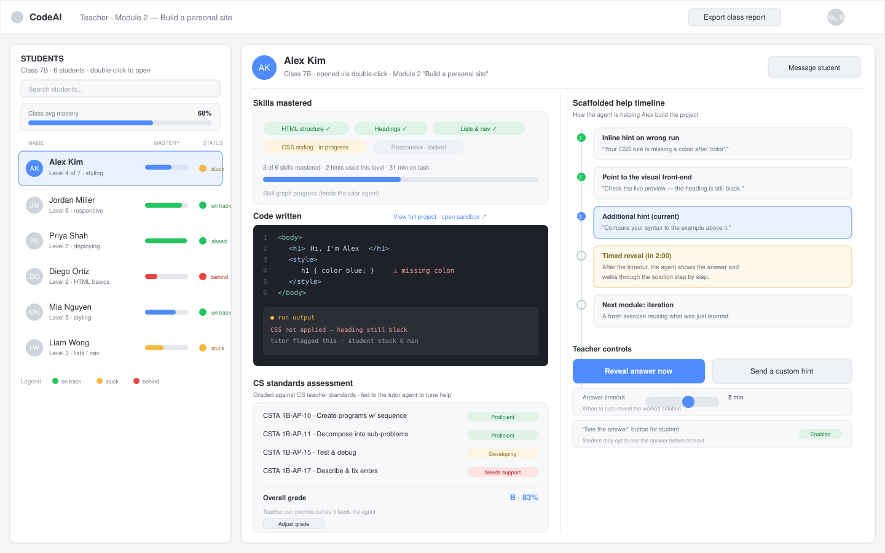

# Teacher View — Lesson Wireframe

A wireframe for the teacher's view of a lesson. The teacher sees the whole class
on the left and opens a single student's detail on the right by **double-clicking**
their name in the roster.

## Requirements this design serves

From the teacher-side requirements:

- **Student summary** — skills mastered and code written, at a glance.
- **Grade against CS teacher standards** — a per-student assessment that is
  **fed to the tutor agent** so help can be tuned to the student.
- **Support the student building toward their project**, with a scaffolded ladder
  of help that escalates only as needed:
  1. **Inline hints when a run is wrong.**
  2. **Point toward the visual portion of the front-end** (the live preview).
  3. **Provide an additional hint.**
  4. **After a set time, reveal the answer and walk through the solution** — the
     next module is then an **iteration** of what was just learned.
  5. **"See the answer"** available to the student via a button or on timeout.

## Layout overview

### Top bar
Context (teacher, current module) and an **Export class report** action.

### Left column — Student roster (the whole class)
- Every student in the class with avatar, current level, a **mastery bar**, and a
  **status pill** (on track / stuck / behind).
- Search box, class-average mastery summary, and a status legend.
- **Double-click a student** to open their detail on the right (the selected
  student is highlighted).

### Right panel — Student detail (opens on double-click)
Split into two columns.

**Left detail column — the student summary**
- **Skills mastered** — chips for mastered / in-progress / locked skills, with
  hints used and time on task. This is the skill-graph signal that feeds the
  tutor agent.
- **Code written** — a snapshot of the student's current code with the run
  output, including where the tutor flagged an error (e.g. a missing colon in a
  CSS rule) and how long they've been stuck.
- **CS standards assessment** — each relevant standard (e.g. CSTA codes) rated
  Proficient / Developing / Needs support, rolling up to an overall grade. The
  teacher can **override the grade before it feeds the agent**.

**Right detail column — scaffolded help + controls**
- **Scaffolded help timeline** showing exactly where the agent is on the help
  ladder for this student: inline hint → point to front-end → additional hint →
  **timed reveal of the worked solution** → **next iteration module**. Completed
  steps, the current step, and upcoming steps are visually distinct.
- **Teacher controls:**
  - **Reveal answer now** — override the timer and show the worked solution.
  - **Send a custom hint** — push a teacher-written nudge.
  - **Answer timeout** slider — when the agent should auto-reveal the solution.
  - **"See the answer" toggle** — allow the student to opt into the answer before
    the timeout.

## Design principles

- **Help escalates, it doesn't shortcut.** The timeline makes the ladder visible
  so a teacher can see a student got real scaffolding before the answer appeared.
- **The grade is a signal, not a verdict.** CS-standards ratings feed the agent
  and are teacher-overridable.
- **Whole class, one student, one click apart.** Roster for triage, double-click
  for depth.

## Wireframe

The source is the standalone file [`teacher-view.svg`](./teacher-view.svg) (kept
as its own file so it renders on GitHub).

## Component reference

| Region | Component | Purpose |
| --- | --- | --- |
| Left | Student roster | Whole class with mastery + status; double-click to open |
| Left | Class summary | Average mastery and status legend for quick triage |
| Right · summary | Skills mastered | Mastered / in-progress / locked skills; feeds the agent |
| Right · summary | Code written | Current code + run output + flagged error |
| Right · summary | CS standards assessment | Per-standard ratings + overall grade, teacher-overridable |
| Right · help | Scaffolded timeline | Inline hint → front-end → extra hint → timed reveal → iteration |
| Right · help | Reveal answer now | Teacher override of the timer |
| Right · help | Send a custom hint | Teacher-authored nudge |
| Right · help | Answer timeout slider | When to auto-reveal the worked solution |
| Right · help | "See the answer" toggle | Let the student opt in before timeout |

## Possible next steps

- A class-level analytics dashboard (trends across lessons).
- The worked-solution walkthrough screen itself.
- The "next iteration module" generation flow.
