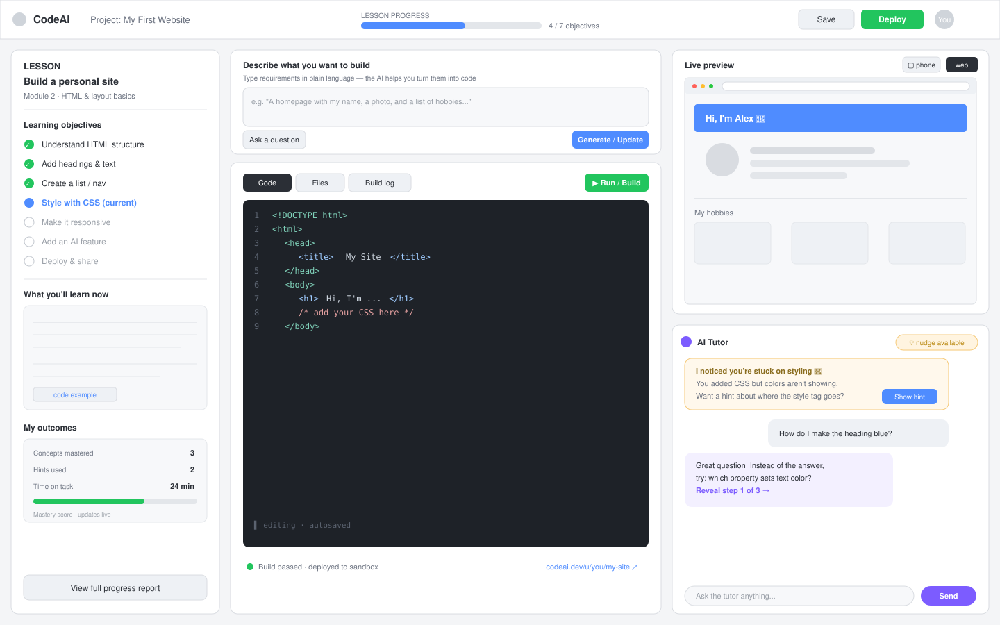

# CodeAI Learning Interface — Wireframe Design

A wireframe for the CodeAI learning platform where students learn coding and AI
concepts by building a small website or app. The layout is organized into three
columns so a student can **learn, build, and get help** without leaving the
screen.

## Goals this design serves

- Students work through a **lesson** with explicit **learning objectives**.
- The platform can **measure and report on outcomes** (mastery, time, hints).
- Students **type requirements in plain language**, **ask questions**, and
  **build + deploy live** to see the project as it develops.
- An **AI tutor agent** recognizes when learning is lacking and offers
  proactive, scaffolded **hints and nudges** (guidance, not answers).

## Layout overview

### Top bar
Project name, a live **lesson-progress meter** (objectives completed), and the
key actions: **Save** and **Deploy**. Progress is always visible so students
feel momentum.

### Left column — Lesson & outcomes
- Lesson content and a **checklist of learning objectives**, with the current
  one highlighted. This is where the "measure outcomes" requirement lives.
- A **"My outcomes"** panel tracking concepts mastered, hints used, time on
  task, and a live **mastery score**. A link opens the full progress report for
  teachers/mentors.

### Center column — Requirements & code
- A **plain-language requirements box** where students type what they want to
  build ("a homepage with my name and hobbies"), plus an **Ask a question**
  button. This is the entry point for both building and asking.
- A **code editor** with tabs (Code / Files / Build log) and a **Run/Build**
  button. A status strip shows build result and the **live sandbox URL**, so
  build-and-deploy feedback is immediate.

### Right column — Live preview & AI tutor
- **Top:** a **live preview** that re-renders as the project changes, with
  web/phone toggles so students see the real project as it develops.
- **Bottom:** the **AI Tutor**. The key piece for the "recognize a lack of
  learning" requirement is the **proactive nudge bubble** — the agent detects a
  student is stuck (e.g. CSS added but not working) and offers a hint before
  being asked. Replies are **scaffolded** ("reveal step 1 of 3") rather than
  just handing over the answer, which keeps the learning intact.

## Design principles

- **Nudges are hints, not answers.** The tutor reveals guidance in steps so
  students still do the thinking. The outcomes panel counts hints used, which is
  itself a learning signal.
- **Everything is one screen.** Type → generate → run → preview → get help forms
  a tight loop, which matters for younger or first-time learners.
- **Outcomes are first-class.** Mastery and progress are visible to the student
  and exportable for reporting to CodeAI.

## Wireframe

> The wireframe is stored as a standalone file, [`wireframe.svg`](./wireframe.svg),
> so it renders on GitHub. (GitHub's markdown renderer strips inline SVG markup,
> so the image is referenced as a file rather than embedded inline.)

## Component reference

| Region | Component | Purpose |
| --- | --- | --- |
| Top bar | Progress meter | Shows objectives completed; keeps momentum visible |
| Top bar | Save / Deploy | One-click persistence and live deployment |
| Left | Objectives checklist | Tracks learning objectives, highlights current |
| Left | My outcomes panel | Mastery score, hints used, time on task; exportable report |
| Center | Requirements box | Plain-language input to generate/update the project |
| Center | Ask a question | Routes a question to the AI tutor |
| Center | Code editor + tabs | Code / Files / Build log |
| Center | Run / Build | Triggers build and sandbox deploy |
| Center | Status strip | Build result + live sandbox URL |
| Right top | Live preview | Re-renders on change; web/phone toggle |
| Right bottom | Proactive nudge | Agent detects stuck state and offers a hint |
| Right bottom | Scaffolded reply | Step-by-step guidance instead of direct answers |
| Right bottom | Chat input | Free-form questions to the tutor |

## Possible next steps

- A clickable HTML mock for a hackathon demo.
- A teacher/admin dashboard wireframe for the reporting side.
- A student onboarding / lesson-select screen.
- A mobile layout version.
